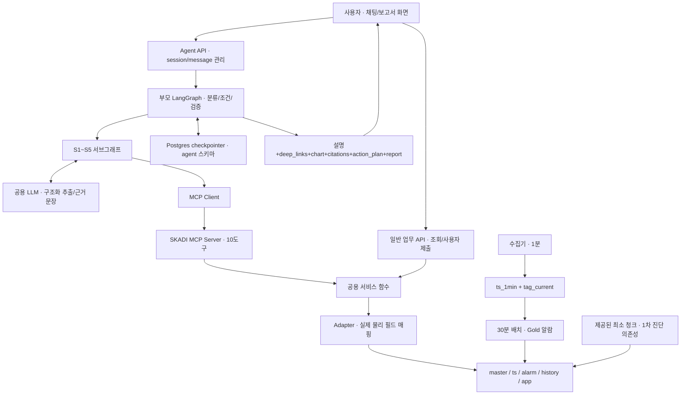
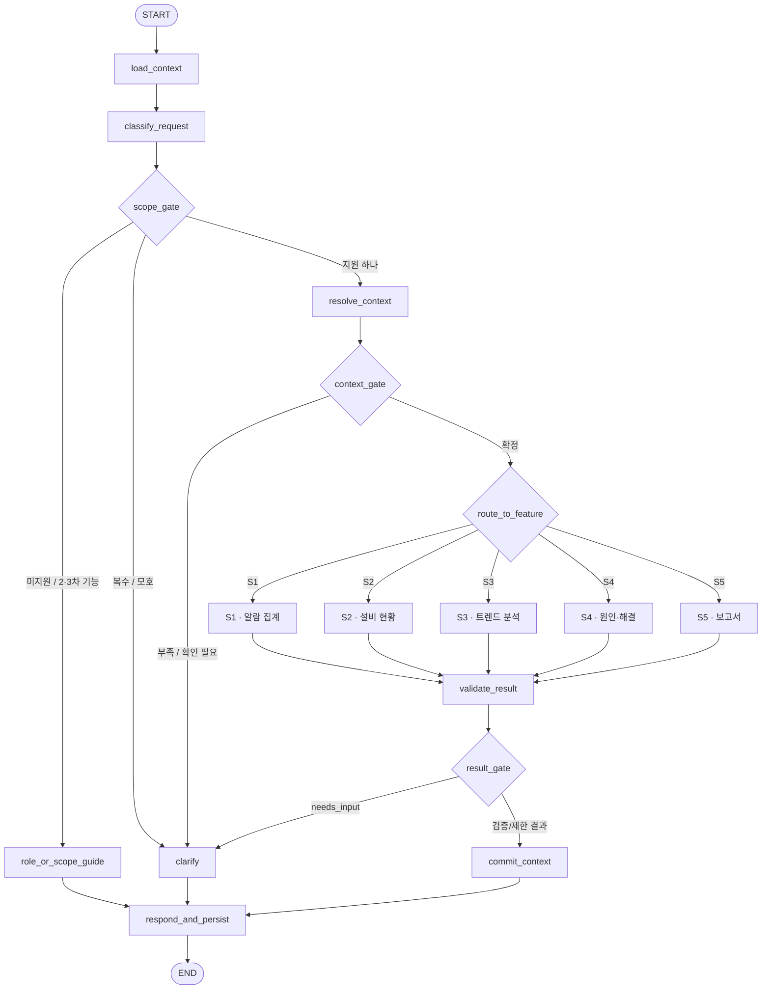
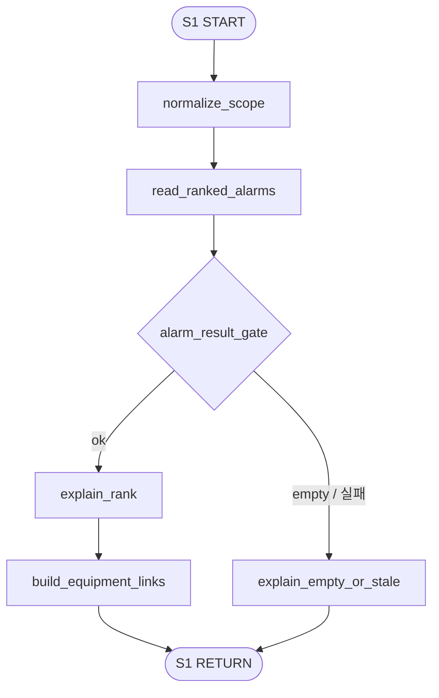
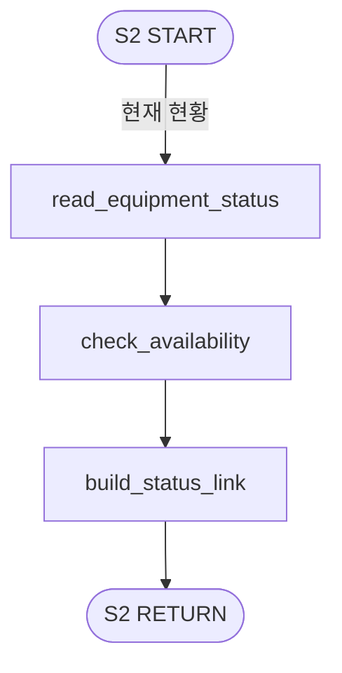
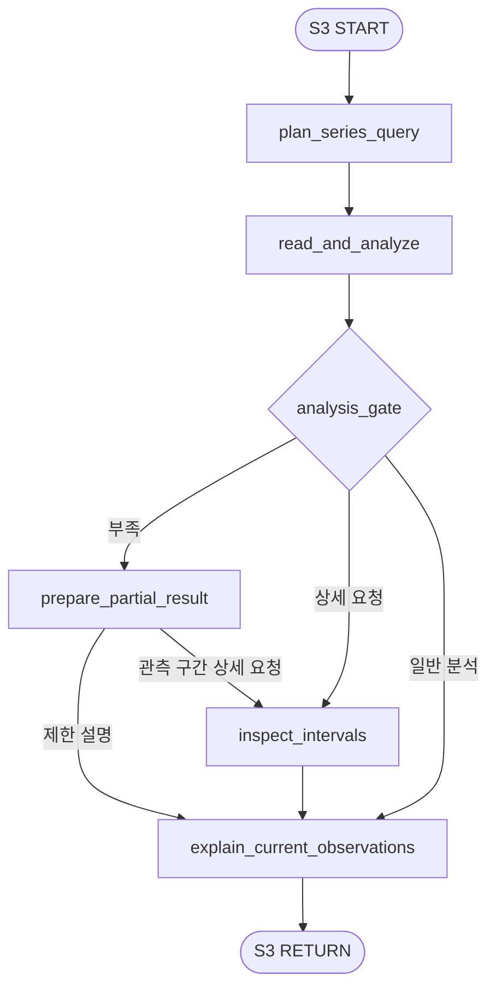
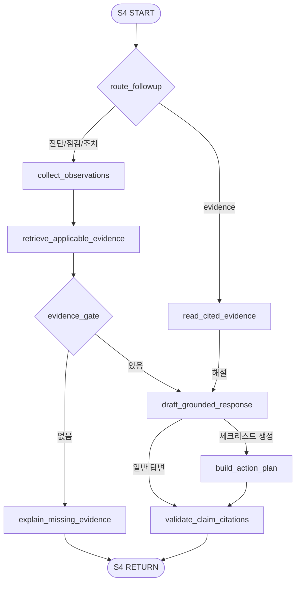
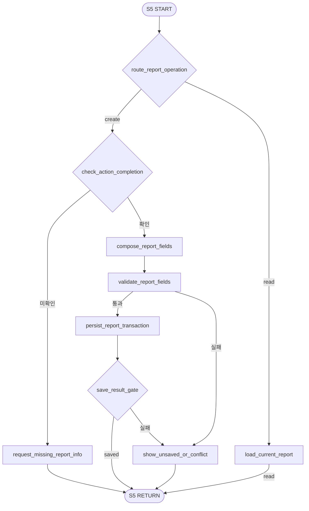

# SKADI AI Agent — LangGraph 흐름과 MCP 도구 설계 v2.1

기준: **사용자가 새로 지정한 Downloads 요구사항정의서의 1111 탭**, DB·데모 **v1.3**. 작성: 2026-11-12.

## 1. 설계의 출발점

최신 Downloads판은 기능을 분리한 **52개 행**이다. K열 기준 **1차 24행 / 2차 18행 / 3차 9행 / 후순위 1행**이다. v2.1은 1차 행을 구현 대상으로 삼는다. 기존 프로젝트 폴더의 47행 파일을 기준으로 만든 v2는 비교용 전체 설계로 보존한다. v2.1의 행 번호와 출처는 새 파일 기준으로 다시 연결했다.

1차 행 안에 남은 빨간 H11(직접 기간 선택 UI), H12(보고서 목록 필터)는 앞서 사용자가 정한 빨간 글씨 제외 기준을 함께 적용한다. 빨간 줄바꿈만 있는 H27은 기능 제외로 해석하지 않는다. 원본 Excel은 변경하지 않았다. 현재 산출물은 설계·fixture 참조 실행이며 실제 LLM·MCP 서버·DB 연결은 후속 구현이다.

### 1차에 포함되는 챗봇 업무

- S1: 단건/다건 미해결 알람·우선순위·설비 딥링크.
- S2: 확인된 설비의 기본 정보·관측값·현황 딥링크. 별칭 매핑과 복귀 판단은 제외.
- S3: 현재 12시간 기본 상태·관측 이상 구간·상세 딥링크. 과거 기간 추가 분석은 제외.
- S4: 초기 원인 후보·점검·근거·조치·주의사항·체크리스트 생성과 고정 표시.
- S5: 조치 완료 확인 후 세션 내 신규 초안 작성·저장·현재 초안 조회. 화면 수동 수정/제출은 일반 API.

### 후속 스프린트와 1차의 경계


| 새 파일 위치 | 이번 버전에서 제외 | 1차에서 유지 |
| --- | --- | --- |
| H11 · 빨간 부분 | 2차 · Starttime/Endtime 직접 선택 UI | 현재 12시간 그래프·이상 구간 모달 |
| H12 · 빨간 부분 | 2차 · 내 보고서 Unit·기간 필터 | 목록·10건 페이지·상세·상태 |
| K3, K6, K8 | 2차 · 알람 필터 UI·위치 시각화·설비 종합 추이 요약 | 기본 알람 목록·설비 메타데이터·센서 상세 |
| K15, K18, K21 | 2차 · 이전 세션 선택/재개·역할 외 질문 대응 고도화·별칭 매핑 | 현재 세션 맥락·정확한 ID/기존 메타데이터 확인·최소 범위 게이트 |
| K23 | 2차 · 과거 기간 추가 분석·통계적 추이 질문 | H22 현재 이상 구간·상태 설명·딥링크 |
| K25, K26, K28 | 2차 · 과거 보고서 조회 질문·현장 재진단·남은 리스크/대안 | H24 기본 진단·점검·근거, H27 조치·주의사항·원문 |
| K30, K32 | 2차 · 조치 진행 추적/변경·보고서 대화 수정/복원 | H29 체크리스트 생성·고정, H31 완료 후 신규 초안 |
| K40:K43 | 2차 · 발생 당시 설정값 이력·기간/해상도 분석·독립 비교/해석 기능 | H10:H11/H22에 명시된 기본 센서값·기준선·이상 구간 표시는 유지 |
| K46, K47 | 2차 · 매뉴얼 8건/사례 20건 색인 확장·정답 사건 연계 데모 | S4 근거 설명의 최소 구현 의존성으로 제공된 청크만 사용 |
| K9, K34, K38, K48:K53 | 3차 · 점검 이력 바로가기·정상 복귀 모니터링·계층 탐색·S6 평가 | 현재 현황 조회·선택 설비 경로 표시·기본 코드 검증 |
| K33 | 후순위 · 에이전트 밖에서 작성한 수리 보고서 수정 지원 | 세션 내 완료 확인 후 신규 초안 작성 |


**겹치는 요구사항의 처리:** H10:H11/H22는 1차 기본 관측·기준선·이상 구간을 명시하므로 유지한다. K23/K40:K43의 과거 기간·해상도 선택·독립 비교/해석 고도화는 제외한다. 이 구분은 중복된 항목 사이의 구현 경계 제안이다. 현재 세션 State 저장은 유지하되 K15의 이전 세션 목록/선택/재개 UI는 제외한다. K18의 역할 외 대화 고도화 없이도 미지원 요청을 도구로 보내지 않는 최소 범위 검사는 필요하다.

**S4의 최소 의존성:** H24/H27/H29는 1차이며 근거·문서 링크가 필요하다. 제공된 최소 청크의 검색·출처 검증은 구현 의존성으로 제안한다. K46의 매뉴얼8건/사례20건 전체 색인 구축, K47 정답 사건 데모, K48:K53 정식 S6 평가는 1차 완료 범위로 계산하지 않는다.


원본 판별 SHA-256: `829b875fd8e1414ec920b874f7216f4b507a4ed7b8302cf8a4f90722b2aa7c2e`. 추출 기록: `v21/scope.json`.

## 2. 전체 구조





| 구성요소 | 담당·실행 위치 | 역할 |
| --- | --- | --- |
| Agent API | 백엔드 | 로그인 사용자·session 소유권, 메시지 멱등 접수, 중지, 응답 저장 |
| LangGraph 노드 | AI팀 / Agent 서버 | 업무 분기, 상태, 필요한 도구 호출, 검증 |
| LLM | 모델 추론 서비스 | 의도/기간/현장 관측 추출, 근거를 사용한 문장. 숫자/우선순위 계산 안 함 |
| MCP Server | AI팀 / 별도 프로세스 또는 동일 호스트 | 10개 계약을 노출. 서비스를 호출하는 접점 |
| 서비스·Adapter | AI/백엔드 공용 코드 | 고정 SQL/계산/저장. 화면과 챗봇이 같은 결과 사용 |
| 수집기·30분 배치 | 백엔드 데이터 작업 | 센서 판정·Gold 생성. 사용자 대화 밖에서 실행 |
| 프론트 | 사용자 브라우저 | 차트·모달·문서·체크리스트 표시, 최종 제출 |
| checkpointer | Agent 서버 + PostgreSQL | 각 노드 상태 저장. 테이블은 saver가 관리, 수동 INSERT 금지 |


## 3. 큰 LangGraph




| 노드 | 누가 / 어디서 | Input | Output | MCP 도구 | State 기록 |
| --- | --- | --- | --- | --- | --- |
| START | 그래프 실행 경계 / Agent 백엔드 · LangGraph 런타임 | 검증된 session_id, message_id, question | 실행 시작 | 없음 | 없음 |
| load_context | AI 개발자가 작성한 Python 함수 / Agent 백엔드 · LangGraph 런타임 | session_id=thread_id, 질문 ID | checkpoint state + 이번 turn 초기화 | 없음 | request, _turn |
| classify_request | 노드 함수가 호출하는 공용 LLM / Agent 백엔드 → LLM 추론 서비스 | 질문, pending_question, 현재 선택 | request_type, intent, 허용 operation, mentions, time_range | 없음 | request |
| scope_gate | 상태를 읽는 조건 함수 / Agent 백엔드 · 조건부 edge | 분류 결과 + v2.1 허용 작업 목록 | 지원·모호·범위 밖 요청 경로 | 없음 | 없음 |
| role_or_scope_guide | AI 개발자가 작성한 Python 함수 / Agent 백엔드 · LangGraph 런타임 | 미지원 작업/2·3차 요청 | 현재 가능한 업무와 제외 기능 안내 | 없음 | _turn.response |
| resolve_context | 노드 코드 + MCP Client + 서비스 함수 / Agent 백엔드 → MCP Server → DB/API Adapter | 대상 표현, 보류 질문, 기간 | 후보/검증된 설비·태그/기간/보고서 대상 | resolve_equipment, list_equipment_tags, get_report_draft | selected_equipment, selected_tag, time_range |
| context_gate | 상태를 읽는 조건 함수 / Agent 백엔드 · 조건부 edge | 필수 조건, 선택 확인 여부 | ready / needs_input | 없음 | 없음 |
| clarify | AI 개발자가 작성한 Python 함수 / Agent 백엔드 · LangGraph 런타임 | 후보 또는 빠진 조건 | 질문, 최대 3개 후보 | 없음 | pending_question |
| route_to_feature | 상태를 읽는 조건 함수 / Agent 백엔드 · 조건부 edge | intent=S1…S5 | 서브그래프 하나 호출 | 없음 | 없음 |
| S1 · 알람 집계 | 노드 코드 + MCP Client + 서비스 함수 / Agent 백엔드 → MCP Server → DB/API Adapter | scope, limit, sort | 순위·근거·링크 | summarize_unresolved_alarms | _turn.result |
| S2 · 설비 현황 | 노드 코드 + MCP Client + 서비스 함수 / Agent 백엔드 → MCP Server → DB/API Adapter | equip_id, tag_id?, operation=status | 기본 현황·화면 링크 | get_equipment_status | _turn.result |
| S3 · 트렌드 분석 | 노드 코드 + MCP Client + 서비스 함수 / Agent 백엔드 → MCP Server → DB/API Adapter | equip_id, tag_id, start/end | 차트·기준선·구간·해석 | analyze_sensor_trend, get_abnormal_interval_detail | _turn.result |
| S4 · 원인·해결 | 노드 함수가 호출하는 공용 LLM / Agent 백엔드 → LLM 추론 서비스 | 관측, operation=diagnose/inspect/action/evidence/checklist | 초기 원인·근거·조치·체크리스트 | search_knowledge, get_document_evidence | _turn.result |
| S5 · 보고서 | 노드 함수가 호출하는 공용 LLM / Agent 백엔드 → LLM 추론 서비스 | operation=create/read | 현재 초안 생성·저장 또는 조회 | get_report_draft, save_report_draft | _turn.result |
| validate_result | AI 개발자가 작성한 Python 함수 / Agent 백엔드 · LangGraph 런타임 | 서브그래프 결과·출처·수치 | validated / partial / needs_input | get_document_evidence | _turn.validation |
| result_gate | 상태를 읽는 조건 함수 / Agent 백엔드 · 조건부 edge | 검증 상태·서브그래프 needs_input | 추가 질문 / 검증·제한 응답 | 없음 | 없음 |
| commit_context | AI 개발자가 작성한 Python 함수 / Agent 백엔드 · LangGraph 런타임 | 검증된 필드와 결과 상태 | 맥락 병합·기억 | 없음 | contexts, pending_question, action_plan |
| respond_and_persist | AI 개발자가 작성한 Python 함수 / Agent 백엔드 · LangGraph 런타임 | 답변·deep_links·citations·UI payload | chat_message 완료 갱신, UI 응답 | 없음 | _turn.response |
| END | 그래프 실행 경계 / Agent 백엔드 · LangGraph 런타임 | 응답 또는 질문 | 다음 사용자 입력 대기 | 없음 | 없음 |


### 분류와 범위 게이트

`request_type=supported/multiple/ambiguous/unrelated/unsupported_change/deferred_feature`, `intent=S1..S5|null`. S1 summary, S2 status, S3 current_status/interval_detail, S4 diagnose/inspect/action/evidence/checklist, S5 create/read만 허용한다. `past_trend/alias_mapping/rediagnose/history/risk/update_checklist/edit/restore/recovery` 요청은 v2.1에서 해당 도구를 호출하지 않고 범위 안내로 종료한다. 여러 업무를 동시에 요청하면 우선할 업무를 확인한다.

정확한 ID·화면 선택 또는 기존 메타데이터 정확 일치 후보를 검증하고 확인한다. 별칭·호기 추측·퍼지·계층 매핑 대화는 2차다. 최소 후보 확인과 pending_question 보존은 유지한다. 새 입력은 보류 질문의 답인지 먼저 해석하며, 새 업무 요청이면 보류를 해제한다. S3는 현재12h 기본 범위 또는 그 안의 선택 구간을 코드로 정규화한다. 빈 데이터와 모르는 상태를 정상으로 바꾸지 않는다.

## 4. 세션에 무엇을 기억할 것인가

`session_id=thread_id`. 다음은 물리 DB 컬럼이 아니라 Graph State 계약이다. 설비가 바뀌면 해당 대상의 태그·관측·추세·근거·진단·체크리스트·완료 확인을 분리하고 새 턴의 `_turn`을 초기화한다.


| State | 형태 | 작성 주체 | 규칙 |
| --- | --- | --- | --- |
| session_id | chat_session.session_id = configurable.thread_id | API | 대화별 체크포인트 키 |
| request | message_id, question, request_type, intent, operation | load/classify | 이번 턴마다 초기화. 재전송 message_id는 동일 |
| selected_equipment | equip_id, equip_type, equip_model, hierarchy, confirmed_by | resolve_context | 명시 대상 우선. 후보 확인 전 변경 금지 |
| selected_tag | tag_id, sensor_type, unit | resolve_context | 새 설비 선택 시 무효화 |
| time_range | start,end,resolution,as_of,timezone | resolve/plan_series | 현재12h 기본 범위/구간 상세. 과거 추가 기간 분석은 2차 |
| pending_question | intent,operation,candidates,missing_fields,question_message_id | clarify | 다음 답변을 보류 요청과 연결. 새로운 업무 전환 시 해제 |
| alarm_context | scope, representative_alarm_ids, rank, watermark | commit_context | S1 결과이며 대상 자동 선택 아님 |
| status_context | equip_id, sensor snapshots, measured_at, freshness | commit_context | 현재값과 알람 배치 시각 분리 |
| trend_context | equip_id,tag_id,range,summary,chart payload/ref,status | commit_context | 기본 관측·구간·기준선·부족 상태. 통계 추세/예측 없음 |
| observations | initial_observations | S4 | 초기 진단의 관측만. 현장 추가 정보로 재진단은 2차 |
| evidence_context | chunk_ids,source_ids,pages,applicability | S4/commit | 본문 대량 배열 대신 확인 출처 중심 |
| diagnosis_context | candidate_id,cause,supports,counter_evidence,citations | S4/commit | 근거 있는 초기 원인 후보 최대5개. 현장 추가 발견에 따른 재진단은 2차 |
| action_plan | items[{item_id,cause_id,text,citations}] | S4 | 생성한 체크리스트를 기억. 대화 진행 추적·체크/변경 없음 |
| action_completion | confirmed,user_message_id,performed_action,action_result | S5 gate | 실제 조치 완료 확인. 효과 확인은 별도 |
| report_context | report_id,status,saved,source_message_id | S5 persist | 현재 초안 저장 결과. revision_no 없음 |
| _turn | query,tool_results,validation,warnings,response | 각 노드 | 임시 실행 값도 checkpoint에는 기록. 다음 load에서 초기화 |
| ui_context | chart payload/ref,action_plan,clarification,report | respond | chat_message에 없는 구조화 UI 복원용. 화면 새로고침 시 서버가 checkpoint에서 제공 |


## 5. MCP 도구 10개 — 실제 필드와 입출력

v2에서 `list_equipment_reports`, `revise_report_draft`, `check_recovery`를 제거했다. `analyze_sensor_trend`는 현재12h 1분 기본 관측만 허용하고 과거 기간/다른 해상도 요청은 deferred_feature로 반환한다. `resolve_equipment`는 현재 데이터의 ID/정확 일치 후보만 확인하며 별칭 규칙은 포함하지 않는다. `get_report_draft`는 현재 보고서만 조회하고 `save_report_draft`는 revision journal 없이 신규 초안만 저장한다. 사용자·세션·message_id·as_of는 서버가 검증·주입한다. 조회는 허용 테이블/필드로 고정한다.

도구 결과는 `{status,data,warnings,meta}`. empty/ambiguous/needs_input/insufficient_data/policy_required/conflict/error를 구분한다. `deferred_feature`는 버전 범위 안내이며 이때 제외된 도구를 실행하지 않는다. 실제 MCP 호출은 후속 구현이며 현재 수치·저장 예시는 fixture 참조 서비스다.


### 1. `resolve_equipment` — 설비 후보 해석

resolve_asset → 물리 키 equip_id 사용. 실행: MCP Server → 공용 서비스 함수 → DB/API Adapter.


입력 Schema:
```json
{
  "type": "object",
  "properties": {
    "query": {
      "type": "string"
    },
    "unit_id": {
      "type": "string"
    }
  },
  "required": [
    "query"
  ],
  "additionalProperties": false
}
```


출력 data: `match_status`, `candidates[{equip_id,equip_type,equip_model,process_name,hierarchy,match_reason,requires_confirmation}]`


| 실제 테이블 | 사용 컬럼 |
| --- | --- |
| equipment | equip_id, equip_type, equip_model, process_name, is_used |
| facility_hierarchy | facility_id, name, level, parent_id |


처리 순서:

1. 정확한 equip_id 또는 화면에서 선택한 ID를 검증한다.
2. 기존 유형·모델 등 메타데이터의 정확한 일치 후보만 최대3개 확인한다. 이름·호기를 추측하지 않는다.
3. 별칭·퍼지·공정/계층 기반 매핑 대화는 2차. 못 찾으면 ID 또는 화면 선택을 요청한다.

예외: empty, ambiguous, invalid_hierarchy

근거: 1111 H20 / K21(별칭은 2차); DB 설비 기본정보·시설 계층


### 2. `list_equipment_tags` — 설비의 실제 태그

list_asset_tags → list_equipment_tags. 실행: MCP Server → 공용 서비스 함수 → DB/API Adapter.


입력 Schema:
```json
{
  "type": "object",
  "properties": {
    "equip_id": {
      "type": "string"
    },
    "sensor_type": {
      "type": "string",
      "enum": [
        "VIBRATION",
        "TEMPERATURE",
        "PRESSURE",
        "SPEED"
      ]
    }
  },
  "required": [
    "equip_id"
  ],
  "additionalProperties": false
}
```


출력 data: `tags[설비 태그의 사용 필드 12개]`


| 실제 테이블 | 사용 컬럼 |
| --- | --- |
| equipment_tag | equip_id, tag_id, unit, delay_yn, is_used, alarm_hi, alarm_lo, trip_hi, trip_lo, sensor_type, soft_consec_cnt, trip_consec_cnt |


처리 순서:

1. equip_id·is_used로 조회. sensor_type은 VIBRATION/TEMPERATURE/PRESSURE/SPEED.
2. 0개면 없는 센서 안내, 여러 개면 tag_id 선택. drive_side/location은 삭제되어 조회하지 않음.

예외: empty, ambiguous

근거: DB 설비 태그 17:41


### 3. `get_equipment_status` — 현재값·최근 알람

get_asset_status 변경; quality 제거. 실행: MCP Server → 공용 서비스 함수 → DB/API Adapter.


입력 Schema:
```json
{
  "type": "object",
  "properties": {
    "equip_id": {
      "type": "string"
    },
    "as_of": {
      "type": "string",
      "format": "date-time"
    }
  },
  "required": [
    "equip_id",
    "as_of"
  ],
  "additionalProperties": false
}
```


출력 data: `equipment`, `hierarchy`, `sensors[{tag,current,classification,age_seconds,freshness,quality_status}]`, `missing_sensor_types`, `recent_alarms`


| 실제 테이블 | 사용 컬럼 |
| --- | --- |
| equipment | equip_id, equip_type, equip_model, is_running, is_used, process_name |
| equipment_tag | equip_id, tag_id, sensor_type, unit, alarm_hi, alarm_lo, trip_hi, trip_lo |
| tag_current | tag_id, equip_id, tag_desc, eng_unit, current_value, measured_at |
| ts_1min | tag_id, measured_at, limit_kind, abnormal_level, severity_score |
| alarm_detail | equip_id, alarm_id, window_end, is_resolved, tag_id, measured_val |


처리 순서:

1. 현재값은 태그별 최신 UPSERT 행. 동일 tag_id+measured_at의 1분 판정을 연결. 일치 행이 없으면 판정 미확인.
2. age_seconds 계산. 300초 stale 기준은 제안 설정. 단위 불일치 시 계산하지 않음.
3. 최근 알람에는 해결된 과거 행도 포함. 현재 상태와 미해결 누적 알람을 섞지 않음.

예외: empty, insufficient_data, unit_mismatch

근거: 1111 H7:H11,H20; DB 태그 현재값 17:23


### 4. `summarize_unresolved_alarms` — 미처리 설비별 대응 순서

summarize_setpoint_alarms 교체; 누적 Gold 조회. 실행: MCP Server → 공용 서비스 함수 → DB/API Adapter.


입력 Schema:
```json
{
  "type": "object",
  "properties": {
    "unit_id": {
      "type": "string"
    },
    "limit": {
      "type": "integer",
      "minimum": 1,
      "maximum": 100
    },
    "sort": {
      "type": "string",
      "enum": [
        "priority",
        "latest"
      ]
    },
    "as_of": {
      "type": "string",
      "format": "date-time"
    }
  },
  "required": [
    "as_of"
  ],
  "additionalProperties": false
}
```


출력 data: `items[{equip_id,rank,representative_alarm,unit,unresolved_window_count,latest_abnormal_at,score_formula}]`, `total_equipment`, `unresolved_window_count`, `last_updated`, `last_run_id`


| 실제 테이블 | 사용 컬럼 |
| --- | --- |
| alarm_detail | alarm_id, equip_id, window_start, window_end, severity_score, equip_grade_score, priority_score, tag_id, sensor_type, limit_kind, limit_val, measured_val, measured_at, first_abnormal_at, is_resolved |
| alarm_poll_run | run_id, window_end, status, finished_at |
| equipment_tag | tag_id, unit |
| facility_hierarchy | facility_id, level, parent_id |


처리 순서:

1. SUCCESS 및 finished_at≤as_of인 마지막 배치 watermark 확인. default 최근 12/24h 필터 없음.
2. is_resolved=false를 설비별로 모아 priority_score DESC, first_abnormal_at ASC, alarm_id 순 대표 선택.
3. 설비 목록은 대표 priority_score DESC → 대표 first_abnormal_at ASC → equip_id. 등급점수×10+심각도 점수 검증.
4. rank는 범위 내 전체 목록에서 먼저 계산. latest 정렬·limit=1·10건 페이지에도 rank 유지. window 수는 사건 횟수가 아님.

예외: empty, insufficient_data, priority_score mismatch

근거: 1111 H2:H4,H19; DB 알람 상세정보 C5:C11,18:32


### 5. `analyze_sensor_trend` — 현재12h 기본 관측·이상점

입출력 구체화; 규칙 미정은 명시. 실행: MCP Server → 공용 서비스 함수 → DB/API Adapter.


입력 Schema:
```json
{
  "type": "object",
  "properties": {
    "equip_id": {
      "type": "string"
    },
    "tag_id": {
      "type": "string"
    },
    "start": {
      "type": "string",
      "format": "date-time"
    },
    "end": {
      "type": "string",
      "format": "date-time"
    },
    "resolution": {
      "type": "string",
      "enum": [
        "1min"
      ]
    },
    "as_of": {
      "type": "string",
      "format": "date-time"
    }
  },
  "required": [
    "equip_id",
    "tag_id",
    "start",
    "end",
    "resolution",
    "as_of"
  ],
  "additionalProperties": false
}
```


출력 data: `source_table`, `equip_id`, `tag_id`, `start`, `end`, `resolution`, `points[]`, `limits`, `summary{min,max,unit,direction,slope_per_hour,valid_points,expected_points,coverage}`, `highlights[]`, `analysis_policy`, `statistical_outliers`


| 실제 테이블 | 사용 컬럼 |
| --- | --- |
| ts_1min | tag_id, equip_id, measured_at, value, limit_kind, abnormal_level, severity_score |
| equipment_tag | tag_id, unit, alarm_hi, alarm_lo, trip_hi, trip_lo |


처리 순서:

1. 서버 as_of 기준 현재12h 내 범위와 resolution=1min만 허용. 그 밖의 기간/해상도는 deferred_feature.
2. [start,end) 1분 관측 조회·설비/태그 일치·시각·단위·누락 확인. 표본 기대 수와 관측 최소/최대 반환.
3. 기준선과 실제 초과 표본을 기본 화면에 표시. 방향/기울기/통계 검정/예측은 실행하지 않는다.
4. 정확한 이상 구간 상세는 별도 도구로 조회. 부족한 표본을 보간하지 않고 상태를 한정해 설명한다.

예외: empty, insufficient_data, invalid_time_range, tag_equip_mismatch, quality_unknown, deferred_feature

근거: 1111 H10:H11,H22 / K23,K41:K43(추가 분석 2차); DB 1분 시계열


### 6. `get_abnormal_interval_detail` — 이상 구간과 앞뒤 15분

신규: 박스·지속시간·상세 모달 대응. 실행: MCP Server → 공용 서비스 함수 → DB/API Adapter.


입력 Schema:
```json
{
  "type": "object",
  "properties": {
    "equip_id": {
      "type": "string"
    },
    "tag_id": {
      "type": "string"
    },
    "start": {
      "type": "string",
      "format": "date-time"
    },
    "end": {
      "type": "string",
      "format": "date-time"
    }
  },
  "required": [
    "equip_id",
    "tag_id",
    "start",
    "end"
  ],
  "additionalProperties": false
}
```


출력 data: `intervals[{sample_start,sample_end,abnormal_samples,sampled_duration_minutes,continuous_duration_minutes,left_censored,right_censored,display_start,display_end}]`, `observed_group_count`, `points[]`


| 실제 테이블 | 사용 컬럼 |
| --- | --- |
| ts_1min | equip_id, tag_id, measured_at, value, limit_kind, abnormal_level, severity_score |


처리 순서:

1. 인접 1분 표본의 abnormal_level>0을 묶고 시간 간격이 1분을 넘으면 구간 분리.
2. 시작 전·끝 후 정상 표본이 없으면 censored. 결측 사이를 연결하지 않고 지속시간 NULL.
3. 앞뒤 15분 표시 범위와 이전/다음 구간 ID는 동일 조건의 결과에서 생성. SQL로 표시 범위를 별도 조회.

예외: insufficient_data, empty

근거: 1111 H10:H11


### 7. `search_knowledge` — 사례·매뉴얼·외부 자료 검색

1차 진단·근거를 위한 최소 검색 의존성. 전체 색인 규모 확장은 2차. 실행: MCP Server → 공용 서비스 함수 → DB/API Adapter.


입력 Schema:
```json
{
  "type": "object",
  "properties": {
    "equip_id": {
      "type": "string"
    },
    "query": {
      "type": "string"
    },
    "source_types": {
      "type": "array",
      "items": {
        "type": "string",
        "enum": [
          "manual",
          "case",
          "external"
        ]
      },
      "minItems": 1,
      "uniqueItems": true
    },
    "top_k": {
      "type": "integer",
      "minimum": 1,
      "maximum": 20
    }
  },
  "required": [
    "equip_id",
    "query"
  ],
  "additionalProperties": false
}
```


출력 data: `hits[{chunk_id,source_type,source_id,title,content,page_start,page_end,pdf_url,revision,case_cause_status,retrieval_score,score_kind}]`, `retrieval_mode`, `query`


| 실제 테이블 | 사용 컬럼 |
| --- | --- |
| rag_chunk | chunk_id, source_type, case_doc_id, manual_doc_id, reference_doc_id, content, page_start, page_end, embedding, is_eval |
| equipment_manual | doc_id, equip_id, equip_types, applicable_models, pdf_url, revision, title |
| equipment_case | doc_id, equip_id, cause_status, symptom, cause_description, performed_action, action_result, title, pdf_url |
| technical_reference | doc_id, equip_types, reference_type, title, pdf_url, source_url |


처리 순서:

1. is_eval=false·source_type 필터를 ranking/LIMIT 전에 적용. FK 3개 중 하나로 원문 연결.
2. manual은 equip_id 및 유형·모델 적용 조건 확인. case는 먼저 같은 설비, 다른 설비 확장은 명시적 설정 후 적용.
3. 현재 데모는 키워드 검색. 운영은 동일 모델·차원 pgvector + 텍스트 검색 후 순위화. 점수는 고장 확률 아님.
4. 최대 5개 원인은 근거가 있는 만큼만. 2개 청크를 5개 원인으로 부풀리지 않음.

예외: empty, insufficient_data, embedding_not_ready

근거: 1111 H24,H27,H29 / K46(규모 확장 2차); DB RAG 청크


### 8. `get_document_evidence` — 인용 본문·페이지 재확인

신규: 근거 후속 질문·인용 검증. 실행: MCP Server → 공용 서비스 함수 → DB/API Adapter.


입력 Schema:
```json
{
  "type": "object",
  "properties": {
    "chunk_ids": {
      "type": "array",
      "items": {
        "type": "string"
      },
      "minItems": 1,
      "maxItems": 20,
      "uniqueItems": true
    }
  },
  "required": [
    "chunk_ids"
  ],
  "additionalProperties": false
}
```


출력 data: `evidence[{chunk_id,source_type,source_id,page_start,page_end,content,pdf_url,pdf_verified}]`


| 실제 테이블 | 사용 컬럼 |
| --- | --- |
| rag_chunk | chunk_id, source_type, case_doc_id, manual_doc_id, reference_doc_id, content, page_start, page_end, is_eval |
| equipment_manual | doc_id, pdf_url |
| equipment_case | doc_id, pdf_url |
| technical_reference | doc_id, pdf_url |


처리 순서:

1. 후속 “근거 자세히” 요청이나 최종 검증에서 저장된 ID를 재조회.
2. source_id·유형·페이지와 청크 소속 일치 검사. eval 자료 차단.
3. pdf_url+#page=N은 서비스 공통 링크 함수에서 생성. 실파일 미제공은 별도 표시.

예외: invalid_or_eval_citation, empty

근거: 1111 H24,H27,H29; DB RAG 청크


### 9. `get_report_draft` — 현재 보고서 조회

v2.1: 현재 보고서 조회만, revision 제외. 실행: MCP Server → 공용 서비스 함수 → DB/API Adapter.


입력 Schema:
```json
{
  "type": "object",
  "properties": {
    "report_id": {
      "type": "string"
    }
  },
  "required": [
    "report_id"
  ],
  "additionalProperties": false
}
```


출력 data: `report[maintenance_report 18개 필드]`


| 실제 테이블 | 사용 컬럼 |
| --- | --- |
| maintenance_report | report_id, session_id, equip_id, report_title, occurred_at, symptom, incident_type, incident_grade, cause_subcategory, cause_description, performed_action, action_result, chart_url, remaining_risk, citations, status, created_by, confirmed_at |


처리 순서:

1. report_id로 현재 보고서 18필드를 조회한다. 로그인 사용자와 접근 조건은 서버에서 검사한다.
2. DRAFT/CONFIRMED 표시. 수정 이력·revision 번호를 반환하지 않는다.

예외: empty, access_denied

근거: 1111 H12:H14,H31; DB 정비 보고서


### 10. `save_report_draft` — 조치 완료 확인 후 초안 저장

v2.1: 수정 이력 확장 없이 신규 초안 저장. 실행: MCP Server → 공용 서비스 함수 → DB/API Adapter.


입력 Schema:
```json
{
  "type": "object",
  "properties": {
    "report": {
      "type": "object",
      "properties": {
        "report_id": {
          "type": "string",
          "description": "보고서 ID"
        },
        "session_id": {
          "type": "string",
          "description": "세션 ID"
        },
        "equip_id": {
          "type": "string",
          "description": "설비 ID"
        },
        "report_title": {
          "type": "string",
          "description": "보고서 제목"
        },
        "occurred_at": {
          "type": [
            "string",
            "null"
          ],
          "description": "발생 시각",
          "format": "date-time"
        },
        "symptom": {
          "type": "string",
          "description": "이상 현상"
        },
        "incident_type": {
          "type": "string",
          "description": "이상·사건 유형명"
        },
        "incident_grade": {
          "type": "string",
          "description": "영향 등급명"
        },
        "cause_subcategory": {
          "type": "string",
          "description": "원인 소분류명"
        },
        "cause_description": {
          "type": [
            "string",
            "null"
          ],
          "description": "원인 설명"
        },
        "performed_action": {
          "type": [
            "string",
            "null"
          ],
          "description": "실제 조치 내역"
        },
        "action_result": {
          "type": [
            "string",
            "null"
          ],
          "description": "조치 결과"
        },
        "chart_url": {
          "type": [
            "string",
            "null"
          ],
          "description": "첨부 차트"
        },
        "remaining_risk": {
          "type": [
            "string",
            "null"
          ],
          "description": "남은 리스크"
        },
        "citations": {
          "type": [
            "array",
            "null"
          ],
          "description": "근거 출처",
          "items": {
            "type": "object"
          }
        },
        "status": {
          "type": "string",
          "description": "문서 상태",
          "enum": [
            "DRAFT"
          ]
        },
        "created_by": {
          "type": "string",
          "description": "작성자 ID"
        },
        "confirmed_at": {
          "type": "null"
        }
      },
      "required": [
        "report_id",
        "session_id",
        "equip_id",
        "report_title",
        "symptom",
        "incident_type",
        "incident_grade",
        "cause_subcategory",
        "status",
        "created_by"
      ],
      "additionalProperties": false
    },
    "source_message_id": {
      "type": "string"
    },
    "action_completed": {
      "type": "boolean"
    }
  },
  "required": [
    "report",
    "source_message_id",
    "action_completed"
  ],
  "additionalProperties": false
}
```


출력 data: `report_id`, `status`, `persistence`, `schema_extension_required=false`


| 실제 테이블 | 사용 컬럼 |
| --- | --- |
| maintenance_report | report_id, session_id, equip_id, report_title, occurred_at, symptom, incident_type, incident_grade, cause_subcategory, cause_description, performed_action, action_result, chart_url, remaining_risk, citations, status, created_by, confirmed_at |
| classification_code | code, category, name, parent_code |


처리 순서:

1. 사용자의 조치 완료와 실제 수행 내역을 확인한다. 서버가 session_id·created_by·report_id를 정한다.
2. 18개 실제 필드와 분류명·인용을 검증한다. DRAFT만 저장하고 confirmed_at=NULL.
3. 추가 이력 테이블 없이 현재 보고서만 INSERT. report_id는 session_id+질문 message_id로 결정적으로 생성한다.
4. 동일 질문 재전송이면 기존 report_id를 조회해 반환한다. 다른 세션·작성자 충돌은 거부한다. 메모리 예시의 payload 대조는 운영 DB 영속 이력 검증을 대신하지 않는다.

예외: needs_input, conflict, invalid_classification_name, invalid_citation

근거: 1111 H31; DB 정비 보고서


## 6. S1~S5별 정확한 내부 LangGraph

각 START/RETURN은 부모 호출·반환 경계다. 한 질문에서 업무를 연쇄 자동 실행하지 않는다.


### S1 · 알람 집계

Gold의 미처리 행을 설비별로 묶는다. 순위와 계산은 코드가, 이유 문장은 LLM이 맡는다.





| 노드 | 누가 / 어디서 | Input | Output | MCP 도구 | State 기록 |
| --- | --- | --- | --- | --- | --- |
| S1 START | 그래프 실행 경계 / Agent 백엔드 · LangGraph 런타임 | Unit 범위, top_n, sort, as_of | 조회 조건 | 없음 | 없음 |
| normalize_scope | AI 개발자가 작성한 Python 함수 / Agent 백엔드 · LangGraph 런타임 | 사용자 담당 UnitGroup, 명시 Unit | scope + limit 1/10 + sort | 없음 | _turn.scope |
| read_ranked_alarms | 노드 코드 + MCP Client + 서비스 함수 / Agent 백엔드 → MCP Server → DB/API Adapter | scope, as_of | items, rank, watermark, total | summarize_unresolved_alarms | _turn.alarm_result |
| alarm_result_gate | 상태를 읽는 조건 함수 / Agent 백엔드 · 조건부 edge | status, last_updated | 있음 / empty / 실패 | 없음 | 없음 |
| explain_empty_or_stale | AI 개발자가 작성한 Python 함수 / Agent 백엔드 · LangGraph 런타임 | empty 또는 배치 실패 | 범위·마지막 갱신·한계 | 없음 | _turn.result |
| explain_rank | 노드 함수가 호출하는 공용 LLM / Agent 백엔드 → LLM 추론 서비스 | rank, priority_score, measured_val, limit_val, unit | 순서 보존한 설명 | 없음 | _turn.answer |
| build_equipment_links | AI 개발자가 작성한 Python 함수 / Agent 백엔드 · LangGraph 런타임 | 검증된 equip_id/tag_id/sensor_type | deep_links, items | 없음 | _turn.result |
| S1 RETURN | 그래프 실행 경계 / Agent 백엔드 · LangGraph 런타임 | 알람 결과 | 부모 validate_result | 없음 | 없음 |


- **S1 START:** 설비를 먼저 고를 필요가 없다. “가장 먼저”는 limit=1.
- **normalize_scope:** 기본 담당 그룹과 명시 Unit 업무 요청(H19)은 유지. 화면 12/24h·Unit 필터(K3)는 2차.
- **read_ranked_alarms:** 미해결 모든 구간→대표 행→설비 순위→화면 정렬→페이지 순서.
- **alarm_result_gate:** 빈 알람 목록은 전체 설비 정상 선언이 아니다.
- **explain_empty_or_stale:** 성공 배치 0건과 적재 실패를 구분한다.
- **explain_rank:** 166=16×10+6. 점수 차이를 확률·퍼센트로 바꾸지 않는다.
- **build_equipment_links:** 공통 URL 함수. S1 1위가 나와도 selected_equipment로 자동 확정하지 않는다.
- **S1 RETURN:** alarm_context는 범위·배치 시각과 함께 보존.


### S2 · 설비 현황

확인된 설비의 기본 메타데이터·관측값과 현황 딥링크. 정상 복귀 판단·모니터링은 3차다.





| 노드 | 누가 / 어디서 | Input | Output | MCP 도구 | State 기록 |
| --- | --- | --- | --- | --- | --- |
| S2 START | 그래프 실행 경계 / Agent 백엔드 · LangGraph 런타임 | 확정 equip_id, tag_id?, operation | 실행 조건 | 없음 | 없음 |
| read_equipment_status | 노드 코드 + MCP Client + 서비스 함수 / Agent 백엔드 → MCP Server → DB/API Adapter | equip_id, as_of | equipment, sensors, recent_alarms | get_equipment_status | _turn.status_result |
| check_availability | AI 개발자가 작성한 Python 함수 / Agent 백엔드 · LangGraph 런타임 | 현재값, 단위, age_seconds, 센서 목록 | 부족 센서·오래된 값 표지 | 없음 | _turn.warnings |
| build_status_link | AI 개발자가 작성한 Python 함수 / Agent 백엔드 · LangGraph 런타임 | equip_id, 실제 tag_id, sensor_type | 설비 현황 URL | 없음 | _turn.links |
| S2 RETURN | 그래프 실행 경계 / Agent 백엔드 · LangGraph 런타임 | 현재 관측 결과 + 링크 | 부모 validate_result | 없음 | 없음 |


- **S2 START:** 부모 resolve_context에서 자연어 후보 확인을 마친다.
- **read_equipment_status:** tag_current 품질 필드는 없음. 시각 일치 1분 판정을 연결.
- **check_availability:** 등록되지 않은 온도/압력/RPM을 Normal로 채우지 않는다. 데모 C-2100은 진동만 존재.
- **build_status_link:** /equipment/C-2100?sensor=vibration&tag_id=VI-C2100-01. 화면이 이동하고 차트를 렌더링한다.
- **S2 RETURN:** 사용자에게 현재값 측정 시각과 알람 마지막 갱신 시각을 구분해 보여 준다.


### S3 · 트렌드 분석

현재 12시간의 기본 상태·이상 구간과 딥링크. 과거 기간 추가 분석·해상도 선택·통계 검정은 2차다.





| 노드 | 누가 / 어디서 | Input | Output | MCP 도구 | State 기록 |
| --- | --- | --- | --- | --- | --- |
| S3 START | 그래프 실행 경계 / Agent 백엔드 · LangGraph 런타임 | equip_id, tag_id, current_status/interval_detail | 분석 조건 | 없음 | 없음 |
| plan_series_query | AI 개발자가 작성한 Python 함수 / Agent 백엔드 · LangGraph 런타임 | current_status 또는 현재 구간 선택, as_of | 현재12h 내 start,end,resolution=1min | 없음 | time_range, _turn.query |
| read_and_analyze | 노드 코드 + MCP Client + 서비스 함수 / Agent 백엔드 → MCP Server → DB/API Adapter | 검증된 조회 조건 | points, summary, limits, highlights | analyze_sensor_trend | _turn.trend_result |
| analysis_gate | 상태를 읽는 조건 함수 / Agent 백엔드 · 조건부 edge | status, valid_points, coverage | 분석 가능 / 부족 | 없음 | 없음 |
| prepare_partial_result | AI 개발자가 작성한 Python 함수 / Agent 백엔드 · LangGraph 런타임 | 데이터 부족·품질 미합의 | 관측값 + 자료 부족/미평가 표시 | 없음 | _turn.result |
| inspect_intervals | 노드 코드 + MCP Client + 서비스 함수 / Agent 백엔드 → MCP Server → DB/API Adapter | 선택 구간 start/end | 1분 구간·상세 범위 | get_abnormal_interval_detail | _turn.intervals |
| explain_current_observations | 노드 함수가 호출하는 공용 LLM / Agent 백엔드 → LLM 추론 서비스 | 관측값·기준선·관측 이상 구간 | 기본 상태 설명·이상 구간 딥링크 | 없음 | _turn.answer |
| S3 RETURN | 그래프 실행 경계 / Agent 백엔드 · LangGraph 런타임 | 구조화 차트+해석+링크 | 부모 validate_result | 없음 | 없음 |


- **S3 START:** 현재 12시간 상태·이상 구간 요청만 제공. 과거 기간 추가 분석은 2차.
- **plan_series_query:** 현재 기준 기본 12h, 1분 표본을 조회한다. 내부 start/end는 유지한다. 과거 기간 추가 질문은 부모에서 2차 안내. 기간 직접 선택 UI도 2차다.
- **read_and_analyze:** 현재 1분 관측→표본 수·누락→관측 최소/최대·기준선·이상점. 회귀·예측·통계 검정은 수행하지 않는다.
- **analysis_gate:** 부족해도 실제 관측값과 차트 표본은 반환한다.
- **prepare_partial_result:** 한 점·빈 구간은 보간하지 않음. 최대값은 “조회된 구간 내 최대”로 제한.
- **inspect_intervals:** 박스 클릭/상세 요청 때만 호출. 양 끝 표본이 없으면 duration=NULL.
- **explain_current_observations:** 관측된 사실만 설명한다. 지속시간을 만들지 않으며 과거 기간 추가 추이 분석은 2차다.
- **S3 RETURN:** chart payload를 사용해 프론트가 그림. 원시 배열은 LLM에 넣지 않는다.


### S4 · 초기 원인·조치·근거·체크리스트

초기 진단, 점검·조치 안내, 근거 설명, 체크리스트 생성을 제공한다.





| 노드 | 누가 / 어디서 | Input | Output | MCP 도구 | State 기록 |
| --- | --- | --- | --- | --- | --- |
| S4 START | 그래프 실행 경계 / Agent 백엔드 · LangGraph 런타임 | intent=S4, 허용 operation, 질문, 현재 맥락 | 작업 구분 | 없음 | 없음 |
| route_followup | 상태를 읽는 조건 함수 / Agent 백엔드 · 조건부 edge | 허용 operation, 선택 원인/문서 | 필요한 경로 | 없음 | 없음 |
| collect_observations | 노드 코드 + MCP Client + 서비스 함수 / Agent 백엔드 → MCP Server → DB/API Adapter | 선택 설비와 초기 센서 관측 | 초기 진단에 필요한 관측 | get_equipment_status, analyze_sensor_trend | _turn.observations |
| read_cited_evidence | 노드 코드 + MCP Client + 서비스 함수 / Agent 백엔드 → MCP Server → DB/API Adapter | 저장 chunk_ids | 본문·페이지·원문 경로 | get_document_evidence | _turn.evidence |
| retrieve_applicable_evidence | 노드 코드 + MCP Client + 서비스 함수 / Agent 백엔드 → MCP Server → DB/API Adapter | 관측+질문, 유형·모델, source_types | hits[] | search_knowledge | _turn.evidence |
| evidence_gate | 상태를 읽는 조건 함수 / Agent 백엔드 · 조건부 edge | 관련 본문·적용 조건 | 근거 있음 / 없음 | 없음 | 없음 |
| explain_missing_evidence | AI 개발자가 작성한 Python 함수 / Agent 백엔드 · LangGraph 런타임 | empty 또는 부적합 문서 | 근거 부족·추가 확인 질문 | 없음 | _turn.result |
| draft_grounded_response | 노드 함수가 호출하는 공용 LLM / Agent 백엔드 → LLM 추론 서비스 | 검증 관측 + 문서 본문 + operation | 원인 후보·점검·조치·주의사항·인용 | 없음 | _turn.diagnosis |
| build_action_plan | AI 개발자가 작성한 Python 함수 / Agent 백엔드 · LangGraph 런타임 | 근거 있는 조치 설명 | items[{item_id,cause_id,text,citations}] | 없음 | action_plan |
| validate_claim_citations | AI 개발자가 작성한 Python 함수 / Agent 백엔드 · LangGraph 런타임 | 주장별 인용·태그·수치 | 검증된 결과 또는 제한 응답 | get_document_evidence | _turn.result |
| S4 RETURN | 그래프 실행 경계 / Agent 백엔드 · LangGraph 런타임 | 진단/근거/생성한 계획 | 부모 validate_result | 없음 | 없음 |


- **S4 START:** operation=diagnose/inspect/action/evidence/checklist. 2·3차 작업은 부모에서 범위 안내한다.
- **route_followup:** 초기 진단/점검/조치, 근거 설명, 체크리스트만 분기. 중의적인 대상은 needs_input으로 반환한다.
- **collect_observations:** 초기 진단에 필요한 센서 자료를 조회한다. 추가 현장 발견에 따른 재진단은 2차다.
- **read_cited_evidence:** “근거 자세히”는 기존 인용을 먼저 재조회. 원문 미제공 표시.
- **retrieve_applicable_evidence:** H24/H27/H29를 위한 최소 근거 검색 의존성. 제공된 2개 청크만 참조 실행하며 K46의 8매뉴얼/20사례 전체 색인 구축은 2차다.
- **evidence_gate:** 원인 후보 수 최대5. 비슷한 수치라는 이유만으로 동일 고장 확정하지 않음.
- **explain_missing_evidence:** 근거 없는 점검법을 만들어 내지 않는다.
- **draft_grounded_response:** 근거 있는 후보 최대5개. 원인별 조치와 주의사항은 유지. 리스크/대안 추가 질문과 재진단은 현재 지원하지 않는다.
- **build_action_plan:** 체크리스트 생성·고정 표시만 제공한다. 대화로 체크 상태를 갱신하거나 불가 상황에 따라 재계획하지 않는다.
- **validate_claim_citations:** 코드: ID·페이지·수치 검사. 문장 근거 적합성은 LLM 검토+평가, 증명으로 과장하지 않음.
- **S4 RETURN:** 사용자가 조치 완료를 확인하고 보고서를 요청하면 다음 턴 S5. 자동 실행하지 않는다.


### S5 · 보고서 신규 작성·조회

조치 완료 확인 후 현재 초안을 저장한다. 대화로 수정·복원은 2차, 사용자 화면의 수동 수정·최종 제출은 유지한다.





| 노드 | 누가 / 어디서 | Input | Output | MCP 도구 | State 기록 |
| --- | --- | --- | --- | --- | --- |
| S5 START | 그래프 실행 경계 / Agent 백엔드 · LangGraph 런타임 | operation=create/read, session_id, report_id? | 처리 분기 | 없음 | 없음 |
| route_report_operation | 상태를 읽는 조건 함수 / Agent 백엔드 · 조건부 edge | operation=create/read | 신규 생성 / 현재 보고서 조회 | 없음 | 없음 |
| check_action_completion | 상태를 읽는 조건 함수 / Agent 백엔드 · 조건부 edge | 사용자의 완료 발화·조치 내역 | confirmed / needs_input | 없음 | action_completion |
| load_current_report | 노드 코드 + MCP Client + 서비스 함수 / Agent 백엔드 → MCP Server → DB/API Adapter | report_id | report (18개 물리 필드) | get_report_draft | _turn.report |
| request_missing_report_info | AI 개발자가 작성한 Python 함수 / Agent 백엔드 · LangGraph 런타임 | 미완료/작업 불명/대상 모호 | 질문 + pending_question | 없음 | pending_question |
| compose_report_fields | 노드 함수가 호출하는 공용 LLM / Agent 백엔드 → LLM 추론 서비스 | 확인 관측·근거·사용자 실제 조치 | 18필드 보고서 body 초안 | 없음 | _turn.report_proposal |
| validate_report_fields | AI 개발자가 작성한 Python 함수 / Agent 백엔드 · LangGraph 런타임 | body, source refs, 분류표, 대상 | validated body / errors | get_document_evidence | _turn.validation |
| persist_report_transaction | 노드 코드 + MCP Client + 서비스 함수 / Agent 백엔드 → MCP Server → DB/API Adapter | 검증 body, 서버 생성 report_id, source_message_id | report_id, DRAFT, saved | save_report_draft | report_context |
| save_result_gate | 상태를 읽는 조건 함수 / Agent 백엔드 · 조건부 edge | DB transaction 결과 | saved / failed | 없음 | 없음 |
| show_unsaved_or_conflict | AI 개발자가 작성한 Python 함수 / Agent 백엔드 · LangGraph 런타임 | 초안 및 저장 오류 | 미저장/충돌 안내 | 없음 | _turn.result |
| S5 RETURN | 그래프 실행 경계 / Agent 백엔드 · LangGraph 런타임 | 저장/조회 결과 또는 질문 | 부모 validate_result | 없음 | 없음 |


- **S5 START:** 현재 초안 생성/조회만 허용. AI 수정/복원 요청은 부모의 범위 안내로 반환한다.
- **route_report_operation:** 허용 목록으로 분기. revision 번호를 입력으로 받지 않는다.
- **check_action_completion:** 질문 “조치 완료했나요?”를 확인하고 source_message_id를 보존. 과거 사례의 조치를 가져오지 않음.
- **load_current_report:** 현재 보고서만 읽는다. DRAFT/CONFIRMED 상태를 보여 주며 수정 이력 저장소에 접근하지 않는다.
- **request_missing_report_info:** 요청 상태를 보존해 부모 응답으로 돌아간다. DB에 임시 가짜 수행내역을 저장하지 않음.
- **compose_report_fields:** 모르는 action_result는 NULL. incident_grade는 알람 High와 별개. 생성 시각을 occurred_at에 넣지 않음.
- **validate_report_fields:** classification_code category별 name 검증. 18개 실제 필드만 SQL에 전달. 상태·작성자·ID는 서버에서 고정.
- **persist_report_transaction:** 현재 보고서만 INSERT. report_id PK와 질문 ID 기반 결정적 ID로 재전송 중복을 막는다. revision journal은 만들지 않는다.
- **save_result_gate:** 동일 질문의 재시도는 결정적 report_id로 기존 초안을 확인. 저장 후 응답 실패로 중복 생성하지 않는다.
- **show_unsaved_or_conflict:** 저장 실패/동일 ID 충돌을 안내한다. 저장되지 않은 결과를 저장 완료로 표시하지 않는다.
- **S5 RETURN:** 사용자 화면에서 DRAFT 수동 수정과 최종 제출 가능. CONFIRMED 잠금은 유지하며 AI 수정/복원은 제공하지 않는다.


## 7. 도구와 화면이 주고받을 결과 형식

API 응답은 answer_markdown, deep_links, chart, citations, action_plan, report, clarification, warnings, answer_status를 유지한다. `chart/action_plan/report/clarification`은 현재 chat_message 물리 컬럼이 아니므로 API와 checkpoint의 ui_context로 복원한다. 로그인·소유권·중지·현재 메시지 저장·일반 보고서 화면은 업무 API가 담당한다. 과거 대화 세션 목록·선택·재개 화면은 K15의 2차다.

### 보고서 저장: 이력 테이블이 없는 1차 계약

기존 `maintenance_report` 18필드를 사용한다. 보고서 ID를 서버의 고정 namespace와 `session_id + 질문 message_id`로 결정적으로 생성한다(UUIDv5 등은 구현 제안). INSERT는 report_id PK로 충돌을 막고, 재전송은 소유권을 확인한 기존 보고서를 반환한다. API 계층에서 같은 message_id로 다른 질문을 보내는 요청을 거절한다. 응답 실패·중지 후 재시도도 이미 저장한 초안을 중복 생성하지 않는다.

메모리 참조 구현은 같은 프로세스의 payload digest도 비교한다. DB 재시작을 넘는 원본 payload 비교가 추가로 필요하면 요청 이력 저장 방식을 별도 합의해야 하며, 현재 18필드에 없는 이력을 저장했다고 주장하지 않는다. 신규 초안 저장에는 revision_no, expected_revision, maintenance_report_revision이 필요하지 않다.

H14의 일반 화면 수동 수정은 행 잠금 후 DRAFT를 확인하여 UPDATE한다. 최종 제출은 사용자가 일반 API로 수행하며 CONFIRMED와 confirmed_at을 기록한다. 제출 후 수정 금지는 유지한다. 대화로 수정·복원은 현재 버전에서 실행하지 않는다.

## 8. 데모 데이터로 확인한 흐름

고정 시각은 2026-11-10 11:05 KST. 센서·알람·청크는 제공된 데모 값, 질문·문장은 학습용 예시다. 같은 세션 6개 질문·38개 주요 단계를 재생한다. S3를 새 파일 H22의 현재 상태 질문으로 바꾸고 12h/1min 관측·이상 구간 상세 도구를 다시 실행했다. 공통 진입·일부 조건 분기는 생략했으며 실제 LangGraph 실행 로그는 아니다. 보고서 생성은 v2.1 참조 저장 함수로 다시 실행했다.


### S1 — 우선순위 166과 112

질문: “지금 알람 뭐부터 봐야 해?”

수치·행 ID는 제공된 데모에서 계산했다. 대화 문장과 세션 ID는 학습용 예시다.

주요 단계: s1scope → s1query → s1gate → s1explain → s1link → commit → respond


대표 Input:
```json
{
  "unit_id": "UG-01",
  "as_of": "2026-11-10T11:05:00+09:00",
  "limit": 10,
  "sort": "priority"
}
```


참조 실행 Output:
```json
{
  "status": "ok",
  "data": {
    "items": [
      {
        "equip_id": "C-2100",
        "representative_alarm": {
          "alarm_id": "ALM-102332",
          "equip_id": "C-2100",
          "window_start": "2026-11-10 10:00:00",
          "window_end": "2026-11-10 10:30:00",
          "severity_score": 6,
          "equip_grade_score": 16,
          "priority_score": 166,
          "tag_id": "VI-C2100-01",
          "sensor_type": "VIBRATION",
          "limit_kind": "TRIP_HIGH",
          "limit_val": 7.1,
          "measured_val": 7.8,
          "measured_at": "2026-11-10 10:21:00",
          "first_abnormal_at": "2026-11-10 10:21:00",
          "is_resolved": false
        },
        "unit": "mm/s RMS",
        "unresolved_window_count": 1,
        "latest_abnormal_at": "2026-11-10T10:21:00+09:00",
        "score_formula": "16 × 10 + 6 = 166",
        "rank": 1
      },
      {
        "equip_id": "P-2201A",
        "representative_alarm": {
          "alarm_id": "ALM-102333",
          "equip_id": "P-2201A",
          "window_start": "2026-11-10 10:00:00",
          "window_end": "2026-11-10 10:30:00",
          "severity_score": 12,
          "equip_grade_score": 10,
          "priority_score": 112,
          "tag_id": "PI-P2201A-DIS",
          "sensor_type": "PRESSURE",
          "limit_kind": "TRIP_HIGH",
          "limit_val": 14.9,
          "measured_val": 14.9,
          "measured_at": "2026-11-10 10:21:00",
          "first_abnormal_at": "2026-11-10 10:21:00",
          "is_resolved": false
        },
        "unit": "bar",
        "unresolved_window_count": 1,
        "latest_abnormal_at": "2026-11-10T10:21:00+09:00",
        "score_formula": "10 × 10 + 12 = 112",
        "rank": 2
      }
    ],
    "total_equipment": 2,
    "unresolved_window_count": 2,
    "last_updated": "2026-11-10T10:30:00+09:00",
    "last_run_id": "POLL-20261110-1030"
  },
  "warnings": [],
  "meta": {
    "data_mode": "xlsx_fixture",
    "schema_version": "v1.3",
    "policy_version": "V1.0",
    "timezone": "Asia/Seoul",
    "as_of": "2026-11-10T11:05:00+09:00"
  }
}
```


### S2 — 실제 진동 태그 확인

질문: “C-2100 진동 현황 보여줘.”

정확한 ID로 선택한다. 11:05 기준 10:21 측정값은 44분 전 값이다. 다른 3종 센서를 정상으로 채우지 않는다.

주요 단계: resolve → resolve → s2status → s2quality → s2link → commit → respond


대표 Input:
```json
{
  "equip_id": "C-2100",
  "as_of": "2026-11-10T11:05:00+09:00"
}
```


참조 실행 Output:
```json
{
  "status": "ok",
  "data": {
    "equipment": {
      "equip_id": "C-2100",
      "equip_type": "원심 압축기",
      "equip_model": "TCX-5000",
      "is_running": true,
      "is_used": true,
      "run_changed_at": 202611011920,
      "criticality": "HIGH",
      "equip_grade_score": 16,
      "criticality_reason": "분해가스 고압 압축. 씰 누출 시 증기운 폭발",
      "process_name": "UNIT-A"
    },
    "hierarchy": [
      {
        "facility_id": "CPX-01",
        "name": "COMPLEX-01",
        "level": "Complex",
        "parent_id": null
      },
      {
        "facility_id": "COM-01",
        "name": "COMPANY-01",
        "level": "Company",
        "parent_id": "CPX-01"
      },
      {
        "facility_id": "PLT-01",
        "name": "PLANT-01",
        "level": "Plant",
        "parent_id": "COM-01"
      },
      {
        "facility_id": "UG-01",
        "name": "UNITGROUP-01",
        "level": "UnitGroup",
        "parent_id": "PLT-01"
      },
      {
        "facility_id": "UNIT-A",
        "name": "UNIT-A",
        "level": "Unit",
        "parent_id": "UG-01"
      },
      {
        "facility_id": "C-2100",
        "name": "C-2100",
        "level": "Equip",
        "parent_id": "UNIT-A"
      }
    ],
    "sensors": [
      {
        "tag": {
          "equip_id": "C-2100",
          "tag_id": "VI-C2100-01",
          "unit": "mm/s RMS",
          "delay_yn": false,
          "is_used": true,
          "alarm_hi": 4.5,
          "alarm_lo": null,
          "trip_hi": 7.1,
          "trip_lo": null,
          "sensor_type": "VIBRATION",
          "soft_consec_cnt": 1,
          "trip_consec_cnt": 1
        },
        "current": {
          "tag_id": "VI-C2100-01",
          "equip_id": "C-2100",
          "tag_desc": "압축기 진동",
          "eng_unit": "mm/s RMS",
          "current_value": 7.8,
          "measured_at": "2026-11-10 10:21:00.000"
        },
        "classification": {
          "limit_kind": "TRIP_HIGH",
          "abnormal_level": 3,
          "severity_score": 6
        },
        "age_seconds": 2640.0,
        "freshness": "stale",
        "quality_status": "not_provided"
      }
    ],
    "missing_sensor_types": [
      "PRESSURE",
      "SPEED",
      "TEMPERATURE"
    ],
    "recent_alarms": [
      {
        "alarm_id": "ALM-102332",
        "equip_id": "C-2100",
        "window_start": "2026-11-10 10:00:00",
        "window_end": "2026-11-10 10:30:00",
        "severity_score": 6,
        "equip_grade_score": 16,
        "priority_score": 166,
        "tag_id": "VI-C2100-01",
        "sensor_type": "VIBRATION",
        "limit_kind": "TRIP_HIGH",
        "limit_val": 7.1,
        "measured_val": 7.8,
        "measured_at": "2026-11-10 10:21:00",
        "first_abnormal_at": "2026-11-10 10:21:00",
        "is_resolved": false
      }
    ]
  },
  "warnings": [
    "freshness 300초는 개발 제안 설정. quality 필드는 현재값 테이블에 없다."
  ],
  "meta": {
    "data_mode": "xlsx_fixture",
    "schema_version": "v1.3",
    "policy_version": "V1.0",
    "timezone": "Asia/Seoul",
    "as_of": "2026-11-10T11:05:00+09:00"
  }
}
```


### S3 — 현재 12시간 · 이상 구간 확인

질문: “지금 이상 구간이랑 상태 알려줘.”

1차 H22의 기본 시나리오. 실제 1분 표본은 1개로, 전후 상태와 지속시간은 확인할 수 없다. 과거 7일 분석은 2차다.

주요 단계: s3plan → s3calc → s3gate → s3partial → s3detail → s3explain → commit → respond


대표 Input:
```json
{
  "equip_id": "C-2100",
  "tag_id": "VI-C2100-01",
  "start": "2026-11-09T23:05:00+09:00",
  "end": "2026-11-10T11:05:00+09:00",
  "resolution": "1min",
  "as_of": "2026-11-10T11:05:00+09:00"
}
```


참조 실행 Output:
```json
{
  "status": "insufficient_data",
  "data": {
    "summary": {
      "min": 7.8,
      "max": 7.8,
      "unit": "mm/s RMS",
      "direction": "not_evaluated",
      "slope_per_hour": null,
      "valid_points": 1,
      "expected_points": 720,
      "coverage": 0.001389
    },
    "limits": {
      "alarm_hi": 4.5,
      "alarm_lo": null,
      "trip_hi": 7.1,
      "trip_lo": null
    },
    "highlights": [
      {
        "kind": "observed_setpoint_sample",
        "start": "2026-11-10T10:21:00+09:00",
        "end": "2026-11-10T10:22:00+09:00",
        "exact_duration_minutes": null,
        "quality": "quality_not_provided"
      }
    ]
  },
  "warnings": [
    "기본 관측·이상 구간만 설명. 7일 추세·통계 검정·도달 시각 예측은 2차.",
    "표본 부족: 관측 사이 상태와 전체 지속시간을 추정하지 않음. coverage 80%는 구현 제안."
  ],
  "meta": {
    "data_mode": "xlsx_fixture",
    "schema_version": "v1.3",
    "policy_version": "V1.0",
    "timezone": "Asia/Seoul",
    "as_of": "2026-11-10T11:05:00+09:00"
  }
}
```


### S4 — 두 청크로 근거 있는 후보 하나

질문: “진동 원인이 뭐로 보여? 뭘 점검해야 해?”

실제 청크 본문을 사용한다. 벡터 자리표시 대신 키워드 참조 검색이며 LLM 문장은 학습용이다. ACC-003은 과거 사례다.

주요 단계: s4obs → s4search → s4gate → s4draft → s4verify → commit → respond


대표 Input:
```json
{
  "equip_id": "C-2100"
}
```


참조 실행 Output:
```json
{
  "status": "ok",
  "data": {
    "equipment": {
      "equip_id": "C-2100",
      "equip_type": "원심 압축기",
      "equip_model": "TCX-5000",
      "is_running": true,
      "is_used": true,
      "run_changed_at": 202611011920,
      "criticality": "HIGH",
      "equip_grade_score": 16,
      "criticality_reason": "분해가스 고압 압축. 씰 누출 시 증기운 폭발",
      "process_name": "UNIT-A"
    },
    "hierarchy": [
      {
        "facility_id": "CPX-01",
        "name": "COMPLEX-01",
        "level": "Complex",
        "parent_id": null
      },
      {
        "facility_id": "COM-01",
        "name": "COMPANY-01",
        "level": "Company",
        "parent_id": "CPX-01"
      },
      {
        "facility_id": "PLT-01",
        "name": "PLANT-01",
        "level": "Plant",
        "parent_id": "COM-01"
      },
      {
        "facility_id": "UG-01",
        "name": "UNITGROUP-01",
        "level": "UnitGroup",
        "parent_id": "PLT-01"
      },
      {
        "facility_id": "UNIT-A",
        "name": "UNIT-A",
        "level": "Unit",
        "parent_id": "UG-01"
      },
      {
        "facility_id": "C-2100",
        "name": "C-2100",
        "level": "Equip",
        "parent_id": "UNIT-A"
      }
    ],
    "sensors": [
      {
        "tag": {
          "equip_id": "C-2100",
          "tag_id": "VI-C2100-01",
          "unit": "mm/s RMS",
          "delay_yn": false,
          "is_used": true,
          "alarm_hi": 4.5,
          "alarm_lo": null,
          "trip_hi": 7.1,
          "trip_lo": null,
          "sensor_type": "VIBRATION",
          "soft_consec_cnt": 1,
          "trip_consec_cnt": 1
        },
        "current": {
          "tag_id": "VI-C2100-01",
          "equip_id": "C-2100",
          "tag_desc": "압축기 진동",
          "eng_unit": "mm/s RMS",
          "current_value": 7.8,
          "measured_at": "2026-11-10 10:21:00.000"
        },
        "classification": {
          "limit_kind": "TRIP_HIGH",
          "abnormal_level": 3,
          "severity_score": 6
        },
        "age_seconds": 2640.0,
        "freshness": "stale",
        "quality_status": "not_provided"
      }
    ],
    "missing_sensor_types": [
      "PRESSURE",
      "SPEED",
      "TEMPERATURE"
    ],
    "recent_alarms": [
      {
        "alarm_id": "ALM-102332",
        "equip_id": "C-2100",
        "window_start": "2026-11-10 10:00:00",
        "window_end": "2026-11-10 10:30:00",
        "severity_score": 6,
        "equip_grade_score": 16,
        "priority_score": 166,
        "tag_id": "VI-C2100-01",
        "sensor_type": "VIBRATION",
        "limit_kind": "TRIP_HIGH",
        "limit_val": 7.1,
        "measured_val": 7.8,
        "measured_at": "2026-11-10 10:21:00",
        "first_abnormal_at": "2026-11-10 10:21:00",
        "is_resolved": false
      }
    ]
  },
  "warnings": [
    "freshness 300초는 개발 제안 설정. quality 필드는 현재값 테이블에 없다."
  ],
  "meta": {
    "data_mode": "xlsx_fixture",
    "schema_version": "v1.3",
    "policy_version": "V1.0",
    "timezone": "Asia/Seoul",
    "as_of": "2026-11-10T11:05:00+09:00"
  }
}
```


### S4 — 체크리스트 생성

질문: “점검할 내용을 체크리스트로 만들어줘.”

생성한 점검·조치 항목을 고정 표시한다. 대화로 완료 체크·진행 추적·재계획은 하지 않는다.

주요 단계: s4plan → commit → respond


### S5 — 확인된 작업으로 초안 작성

질문: “조치 완료했어. 축 정렬을 측정하고 커플링을 재정렬했어. 재측정 결과는 아직 없어. 보고서 초안 써줘.”

조치 완료 발화는 학습용 시나리오다. 현재 초안 18필드만 메모리에 저장하며 수정 이력 확장은 사용하지 않는다.

주요 단계: s5complete → s5compose → s5validate → s5save → commit → respond


대표 Input:
```json
{
  "report": {
    "report_id": "RPT-DEMO-V21-001",
    "session_id": "SES-DEMO-V21",
    "equip_id": "C-2100",
    "report_title": "[C-2100] 진동 이상 조치 보고서 초안",
    "occurred_at": "2026-11-10 10:21:00+09:00",
    "symptom": "VI-C2100-01 진동 7.8 mm/s RMS, Trip High 7.1 초과",
    "incident_type": "이상 진동·소음",
    "incident_grade": "미평가",
    "cause_subcategory": "축 정렬 불량",
    "cause_description": "축 정렬 불량 추정. 현장 측정 필요.",
    "performed_action": "사용자 보고: 축 정렬 측정 및 커플링 재정렬",
    "action_result": null,
    "chart_url": "/equipment/C-2100?sensor=vibration&tag_id=VI-C2100-01&start=2026-11-10T10%3A06%3A00%2B09%3A00&end=2026-11-10T10%3A36%3A00%2B09%3A00",
    "remaining_risk": "조치 후 재측정 결과 미확인. 데이터 부족으로 추세 미판정.",
    "citations": [
      {
        "source_type": "case",
        "source_id": "ACC-003",
        "chunk_id": "CHK-ACC-003-001",
        "page_start": 2,
        "page_end": 2
      },
      {
        "source_type": "manual",
        "source_id": "MAN-002",
        "chunk_id": "CHK-MAN-002-001",
        "page_start": 18,
        "page_end": 19
      }
    ],
    "status": "DRAFT",
    "created_by": "USR-001",
    "confirmed_at": null
  },
  "source_message_id": "DEMO-Q-6",
  "action_completed": true
}
```


참조 실행 Output:
```json
{
  "status": "ok",
  "data": {
    "report_id": "RPT-DEMO-V21-001",
    "status": "DRAFT",
    "persistence": "memory_simulation",
    "schema_extension_required": false
  },
  "warnings": [],
  "meta": {
    "data_mode": "xlsx_fixture",
    "schema_version": "v1.3",
    "policy_version": "V1.0",
    "timezone": "Asia/Seoul",
    "as_of": "2026-11-10T11:05:00+09:00"
  }
}
```


## 9. 계산 규칙과 데이터 조회

### 9.1 센서 판정 V1.0

사용하지 않는 한계는 NULL이다. 상한 방향: `value > alarm_hi`일 때만 Soft 이탈, `value >= trip_hi`면 Trip. 하한은 `value < alarm_lo`, `value <= trip_lo`. Soft와 같은 값은 NORMAL, Trip과 같은 값은 high다. 먼저 설정 순서를 검증한다(`trip_hi>alarm_hi`, `trip_lo<alarm_lo`). NULL을 0으로 바꾸지 않는다.

상한 진행률 `(value-alarm_hi)/(trip_hi-alarm_hi)`, 하한 진행률 `(alarm_lo-value)/(alarm_lo-trip_lo)`. NORMAL은 진행률 구간 적용 없이 0. 이탈 후 `0≤p<0.5 → low(1)`, `0.5≤p<1 → mid(2)`, `p≥1 → high(3)`. `severity_score=abnormal_level×weight`, 압력4·온도3·진동2·회전수1. 결측·비정상 설정이면 판정 불가를 반환한다.

예: C-2100 7.8 mm/s RMS → TRIP_HIGH, high3 × 진동2 = 6; P-2201A 14.9 bar → Trip와 같으므로 high3 × 압력4 = 12. 센서 레벨과 점수는 서로 다른 값이다. LLM이 이 점수를 다시 만들지 않는다.

### 9.2 Gold 생성은 대화 밖

수집기가 1분 값을 INSERT하고 tag_current를 UPSERT한다. 30분 배치가 `[window_start,window_end)`를 설비별로 묶고 severity_score 최대 표본을 대표로 고른다. 동률은 센서 가중치 DESC(정의서 제안), measured_at ASC, tag_id ASC의 결정적 순서로 제안한다. `first_abnormal_at`은 구간 내 score>0 최초 시각. 모든 표본 정상은 Gold 행 생성 없음. `UNIQUE(equip_id,window_start)`로 중복 방지. batch SUCCESS 기록과 해당 구간 Gold 확정은 원자적으로 수행해야 한다.

### 9.3 S1 대표 행과 정렬 SQL

아래는 SQL 계약 예시다. Unit 필터는 recursive facility_hierarchy로 얻은 equip_id 목록에 적용한다. 프론트도 같은 서비스를 사용한다. `is_resolved`는 현재 mutable 상태이므로 과거 시각의 미해결 여부를 재구성할 수 없다. as_of는 조회/자료 종료 기준이지 과거 상태 snapshot 보장값이 아니다.

```sql
WITH latest_run AS (
  SELECT run_id, window_end FROM alarm.alarm_poll_run
  WHERE status='SUCCESS' AND finished_at <= :as_of
  ORDER BY window_end DESC LIMIT 1
), scoped AS (
  SELECT a.* FROM alarm.alarm_detail a
  JOIN master.equipment e USING(equip_id)
  CROSS JOIN latest_run p
  WHERE a.is_resolved = false AND e.is_used = true
    AND a.window_end <= p.window_end
    AND a.equip_id = ANY(:scope_equip_ids)
), representatives AS (
  SELECT *, ROW_NUMBER() OVER (
    PARTITION BY equip_id
    ORDER BY priority_score DESC, first_abnormal_at ASC, alarm_id ASC
  ) AS representative_no,
  COUNT(*) OVER (PARTITION BY equip_id) AS unresolved_window_count,
  MAX(first_abnormal_at) OVER (PARTITION BY equip_id) AS latest_abnormal_at
  FROM scoped
), ranked AS (
  SELECT *, ROW_NUMBER() OVER (
    ORDER BY priority_score DESC, first_abnormal_at ASC, equip_id ASC
  ) AS rank
  FROM representatives WHERE representative_no=1
)
SELECT * FROM ranked ORDER BY rank LIMIT :limit OFFSET :offset;
-- latest 표시 정렬은 ranked에서 latest_abnormal_at DESC, rank로 변경.
-- rank와 total_equipment는 페이지 자르기 전에 계산한다.

```


`unresolved_window_count`는 누적 30분 행 수이고 고장 건수·반복 초과 횟수가 아니다. 대표 행의 `first_abnormal_at`과 설비의 가장 최근 관측 구간은 다른 값이다. “현재 이상 센서 전체”는 대표 태그 한 개만으로 알 수 없으므로 S2 현재값/1분 판정을 사용한다. 기존 정상 복귀 알람을 제외하는 정책 변경은 D01 합의 전 적용하지 않는다.

### 9.4 시계열과 이상 구간

1차 실행은 ts_1min 기본 관측이다. 아래 집계 형식은 원본 데이터 Adapter 참고로 보존하며 사용자 해상도 선택 기능은 2차다.

`tag_current.measured_at`은 문자열, 집계 `agg_at`은 timestamp, `agg_date`는 date, 사례 `occurred_at`·설비 `run_changed_at`은 YYYYMMDDHHMM bigint, 보고서 `occurred_at`은 timestamptz다. Adapter가 명시적인 형식 파싱 후 Asia/Seoul로 정규화한다. 숫자형 날짜에 Unix epoch 변환을 쓰지 않는다. JSON 문자열 배열·jsonb는 파싱, boolean 0/1은 boolean, 빈 셀은 NULL로 변환한다.

집계 선은 avg_val, 최대/최소는 max_val/min_val이다. 버킷 내 표준편차 std_val은 시간 사이 추세 변화의 표준편차가 아니다. 10분 status=0 의미는 미합의라 정량 추세 분석에서 제외한다. 현재값 quality는 존재하지 않는다. 파생 `quality_status`는 DB quality 컬럼과 구분한다. 실제 Adapter는 중복·누락·잘못된 숫자·단위 불일치를 검사해야 한다.

**1차 기본 관측:** 현재12h 1분 표본의 개수·기대720개·관측 최소/최대·기준선·이상 표본을 반환한다. 회귀 방향·기울기·통계적 유의성·위험선 도달 예측은 실행하지 않는다. 80% coverage는 기본 자료 충족 여부를 알리는 구현 제안이며 정상 판정 기준이 아니다.

**이상 구간:** 집계 max/min 초과는 해당 버킷에 초과가 있었다는 의미다. 전체 60분 동안 초과했다는 뜻이 아니다. 1분 이상 표본을 연속성으로 묶고 결측에서 끊는다. 표본 사이 실제 지속시간은 모른다. 양 끝 정상 표본이 있어도 sampled_duration과 continuous_duration을 구분한다. 현재 데모 한 점은 지속시간 NULL. 상세 표시 범위는 관측 구간 앞뒤15분이며 해당 데이터가 없으면 빈 구간을 표시한다.

### 9.5 검색과 보고서 검증

`rag_chunk.source_type`은 FK에서 생성되는 컬럼이므로 INSERT하지 않는다. case/manual/reference FK 중 하나만 채워야 한다. `source_types`와 `is_eval=false`를 순위/LIMIT 전에 적용한다. 사례의 원인 추정 상태는 그대로 보존한다. source_id·chunk_id·페이지·적용 설비가 맞아야 인용한다. 실제 의미적 뒷받침은 별도 평가 대상이다.

보고서는 `incident_type`, `incident_grade`, `cause_subcategory`에 분류 **표시명**을 저장한다. `classification_code`의 category+name으로 검증하며 코드(C01-03 등)를 저장 필드에 직접 넣지 않는다. 원인 대분류는 parent_code로 조회한다. 분류표 시트 C7/C13에 남은 “보고서는 코드 저장” 설명은 최신 보고서 상세/데모와 충돌하므로 상세를 채택했다.


## 10. 1차 검증과 후속 S6 평가

1차 검증: 물리 필드·관계키, 우선순위 계산, 없는 ID·빈 데이터·오래된 값, 12h 표본·구간 누락, 근거 출처·실제 수행 작업, 신규 초안 저장의 중복/충돌, 버전별 허용 작업과 State 연속성을 확인한다. 이는 실제 DB 동시성·MCP 전송·LLM 정확도를 검증한 결과는 아니다.

K48:K53의 정답 세트 격리·알람/딥링크/추이/근거/보고서 S6 평가 기능은 **3차**다. 정식 정답 세트 구축과 점수 산출을 v2.1 구현 목록에 넣지 않는다. 개발용 fixture 검사와 독립 평가 제품 기능을 구분한다.


## 11. 1111 요구사항과 설계 대응

새 Downloads판 행 번호로 중복 ID를 구분한다. K열이 1차인 24행만 구현 대상으로 포함한다. 나머지28행은 제외 근거를 확인할 수 있도록 표에 남긴다. 1차 행의 빨간 H11/H12 세부문구도 제외한다.

| 행 / ID | 기능 | 원문 K열 | 구현 위치 | v2.1 범위 |
| --- | --- | --- | --- | --- |
| 2 / IR-01-01 | 미해결 Setpoint 알람 목록 | 1차 스프린트 | S1 / 대시보드 공용 서비스 | 1차 · 미해결 알람·우선순위·설비별 그룹 |
| 3 / IR-01-01 | 알람 목록 필터 | 2차 스프린트 | 2차 스프린트 · v2.1 제외 | 구현 대상에서 제외. 필터 제공 :  <br>- 최근 12, 24시간 내 발생 설비 목록 <br>- 담당 유닛별 보기  |
| 4 / IR-01-01 | 이상 알람 미리보기 양식 | 1차 스프린트 | 프론트 + S1 결과 | 1차 · 목록 표시. 공식설비명은 현재 DB에 없어 표시 매핑 합의 필요 |
| 5 / IR-01-02 | 설비별 상태 미리보기  | 1차 스프린트 | 프론트 / 설비 조회 API | 1차 · 담당 UnitGroup의 설비 목록·기본 미리보기. 종합 LLM 추이 요약은 K8의 2차 |
| 6 / IR-01-02 | 위치 시각화 | 2차 스프린트 | 2차 스프린트 · v2.1 제외 | 구현 대상에서 제외. - Unit 내 Equip 들 위치 반영해서 보여주기 |
| 7 / IR-01-03 | 설비 메타 데이터  | 1차 스프린트 | 프론트 + S2 | 1차 · ID·종류·기종·선택 설비 경로. 공식명 필드 부재 명시 |
| 8 / IR-01-03 | 설비 단위 현재 상태 요약 | 2차 스프린트 | 2차 스프린트 · v2.1 제외 | 구현 대상에서 제외. 2. 현재 상태 요약<br>- 센서 4종 현재 상태 <br>  등급 : (High, Mid, Low, Normal)<br>- 트렌드 추이 요약 (현재 상태, 센서 간의 연계, 현재 기울기 유지 시 N시간 후 위험선 도달 등)<br>   EX. 주요 내용은 현업자에게 질문 |
| 9 / IR-01-03 | 점검 이력  | 3차 스프린트 | 3차 스프린트 · v2.1 제외 | 구현 대상에서 제외. 3. 해당 설비 과거 점검(보고서) 이력 바로가기 버튼<br>- 해당 설비 관련 내부문서 확인 <br>(점검 이력, 설비 보고서) |
| 10 / IR-01-04 | 센서별 데이터 확인 | 1차 스프린트 | S3 / 센서 상세 API | 1차 · 기본 12h 이상 구간·상태·칩. 예측/센서 연계 설명 정책은 미확정이라 단정 금지 |
| 11 / IR-01-04 | 센서별 데이터 확인 · 세부조건 | 1차 스프린트 | S3 / 센서 상세 화면 | 1차 · 12h 그래프·기준선·관측 이상점·앞뒤15분 모달 유지. 빨간 직접 기간 선택 UI만 2차 |
| 12 / MN-01-01 | 보고서 목록 확인 | 1차 스프린트 | 일반 보고서 API | 1차 · 내 보고서·상태·10건 페이지·상세 유지. 빨간 Unit/기간 필터만 2차 |
| 13 / MN-01-02 | 보고서 작성  | 1차 스프린트 | 일반 보고서 API + S5 | 1차 · 신규 작성·임시저장·최종 제출. 제출 이후 수정 금지 |
| 14 / MN-01-03 | 보고서 수정 | 1차 스프린트 | 일반 보고서 API | 1차 · DRAFT 수동 수정·임시저장·제출 유지. L14의 AI 복원 메모는 K32의 2차 |
| 15 / CH-01-01 | 대화 세션 관리 | 2차 스프린트 | 2차 스프린트 · v2.1 제외 | 구현 대상에서 제외. 사용자가 이전 대화 세션들 List 를 확인함. <br>대화 세션을 누르면 대화 이력과 함께 해당 대화창에서 대화를 이어갈 수 있어야 함. <br><br><br>히스토리 탭<br>- 히스토리 탭 누르면 대화창만 크게, 우측에는 대화 히스토리 List |
| 16 / IR-02-02 | 챗봇 대응 진입 | 1차 스프린트 | 프론트 → Agent API | 1차 · 상시 패널·예시 질문·입력 시에만 실행 |
| 17 / IR-03-01 | 업무 유형 안내  | 1차 스프린트 | MAIN 분류/조건/되묻기 | 1차 · S1~S5와 최소 범위 게이트. 역할 외 대화 고도화는 K18의 2차 |
| 18 / IR-03-02 | 역할 외 질문 안내 | 2차 스프린트 | 2차 스프린트 · v2.1 제외 | 구현 대상에서 제외. 에이전트 역햘 외 질문의 경우, 아래 업무 유형으로 재질문.<br>- s1 알람 집계<br>- s2 설비 현황<br>- s3 트렌드 분석<br>- s4 원인 + 문제 해결법<br>- s5 보고서<br><br>그럼에도 불구하고 주제에 맞지 않는 질문 시, 응대가 어렵다는 안내.  |
| 19 / IR-02-03 | 1. 알람집계  | 1차 스프린트 | S1 | 1차 · Unit 자연어 업무 요청·단건/다건·딥링크. K3 화면 필터와 구분 |
| 20 / IR-02-04 | 2. 설비현황 딥링크 제공 | 1차 스프린트 | MAIN resolve → S2 | 1차 · 정확한 ID/화면 선택 또는 기존 메타데이터 일치 후보 확인. 별칭·호기 추측/퍼지 매핑은 K21의 2차 |
| 21 / IR-03-03 | 별칭 대응  | 2차 스프린트 | 2차 스프린트 · v2.1 제외 | 구현 대상에서 제외. AI 쪽에서 정책 구체화 필요 <br>- 시설 계층 기반으로 재질문 -> 맵핑<br>- 공정명 기반으로 맵핑 <br>- 다건 후보가 있을 경우 사용자에게 되묻기  |
| 22 / IR-02-05 | 3. 트렌드 분석 | 1차 스프린트 | S3 current_status / interval_detail | 1차 · 현재 12h 기본 상태·이상 구간·딥링크. 과거 기간·통계 질문은 K23의 2차 |
| 23 / IR-02-05 | 3. 트렌드 분석 · 세부조건 | 2차 스프린트 | 2차 스프린트 · v2.1 제외 | 구현 대상에서 제외. 2. User 추가 질문 및 요청 대응 (고도화)<br>[대표 시나리오]<br>“일주일 전에는 상태 어땠어?“<br>-> 자연어 설명 + 차트 <br><br>"통계적으로 유의한 추이 있어?" |
| 24 / IR-02-06 | 4. 원인 분석 | 1차 스프린트 | S4 diagnose / inspect / evidence | 1차 · 초기 원인 후보 최대5개·점검·근거. 제공된 최소 청크 검색은 구현 의존성 |
| 25 / IR-02-06 | 4. 원인 분석 · 세부조건 | 2차 스프린트 | 2차 스프린트 · v2.1 제외 | 구현 대상에서 제외. 2. 과거 이력 확인 돕기 <br>[대표 시나리오]<br>-과거에도 비슷한 일이 있었어? <br>ㄴ보고서 보여줘. (딥링크)  |
| 26 / IR-02-06 | 4. 원인 분석 · 세부조건 | 2차 스프린트 | 2차 스프린트 · v2.1 제외 | 구현 대상에서 제외. - 현장 점검에 따른 예상 원인 재진단 (고도화)<br>[대표 시나리오]<br>현장에서 이런 게 추가로 발견되었어 (재진단 해줘) |
| 27 / IR-02-07 | 5. 해결 도출 | 1차 스프린트 | S4 action / evidence | 1차 · 선택 원인별 조치·주의사항·문서 링크. 잔여 리스크/대안 추가 질문은 K28의 2차 |
| 28 / IR-02-07 | 5. 해결 도출 · 세부조건 | 2차 스프린트 | 2차 스프린트 · v2.1 제외 | 구현 대상에서 제외. - 남은 리스크 및 대안 안내 (고도화)<br>[대표 시나리오]<br>- 이렇게 조치할 경우 남은 리스크는 뭐야? (리스크나 대안 질문) |
| 29 / IR-02-08 | 5. 해결 도출 고도화 (조치 과정 도움) | 1차 스프린트 | S4 checklist + 프론트 고정 패널 | 1차 · 생성·항목 설명·매뉴얼 링크. 진행 체크/변경은 K30의 2차 |
| 30 / IR-02-08 | 5. 해결 도출 고도화 (조치 과정 도움) · 세부조건 | 2차 스프린트 | 2차 스프린트 · v2.1 제외 | 구현 대상에서 제외. 2-2. 조치 단계 트래킹 (고도화)<br>- 대화로 조치과정 트래킹하며, 액션리스트 체크<br>- 대화로 조치과정 트래킹하며, 필요 시 액션리스트 변경<br><br>[대표 시나리오]<br>- 축 고정까지 했는데 이 다음은 어떻게 해야해? <br>- 이 조치는 지금 할 수 없는 상황인데 조치 내용 다시 뽑아줘.  |
| 31 / IR-02-09 | 6. 보고서 작성  | 1차 스프린트 | S5 create / read | 1차 · 사용자 조치 완료 후 세션 내 신규 초안·현재 초안 조회. 대화 수정/복원은 K32의 2차 |
| 32 / IR-02-09 | 6. 보고서 작성  · 세부조건 | 2차 스프린트 | 2차 스프린트 · v2.1 제외 | 구현 대상에서 제외. 2. 보고서 초안 수정<br>- 대화 세션 내에서 작성한 보고서 초안 수정 <br>- 이전 버전으로 복원도 가능해야함. <br>[대표 시나리오]<br>"수정안 별로야. 이전 걸로 바꿔줘." (고도화) |
| 33 / IR-02-09 | 6. 보고서 작성 (예외 케이스) | 후순위 | 후순위 · v2.1 제외 | 구현 대상에서 제외. 에이전트 도움 없이 수리한 내용에 대한 보고서 작성 후, 수정을 도와달라고 할 때  |
| 34 / IR-02-10 | 조치 완료 후 정상 복귀 트래킹 | 3차 스프린트 | 3차 스프린트 · v2.1 제외 | 구현 대상에서 제외. - 정비보고서 작성 완료 후에도, 사용자 요청 시 해당 설비가 정상복귀했는지 모니터링<br>- 확인되면 사용자에게 알림 |
| 35 / MN-01-01 | 알람 없을 때 | 1차 스프린트 | S1 empty + 프론트 | 1차 · 알람 없음 안내 |
| 36 / MN-01-02 | 알람 없을 때 · 세부조건 | 1차 스프린트 | S1/S2 가용성 검증 | 1차 · 알람 없음과 정상 단정 구분 |
| 37 / MN-02-01 | 전체 설비 목록 확인 | 1차 스프린트 | 일반 설비 API | 1차 · 전체 목록 조회 |
| 38 / MN-02-02 | 설비 계층 탐색 | 3차 스프린트 | 3차 스프린트 · v2.1 제외 | 구현 대상에서 제외. 상세 계층 이동은 부가 기능으로 명시됨 |
| 39 / MN-02-03 | 설비 상세정보 확인 | 1차 스프린트 | S2 / 설비 상세 API | 1차 · 선택 설비 메타데이터·현재 관측값 |
| 40 / MN-02-04 | 발생 당시 설정값 기반 알람 이력 | 2차 스프린트 | 2차 스프린트 · v2.1 제외 | 구현 대상에서 제외. 알람 이력과 발생 당시 설정값을 alarm_id로 연결하고 설정값 변경 이력은 알람으로 사용하지 않음 |
| 41 / MN-02-05 | 기간·해상도별 시계열 추이 | 2차 스프린트 | 2차 스프린트 · v2.1 제외 | 구현 대상에서 제외. 7일 차트는 시간별 데이터를 기본으로 사용하고 급등 상세 확인에는 10분별 데이터를 사용 |
| 42 / MN-02-06 | 기준값 비교 | 2차 스프린트 | 2차 스프린트 · v2.1 제외 | 구현 대상에서 제외. 실측값의 이상 여부 판단에 필수 |
| 43 / MN-02-07 | 이상 구간 해석 | 2차 스프린트 | 2차 스프린트 · v2.1 제외 | 구현 대상에서 제외. 데이터 기반 모니터링 판단을 지원 |
| 44 / DT-01-01 | 설비 계층·별칭·태그 저장 | 1차 스프린트 | 백엔드 데이터 저장 | 1차 · 현재 정의된 계층·설비·태그 저장. 별칭 테이블은 DB 정의에서 제외되어 2차 매핑 합의 필요 |
| 45 / DT-01-02 | 시간 단위별 시계열 데이터 | 1차 스프린트 | 백엔드 수집·시계열 저장 | 1차 · 해상도별 저장 구조 유지. 사용자 기간/해상도 선택 분석은 K41의 2차 |
| 46 / DT-01-03 | 내부 매뉴얼·고장 사례 색인 | 2차 스프린트 | 2차 스프린트 · v2.1 제외 | 구현 대상에서 제외. D-2: 매뉴얼 8건 이상과 과거 사례 20건 이상을 문서 ID·제목·원문 링크와 함께 RAG 색인 |
| 47 / DT-01-04 | 압축기 연계 정답 사례 | 2차 스프린트 | 2차 스프린트 · v2.1 제외 | 구현 대상에서 제외. D-3: 고장 시각, 진동 태그, 알람, 시계열과 정답 사례가 날짜·내용으로 연결된 데모 1건 구성 |
| 48 / DT-01-05 | 평가용 정답 세트 격리 | 3차 스프린트 | 3차 스프린트 · v2.1 제외 | 구현 대상에서 제외. D-4: 평가용 사례를 프롬프트와 개발 검색 색인에서 제외하고 발표 시에만 평가에 사용 |
| 49 / EV-01-01 | 알람 적중 평가 | 3차 스프린트 | 3차 스프린트 · v2.1 제외 | 구현 대상에서 제외. S6: 정답 고장 구간과 알람 또는 이상 구간이 겹치는지 평가 |
| 50 / EV-01-02 | 딥링크 정확도 평가 | 3차 스프린트 | 3차 스프린트 · v2.1 제외 | 구현 대상에서 제외. S6: 이동 화면의 설비 ID·센서 조건과 현재값·최근 알람이 정답과 일치하는지 평가 |
| 51 / EV-01-03 | 추이 해석 평가 | 3차 스프린트 | 3차 스프린트 · v2.1 제외 | 구현 대상에서 제외. S6: 7일 진동 해석의 상승·하강·안정 방향이 정답과 일치하는지 평가 |
| 52 / EV-01-04 | 근거 적중 평가 | 3차 스프린트 | 3차 스프린트 · v2.1 제외 | 구현 대상에서 제외. S6: 트러블슈팅 상위 3개 근거에 정답 사례 ID가 포함되는지 평가 |
| 53 / EV-01-05 | 보고서 일치 평가 | 3차 스프린트 | 3차 스프린트 · v2.1 제외 | 구현 대상에서 제외. S6: 저장 초안의 설비 ID와 추정 원인이 정답 사례 근거와 일치하는지 평가 |

## 12. 확정 사항·구현 제안·남은 합의

| ID | 쟁점·근거 | 현재 판단 | 상태 |
| --- | --- | --- | --- |
| D01 | 정상 복귀는 3차 — Downloads 1111!K34 / DB is_resolved=사용자 정비 처리 여부. | v2.1은 check_recovery를 노출하지 않는다. S1은 현행 is_resolved=false. 복귀 판정 N·알림은 3차 합의. | 3차 제외 |
| D02 | 수정 이력 확장은 2차 — Downloads 1111!H32,K32 / L14 메모 / 보고서18필드에 version 없음. | v2.1 신규 저장에는 이력 테이블 없음. 일반 화면 DRAFT 수동 수정은 H14대로 유지. | 2차 제외 |
| D03 | 공식명 부재와 별칭 2차 — Downloads 1111!H7,H20,K21 / DB 별칭 제외. | 정확한 ID·화면 선택 또는 기존 메타데이터 정확 일치 후보 확인만 제공. 공식명 표시 매핑 합의 필요. | 제한된 동작 가능 |
| D04 | 현재12h 데모 표본 부족 — 데모 ts_1min 각 태그1행, 전체 설비2·태그2. | 12h 기대720분 중1점. 빈 구간·지속시간·추세를 채우지 않는다. 7일/복귀/규모 평가는 후속 범위. | 추가 데이터 필요 |
| D05 | 품질 필드 삭제·코드 불일치 — DB 태그 현재값!K23=불필요, 10분 집계 시계열!L25, 1시간 집계 시계열!J26. | 현재값 quality를 읽지 않는다. age_seconds를 계산한다. 10분 status=0을 Good으로 단정하지 않고 unknown. 1일 품질 미제공. 1분은 품질 인증 없이 표본 누락 검사만 가능. | 품질 매핑 합의 필요 |
| D06 | 정상 경계·수집 주기 구문 잔재 — DB 센서 측정값 (1분)!C11 / 심각도 규칙!C11 / 설비 태그!L40. | V1.3 상세를 적용: 1분 표본, 1회 판정, Soft equality=NORMAL, Trip equality=high. 10분 연속 횟수·1초 수집 잔재는 현재 계산에 적용하지 않는다. | V1.3 기준 적용 |
| D07 | 조치 완료 확인 후 생성 — Downloads 1111!H31 / 기존 데모 보고서 완료 필드 NULL. | 기존 DRAFT 조회 가능. 신규 생성은 사용자 완료 확인과 수행 작업을 구분. 추천 조치를 수행 사실로 복사하지 않는다. | 1차 조건 |
| D08 | 벡터·PDF는 자리표시 — 데모 rag_chunk!J2:J3, equipment_manual!E2:E3 및 technical_reference!F2. | 현재는 키워드 참조 실행. pgvector 차원·모델을 정한 뒤 전 청크 재임베딩. PDF 파일과 페이지를 검증하기 전 원문 열림을 보장하지 않는다. | 실서비스 연결 전 준비 |
| D09 | 정답 세트와 S6 평가는 3차 — Downloads 1111!K48:K53. | 정식 S6 평가 기능은 v2.1에 포함하지 않는다. 개발 fixture 검사와 검색 is_eval 제외는 기본 검증으로 유지. | 3차 제외 |
| D10 | 문서 내부 집계·ID 오류 — DB 목록!G26은 매뉴얼 사용 8, 상세!C15 및 데모는 9. 요구사항 MN-01-01/02는 보고서와 대시보드에서 중복. | 컬럼 상세 9개를 채택한다. 요구사항 추적 키는 기능 ID와 1111 행 번호를 함께 쓴다. | 대조 완료 |
| D11 | 접근 범위 설명 충돌 — DB 사용자!C5=권한 검사 안 함 vs 대화 세션!C13=소유권 검사. | 복잡한 역할별 권한 체계는 보류하되 로그인 사용자와 세션 소유권은 검증한다. app_user.unit_group_ids는 기본 조회 범위이며 보안 권한으로 단정하지 않는다. 공유 보고서 열람 범위 별도 확정. | 구현 경계 제안 |
| D12 | 기본 관측과 추가 분석 경계 — Downloads 1111!H10:H11,H22,H23,K41:K43. | 1차는 현재 구간·관측값·기준선·딥링크. 회귀·통계 유의성·과거 기간 비교·위험선 도달 예측은 현재 구현하지 않음. | 1차 기본/2차 확장 |
| D13 | 시각·집계 확정 시점 — 데모 _목록!B32:B35 및 ts_1hour!E2, ts_1day!E2. | 로컬 timestamp는 Asia/Seoul을 명시적으로 적용. bigint YYYYMMDDHHMM은 Unix time 아님. 집계 시작 시각 기준으로 끝난 버킷만 분석. 11:05 데모에서 당일 일 집계는 미래 누출이므로 제외. | Adapter 계약 |
| D14 | 정답 사건 연계 데모는 2차 — Downloads 1111!K47 / 사례2026-03-22와 현재알람2026-11-10. | ACC-003은 유사 과거 근거일 뿐 현재 사건 정답이 아니다. H24 최소 근거 시연과 K47 정답 데모 구축을 구분. | 2차 제외 |
| D15 | 1차 진단의 최소 지식 의존성 — Downloads 1111!K24,K27,K29=1차 vs K46=2차. | 제공된 매뉴얼/사례 청크를 조회하는 최소 검색·출처 검증은 H24/H27/H29 구현 제안으로 유지. 8매뉴얼·20사례 색인 구축과 임베딩 파이프라인 완성은 2차로 분리. | 구현 의존성 제안 |


## 13. 설계 결과와 참고자료

- 부모 + S1~S5 내부 그래프, 노드별 실행 주체·위치·입출력·State.
- 10개 MCP 도구 계약. 신규 초안만 저장하는 v2.1 fixture 참조 구현.
- 6개 질문·38개 주요 단계의 Input/Output과 State는 사이트에서 확인.
- 52개 요구사항 행의 K열·범위, 1차 행 안의 빨간 세부문구를 추적. 원본 데이터 필드193개는 변경하지 않음.

참고: [LangGraph Graph API](https://docs.langchain.com/oss/python/langgraph/graph-api), [Persistence](https://docs.langchain.com/oss/python/langgraph/persistence), [MCP Tools](https://modelcontextprotocol.io/specification/2025-11-25/server/tools).

### 1차 행 안의 빨간 세부문구 — 기존 지시로 제외


| 원본 셀 | 2차로 분리한 원문 |
| --- | --- |
| H11 |   기간 지정 : 사용자가 볼 시간대 Starttime, Endtime 으로 구간 지정 |
| H12 | - 필터링 (유닛, 기간별)  |


### 실제 데이터 필드 사전


아래는 데모 `_컬럼`과 DB 상세 행의 사용 여부를 대조한 결과다. 원본 DB 정의서의 미사용/제외 필드는 포함하지 않는다. 체크포인트 4테이블의 내부 컬럼은 라이브러리가 관리하므로 직접 도구 매핑에 쓰지 않는다. 사용자 인증 데이터의 샘플 값은 공개 사이트에 싣지 않는다.


#### `classification_code`

| 필드 | 의미 | 타입 | NULL | 키 | 사용 단계 | 정의서 위치 |
| --- | --- | --- | --- | --- | --- | --- |
| code | 분류 코드 | text | N | PK | 필수 | DB 공통 분류 코드!C18 |
| category | 분류 구분 | text | N | CHECK | 필수 | DB 공통 분류 코드!C19 |
| name | 분류명 | text | N | — | 필수 | DB 공통 분류 코드!C20 |
| parent_code | 상위 코드 | text | Y | FK→본 테이블 | 필수 | DB 공통 분류 코드!C21 |
| description | 설명·판정 기준 | text | Y | — | 필수 | DB 공통 분류 코드!C22 |


#### `severity_rule`

| 필드 | 의미 | 타입 | NULL | 키 | 사용 단계 | 정의서 위치 |
| --- | --- | --- | --- | --- | --- | --- |
| rule_version | 규칙 버전 | string | N | PK | 필요 | DB 심각도 규칙!D17 |
| level_name | 이상정도 이름 | string | N | — | 필요 | DB 심각도 규칙!D18 |
| abnormal_level | 이상정도 | int | N | PK | 필요 | DB 심각도 규칙!D19 |
| progress_min | 진행률 하한 | double | Y | — | 필요 | DB 심각도 규칙!D21 |
| progress_max | 진행률 상한 | double | Y | — | 필요 | DB 심각도 규칙!D22 |
| description | 설명 | string | Y | — | 필요 | DB 심각도 규칙!D23 |
| is_active | 사용 여부 | boolean | N | — | 필요 | DB 심각도 규칙!D24 |


#### `sensor_weight`

| 필드 | 의미 | 타입 | NULL | 키 | 사용 단계 | 정의서 위치 |
| --- | --- | --- | --- | --- | --- | --- |
| rule_version | 규칙 버전 | string | N | PK | 필요 | DB 심각도 규칙!D35 |
| sensor_type | 센서 유형 | string | N | PK | 필요 | DB 심각도 규칙!D36 |
| weight | 가중치 | int | N | — | 필요 | DB 심각도 규칙!D37 |


#### `facility_hierarchy`

| 필드 | 의미 | 타입 | NULL | 키 | 사용 단계 | 정의서 위치 |
| --- | --- | --- | --- | --- | --- | --- |
| facility_id | 시설 ID | string | N | PK | 필요 | DB 시설 계층!D17 |
| name | 이름 | string | N | — | 필요 | DB 시설 계층!D18 |
| level | 계층 단계 | string | N | — | 필요 | DB 시설 계층!D19 |
| parent_id | 상위 시설 ID | string | Y | FK→facility_hierarchy | 필요 | DB 시설 계층!D20 |


#### `equipment`

| 필드 | 의미 | 타입 | NULL | 키 | 사용 단계 | 정의서 위치 |
| --- | --- | --- | --- | --- | --- | --- |
| equip_id | 설비 ID | string | N | PK | 필요 | DB 설비 기본정보!D17 |
| equip_type | 대표 설비 유형 | string | N | — | 필요 | DB 설비 기본정보!D20 |
| equip_model | 설비 기종 | string | N | — | 필요 | DB 설비 기본정보!D21 |
| is_running | 운전 여부 | boolean | N | — | 필요 | DB 설비 기본정보!D22 |
| is_used | 사용 여부 | boolean | N | — | 필요 | DB 설비 기본정보!D23 |
| run_changed_at | 운전 변경 시각 | bigint | Y | — | 2차 스프린트 | DB 설비 기본정보!D27 |
| criticality | 설비 등급 (중요도) | string | N | — | 필요 | DB 설비 기본정보!D33 |
| equip_grade_score | 설비등급점수 | int | N | — | 필요 | DB 설비 기본정보!D34 |
| criticality_reason | 등급 사유 | string | Y | — | 필요 | DB 설비 기본정보!D35 |
| process_name | 소속 공정명 | string | N | — | 필요 | DB 설비 기본정보!D37 |


#### `equipment_risk_eval`

| 필드 | 의미 | 타입 | NULL | 키 | 사용 단계 | 정의서 위치 |
| --- | --- | --- | --- | --- | --- | --- |
| equip_id | 설비 ID | string | N | PK, FK→equipment | 필요 | DB 설비 중요도 평가!D17 |
| safety_score | 안전 S | int | N | — | 필요 | DB 설비 중요도 평가!D18 |
| downtime_score | 가동중지 D | int | N | — | 필요 | DB 설비 중요도 평가!D19 |
| protect_score | 보호/구동 P | int | N | — | 필요 | DB 설비 중요도 평가!D20 |
| no_spare_score | 예비기 없음 N | int | N | — | 필요 | DB 설비 중요도 평가!D21 |
| note | 평가 메모 | string | Y | — | 필요 | DB 설비 중요도 평가!D22 |


#### `equipment_tag`

| 필드 | 의미 | 타입 | NULL | 키 | 사용 단계 | 정의서 위치 |
| --- | --- | --- | --- | --- | --- | --- |
| equip_id | 설비 ID | string | N | FK→equipment | 필요 | DB 설비 태그!D17 |
| tag_id | 태그 ID | string | N | PK | 필요 | DB 설비 태그!D18 |
| unit | 단위 | string | Y | — | 필요 | DB 설비 태그!D20 |
| delay_yn | 지연 판정 여부 | boolean | N | — | 2차 스프린트 | DB 설비 태그!D28 |
| is_used | 사용 여부 | boolean | N | — | 필요 | DB 설비 태그!D29 |
| alarm_hi | 알람 상한 | double | Y | — | 필요 | DB 설비 태그!D31 |
| alarm_lo | 알람 하한 | double | Y | — | 필요 | DB 설비 태그!D32 |
| trip_hi | 정지 상한 | double | Y | — | 필요 | DB 설비 태그!D35 |
| trip_lo | 정지 하한 | double | Y | — | 필요 | DB 설비 태그!D36 |
| sensor_type | 센서 유형 | string | N | — | 필요 | DB 설비 태그!D39 |
| soft_consec_cnt | Soft 연속 횟수 | int | N | — | 필요 | DB 설비 태그!D40 |
| trip_consec_cnt | Trip 연속 횟수 | int | N | — | 필요 | DB 설비 태그!D41 |


#### `app_user`

| 필드 | 의미 | 타입 | NULL | 키 | 사용 단계 | 정의서 위치 |
| --- | --- | --- | --- | --- | --- | --- |
| user_id | 사용자 ID | string | N | PK | 필요 | DB 사용자!D17 |
| user_name | 이름 | string | N | — | 필요 | DB 사용자!D18 |
| email | 이메일 | string | Y | — | 필요 | DB 사용자!D19 |
| role | 권한 | string | N | — | 필요 | DB 사용자!D20 |
| unit_group_ids | 담당 유닛그룹 목록 | array<string> | Y | — | 필요 | DB 사용자!D22 |
| is_used | 사용 여부 | boolean | N | — | 필요 | DB 사용자!D23 |
| password_hash | 비밀번호 해시 | string | N | — | 필요 | DB 사용자!D25 |


#### `tag_current`

| 필드 | 의미 | 타입 | NULL | 키 | 사용 단계 | 정의서 위치 |
| --- | --- | --- | --- | --- | --- | --- |
| tag_id | 태그 ID | string | N | PK | 필요 | DB 태그 현재값!D17 |
| equip_id | 설비 ID | string | N | FK→equipment | 필요 | DB 태그 현재값!D18 |
| tag_desc | 태그 설명 | string | Y | — | 필요 | DB 태그 현재값!D19 |
| eng_unit | 공학 단위 | string | Y | — | 필요 | DB 태그 현재값!D20 |
| current_value | 현재값 | double | Y | — | 필요 | DB 태그 현재값!D21 |
| measured_at | 측정 시각 | string | N | — | 필요 | DB 태그 현재값!D22 |


#### `ts_1min`

| 필드 | 의미 | 타입 | NULL | 키 | 사용 단계 | 정의서 위치 |
| --- | --- | --- | --- | --- | --- | --- |
| tag_id | 태그 ID | string | N | PK, FK→equipment_tag | 필요 | DB 센서 측정값 (1분)!D17 |
| measured_at | 측정 시각 | timestamp | N | PK | 필요 | DB 센서 측정값 (1분)!D18 |
| equip_id | 설비 ID | string | N | FK→equipment | 필요 | DB 센서 측정값 (1분)!D19 |
| value | 측정값 | double | N | — | 필요 | DB 센서 측정값 (1분)!D20 |
| limit_kind | 판정 결과 | string | N | — | 필요 | DB 센서 측정값 (1분)!D21 |
| abnormal_level | 이상정도 | int | N | — | 필요 | DB 센서 측정값 (1분)!D22 |
| severity_score | 심각도 점수 | int | N | — | 필요 | DB 센서 측정값 (1분)!D23 |


#### `ts_10min`

| 필드 | 의미 | 타입 | NULL | 키 | 사용 단계 | 정의서 위치 |
| --- | --- | --- | --- | --- | --- | --- |
| equip_id | 설비 ID | string | N | FK→equipment | 필요 | DB 10분 집계 시계열!D17 |
| tag_id | 태그명 | string | N | FK→equipment_tag | 필요 | DB 10분 집계 시계열!D18 |
| tag_desc | 태그 설명 | string | Y | — | 필요 | DB 10분 집계 시계열!D19 |
| eng_unit | 공학 단위 | string | Y | — | 필요 | DB 10분 집계 시계열!D20 |
| agg_at | 집계 시각 | timestamp | N | PK | 필요 | DB 10분 집계 시계열!D21 |
| avg_val | 평균 | double | Y | — | 필요 | DB 10분 집계 시계열!D22 |
| min_val | 최소 | double | Y | — | 필요 | DB 10분 집계 시계열!D23 |
| max_val | 최대 | double | Y | — | 필요 | DB 10분 집계 시계열!D24 |
| status | 상태 | string | Y | — | 필요 | DB 10분 집계 시계열!D25 |


#### `ts_1hour`

| 필드 | 의미 | 타입 | NULL | 키 | 사용 단계 | 정의서 위치 |
| --- | --- | --- | --- | --- | --- | --- |
| equip_id | 설비 ID | string | N | FK→equipment | 필요 | DB 1시간 집계 시계열!D17 |
| tag_id | 태그명 | string | N | FK→equipment_tag | 필요 | DB 1시간 집계 시계열!D18 |
| tag_desc | 태그 설명 | string | Y | — | 필요 | DB 1시간 집계 시계열!D19 |
| eng_unit | 공학 단위 | string | Y | — | 필요 | DB 1시간 집계 시계열!D20 |
| agg_at | 집계 시각 | timestamp | N | PK | 필요 | DB 1시간 집계 시계열!D21 |
| avg_val | 평균 | double | Y | — | 필요 | DB 1시간 집계 시계열!D22 |
| min_val | 최소 | double | Y | — | 필요 | DB 1시간 집계 시계열!D23 |
| max_val | 최대 | double | Y | — | 필요 | DB 1시간 집계 시계열!D24 |
| std_val | 표준편차 | double | Y | — | 필요 | DB 1시간 집계 시계열!D25 |
| status | 상태 | string | Y | — | 필요 | DB 1시간 집계 시계열!D26 |


#### `ts_1day`

| 필드 | 의미 | 타입 | NULL | 키 | 사용 단계 | 정의서 위치 |
| --- | --- | --- | --- | --- | --- | --- |
| equip_id | 설비 ID | string | N | FK→equipment | 필요 | DB 1일 집계 시계열!D17 |
| tag_id | 태그명 | string | N | FK→equipment_tag | 필요 | DB 1일 집계 시계열!D18 |
| tag_desc | 태그 설명 | string | Y | — | 필요 | DB 1일 집계 시계열!D19 |
| eng_unit | 공학 단위 | string | Y | — | 필요 | DB 1일 집계 시계열!D20 |
| agg_date | 집계 일자 | date | N | PK | 필요 | DB 1일 집계 시계열!D21 |
| avg_val | 평균 | double | Y | — | 필요 | DB 1일 집계 시계열!D22 |
| min_val | 최소 | double | Y | — | 필요 | DB 1일 집계 시계열!D23 |
| max_val | 최대 | double | Y | — | 필요 | DB 1일 집계 시계열!D24 |


#### `alarm_poll_run`

| 필드 | 의미 | 타입 | NULL | 키 | 사용 단계 | 정의서 위치 |
| --- | --- | --- | --- | --- | --- | --- |
| run_id | 실행 ID | string | N | PK | 필요 | DB 알람 적재 실행 이력!D17 |
| window_start | 구간 시작 | timestamp | N | UNIQUE | 필요 | DB 알람 적재 실행 이력!D18 |
| window_end | 구간 끝 | timestamp | N | — | 필요 | DB 알람 적재 실행 이력!D19 |
| status | 상태 | string | N | — | 필요 | DB 알람 적재 실행 이력!D20 |
| tags_checked | 점검 태그 수 | int | Y | — | 필요 | DB 알람 적재 실행 이력!D21 |
| alarms_created | 새 알람 수 | int | Y | — | 필요 | DB 알람 적재 실행 이력!D22 |
| started_at | 시작 시각 | timestamp | N | — | 필요 | DB 알람 적재 실행 이력!D24 |
| finished_at | 종료 시각 | timestamp | Y | — | 필요 | DB 알람 적재 실행 이력!D25 |
| error_message | 오류 내용 | string | Y | — | 필요 | DB 알람 적재 실행 이력!D26 |


#### `alarm_detail`

| 필드 | 의미 | 타입 | NULL | 키 | 사용 단계 | 정의서 위치 |
| --- | --- | --- | --- | --- | --- | --- |
| alarm_id | 알람 ID | string | N | PK | 유지 | DB 알람 상세정보 (Gold)!D18 |
| equip_id | 설비 ID | string | N | FK→equipment | 유지 | DB 알람 상세정보 (Gold)!D19 |
| window_start | 구간 시작 | timestamp | N | UNIQUE(equip_id, window_start) | v1.3 추가 | DB 알람 상세정보 (Gold)!D20 |
| window_end | 구간 끝 | timestamp | N | — | v1.3 추가 | DB 알람 상세정보 (Gold)!D21 |
| severity_score | 심각도 점수 | int | N | — | v1.3 추가 | DB 알람 상세정보 (Gold)!D22 |
| equip_grade_score | 설비등급점수 | int | N | — | v1.3 변경 | DB 알람 상세정보 (Gold)!D23 |
| priority_score | 우선순위 점수 | int | N | — | v1.3 변경 | DB 알람 상세정보 (Gold)!D24 |
| tag_id | 대표 태그 ID | string | N | FK→equipment_tag | 유지 | DB 알람 상세정보 (Gold)!D25 |
| sensor_type | 센서 유형 | string | N | — | 유지 | DB 알람 상세정보 (Gold)!D26 |
| limit_kind | 판정 결과 | string | N | — | 유지 | DB 알람 상세정보 (Gold)!D27 |
| limit_val | 기준값 | double | N | — | 유지 | DB 알람 상세정보 (Gold)!D28 |
| measured_val | 실측값 | double | N | — | 유지 | DB 알람 상세정보 (Gold)!D29 |
| measured_at | 대표 값 측정 시각 | timestamp | N | — | v1.3 추가 | DB 알람 상세정보 (Gold)!D30 |
| first_abnormal_at | 이상 시작 시각 | timestamp | N | — | v1.3 추가 | DB 알람 상세정보 (Gold)!D31 |
| is_resolved | 정비 처리 여부 | boolean | N | — | v1.3 추가 | DB 알람 상세정보 (Gold)!D32 |


#### `equipment_case`

| 필드 | 의미 | 타입 | NULL | 키 | 사용 단계 | 정의서 위치 |
| --- | --- | --- | --- | --- | --- | --- |
| doc_id | 문서 ID | text | N | PK | 필요 | DB 설비 이상·조치 사례!D17 |
| cause_category | 원인 대분류명 | text | Y | 적재 검증 | 필요 | DB 설비 이상·조치 사례!D18 |
| cause_subcategory | 원인 소분류명 | text | Y | 적재 검증 | 필요 | DB 설비 이상·조치 사례!D19 |
| incident_result | 발생 영향·결과 | text | Y | — | 필요 | DB 설비 이상·조치 사례!D22 |
| cause_description | 원인 설명 | text | Y | — | 필요 | DB 설비 이상·조치 사례!D25 |
| equip_id | 설비 ID | text | N | FK→equipment | 필요 | DB 설비 이상·조치 사례!D27 |
| pdf_url | 원문 PDF 주소 | text | N | — | 필요 | DB 설비 이상·조치 사례!D28 |
| incident_grade | 영향 등급명 | text | Y | 적재 검증 | 필요 | DB 설비 이상·조치 사례!D29 |
| occurred_at | 발생 시각 | bigint | N | — | 필요 | DB 설비 이상·조치 사례!D33 |
| title | 사례 제목 | text | N | — | 필요 | DB 설비 이상·조치 사례!D40 |
| total_loss | 총 손실 금액 | double precision | Y | — | 필요 | DB 설비 이상·조치 사례!D41 |
| incident_type | 이상·사건 유형명 | text | Y | 적재 검증 | 필요 | DB 설비 이상·조치 사례!D42 |
| symptom | 이상 현상 | text | Y | — | 필요 | DB 설비 이상·조치 사례!D48 |
| cause_status | 원인 판단 상태 | text | N | CHECK | 필요 | DB 설비 이상·조치 사례!D49 |
| performed_action | 실제 조치 내역 | text | Y | — | 필요 | DB 설비 이상·조치 사례!D50 |
| action_result | 조치 결과 | text | Y | — | 필요 | DB 설비 이상·조치 사례!D51 |


#### `equipment_manual`

| 필드 | 의미 | 타입 | NULL | 키 | 사용 단계 | 정의서 위치 |
| --- | --- | --- | --- | --- | --- | --- |
| doc_id | 문서 ID | text | N | PK | 필수 | DB 설비 매뉴얼!C18 |
| title | 매뉴얼 제목 | text | N | — | 필수 | DB 설비 매뉴얼!C21 |
| equip_id | 관련 설비 ID | string | Y | FK→equipment | 필수 | DB 설비 매뉴얼!C22 |
| equip_types | 관련 설비 유형 | text[] | Y | — | 필수 | DB 설비 매뉴얼!C23 |
| pdf_url | 원문 PDF 주소 | text | N | — | 필수 | DB 설비 매뉴얼!C24 |
| published_at | 발행일 | date | Y | — | 필수 | DB 설비 매뉴얼!C28 |
| publisher | 발행 기관·제조사 | text | Y | — | 필수 | DB 설비 매뉴얼!C30 |
| applicable_models | 적용 모델 (설비 기종) | text[] | Y | — | 필수 | DB 설비 매뉴얼!C31 |
| revision | 원문 개정판 | text | Y | — | 필수 | DB 설비 매뉴얼!C32 |


#### `technical_reference`

| 필드 | 의미 | 타입 | NULL | 키 | 사용 단계 | 정의서 위치 |
| --- | --- | --- | --- | --- | --- | --- |
| doc_id | 문서 ID | text | N | PK | 필수 | DB 외부 기술 자료!C18 |
| title | 자료 제목 | text | N | — | 필수 | DB 외부 기술 자료!C19 |
| reference_type | 자료 종류 | text | N | CHECK | 필수 | DB 외부 기술 자료!C20 |
| publisher | 발행 기관·저자 | text | Y | — | 필수 | DB 외부 기술 자료!C21 |
| published_at | 발행일 | date | Y | — | 필수 | DB 외부 기술 자료!C22 |
| source_url | 원본 출처 URL | text | Y | — | 필수 | DB 외부 기술 자료!C23 |
| equip_types | 관련 설비 유형 | text[] | Y | — | 필수 | DB 외부 기술 자료!C24 |
| pdf_url | 원문 PDF 주소 | text | N | — | 필수 | DB 외부 기술 자료!C25 |


#### `rag_chunk`

| 필드 | 의미 | 타입 | NULL | 키 | 사용 단계 | 정의서 위치 |
| --- | --- | --- | --- | --- | --- | --- |
| chunk_id | 청크 ID | text | N | PK | 필수 | DB RAG 청크!C18 |
| source_type | 자료 구분 | text (생성 컬럼) | N | GENERATED | 필수 | DB RAG 청크!C19 |
| case_doc_id | 사례 문서 ID | text | Y | FK→equipment_case | 필수 | DB RAG 청크!C20 |
| manual_doc_id | 매뉴얼 문서 ID | text | Y | FK→equipment_manual | 필수 | DB RAG 청크!C21 |
| reference_doc_id | 외부 자료 문서 ID | text | Y | FK→technical_reference | 필수 | DB RAG 청크!C22 |
| chunk_seq | 문서 안 순서 | integer | N | UNIQUE + CHECK | 필수 | DB RAG 청크!C23 |
| content | 본문 | text | N | — | 필수 | DB RAG 청크!C24 |
| page_start | 시작 페이지 | integer | N | CHECK > 0 | 필수 | DB RAG 청크!C25 |
| page_end | 끝 페이지 | integer | N | CHECK ≥ 시작 | 필수 | DB RAG 청크!C26 |
| embedding | 임베딩 | vector(N) | N | — | 필수 | DB RAG 청크!C27 |
| is_eval | 평가용 여부 | boolean | N | DEFAULT false | 필수 | DB RAG 청크!C28 |


#### `chat_session`

| 필드 | 의미 | 타입 | NULL | 키 | 사용 단계 | 정의서 위치 |
| --- | --- | --- | --- | --- | --- | --- |
| session_id | 세션 ID | text | N | PK | 필수 | DB 대화 세션!C18 |
| user_id | 소유 사용자 ID | text | N | 사용자 참조 | 필수 | DB 대화 세션!C19 |
| created_at | 생성 시각 | timestamptz | N | — | 필수 | DB 대화 세션!C20 |


#### `chat_message`

| 필드 | 의미 | 타입 | NULL | 키 | 사용 단계 | 정의서 위치 |
| --- | --- | --- | --- | --- | --- | --- |
| message_id | 메시지 ID | text | N | PK | 필수 | DB 대화 이력!C18 |
| session_id | 세션 ID | text | N | FK→chat_session | 필수 | DB 대화 이력!C19 |
| reply_to_message_id | 응답 대상 질문 ID | text | Y | FK + UNIQUE | 필수 | DB 대화 이력!C20 |
| seq | 순서 | integer | N | 복합 UNIQUE | 필수 | DB 대화 이력!C21 |
| role | 역할 | text | N | CHECK | 필수 | DB 대화 이력!C22 |
| content | 내용 | text | N | — | 필수 | DB 대화 이력!C23 |
| answer_status | 응답 상태 | text | Y | CHECK | 필수 | DB 대화 이력!C24 |
| deep_links | 화면 링크 | text[] | Y | — | 필수 | DB 대화 이력!C25 |
| citations | 근거 출처 | jsonb | Y | 논리 참조 | 필수 | DB 대화 이력!C26 |
| created_at | 생성 시각 | timestamptz | N | — | 필수 | DB 대화 이력!C27 |


#### `maintenance_report`

| 필드 | 의미 | 타입 | NULL | 키 | 사용 단계 | 정의서 위치 |
| --- | --- | --- | --- | --- | --- | --- |
| report_id | 보고서 ID | text | N | PK | 필수 | DB 정비 보고서!C18 |
| session_id | 세션 ID | text | N | FK→chat_session | 필수 | DB 정비 보고서!C19 |
| equip_id | 설비 ID | text | N | FK→equipment | 필수 | DB 정비 보고서!C20 |
| report_title | 보고서 제목 | text | N | — | 필수 | DB 정비 보고서!C21 |
| occurred_at | 발생 시각 | timestamptz | Y | — | 필수 | DB 정비 보고서!C22 |
| symptom | 이상 현상 | text | N | — | 필수 | DB 정비 보고서!C23 |
| incident_type | 이상·사건 유형명 | text | N | 적재 검증 | 필수 | DB 정비 보고서!C24 |
| incident_grade | 영향 등급명 | text | N | 적재 검증 | 필수 | DB 정비 보고서!C25 |
| cause_subcategory | 원인 소분류명 | text | N | 적재 검증 | 필수 | DB 정비 보고서!C26 |
| cause_description | 원인 설명 | text | Y | — | 필수 | DB 정비 보고서!C27 |
| performed_action | 실제 조치 내역 | text | Y | — | 필수 | DB 정비 보고서!C30 |
| action_result | 조치 결과 | text | Y | — | 필수 | DB 정비 보고서!C32 |
| chart_url | 첨부 차트 | text | Y | — | 필수 | DB 정비 보고서!C33 |
| remaining_risk | 남은 리스크 | text | Y | — | 4차 | DB 정비 보고서!C34 |
| citations | 근거 출처 | jsonb | Y | 논리 참조 | 필수 | DB 정비 보고서!C35 |
| status | 문서 상태 | text | N | CHECK | 필수 | DB 정비 보고서!C36 |
| created_by | 작성자 ID | text | N | 사용자 참조 | 필수 | DB 정비 보고서!C38 |
| confirmed_at | 확정 시각 | timestamptz | Y | — | 필수 | DB 정비 보고서!C41 |


