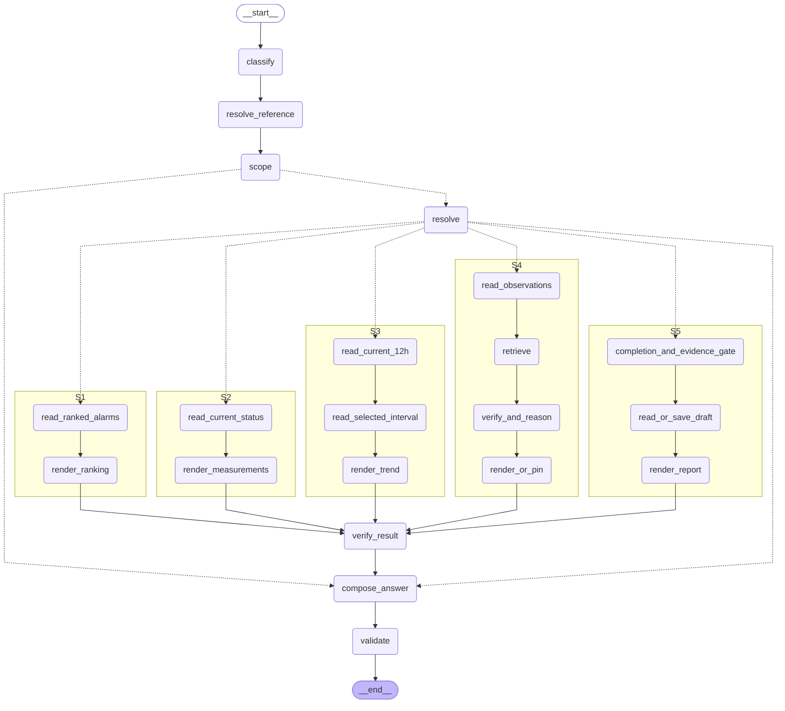

# SKADI Flow Lab v2.2 현재 코드 해설


기준: 2026-11-18 · 소스 `60a5287 + 로컬 변경 포함` · 파일별 SHA-256은 배포 JSON에 포함.


v2/v2.1은 이전 설계이며 이 문서는 현재 구현을 설명합니다. 알려진 결함도 현재 동작 그대로 표시합니다. 사이트는 서버에 연결된 챗봇이 아닙니다.


## 검증 범위


실제 State TypedDict 기준입니다. 모델 JSON·HTTP·DB는 합성 fixture로 대체했습니다. 원본 문서·실제 대화·비밀값은 포함하지 않습니다. 그래프·의도 검증·기억·설비 조건·업무 도구·답변 검사·BM25는 실제 코드를 실행했습니다.

실제 LangGraph와 BusinessTools, Corpus 검색/검증을 실행했습니다. PostgreSQL/SQLite 저장과 권한 검사는 메모리 저장소로 대체하므로 운영 통합 테스트가 아닙니다. 모델의 JSON 응답은 고정 fixture로 대체하고 실제 Language의 후처리는 실행했습니다. 서로 독립된 합성 대화 A~F를 재생합니다. S3는 실제 코드대로 합성 last_poll 기준 T를 사용하며 집계 정보가 없을 때의 시계만 고정합니다.


## 실행 구조


브라우저 → Spring :8000 → AI API :8001 → MCP :8002 → Spring 조회 API / 파일 RAG / PostgreSQL. AI와 MCP는 같은 AI 패키지의 별도 프로세스입니다. 기본 모델 gpt-4.1-mini는 분류·필요시 조건 재해석·근거 ID 선택·일반 답변 생성/검토에 사용합니다. 설정의 OPENAI_MODEL로 바꿀 수 있습니다. SQLite는 체크포인트·완료 State·재시도 예약을 저장합니다. 포트는 코드 기본값이며 운영 배포는 별도입니다.


## 이전 v2.2에서 갱신한 내용


- **그래프**: 이전 v2.2: 공통 4 + 내부 14개 → 현재: 공통 7 + 내부 14개. resolve_reference · verify_result · compose_answer 추가

- **대화 기억**: pending과 직전 대상 중심 → 6종 turn_type · 과거 질문/목록 참조 · 원문 재조회 · 새 요청 전환

- **설비 검색**: ID·이름 단순 후보 조회 → 원문 조건 전체를 카탈로그에 적용. S1은 설비 집합, S2~S5는 단일 대상

- **답변**: 분류·발췌 선택에 모델 사용 → 일반 답변 설명 생성 + 근거 검토 + 한 번 재작성 / 실패 표시. S4/S5 protected 유지

- **추이 기준**: datetime.now 기준 12시간 → 백엔드 last_poll의 성공 여부로 기준 T 선택. 집계 정보가 없을 때만 현재 시각

- **MCP 계약**: 도구 11개 · 기존 입력 계약 → 개수는 11개 유지. resolve_equipment에 conditions/many, 알람 도구에 UG·IDs·conditions


## 실제 StateGraph 전체 펼침


build_graph().get_graph(xray=True).draw_mermaid()의 원문입니다. 노드·연결은 모델 응답과 무관하게 컴파일된 그래프에서 추출했습니다. 현재 구현은 조건 분기 후 순차 실행하며 ToolNode/ReAct 반복 루프와 interrupt는 없습니다. MCP는 노드 함수 내부에서 호출합니다.





## 부모 그래프 · S1~S5 접기

get_graph() 직접 추출 · 접수·State 복원·저장·SSE는 app.py의 그래프 바깥 처리입니다.


연결:


- `S1` → `verify_result`

- `S2` → `verify_result`

- `S3` → `verify_result`

- `S4` → `verify_result`

- `S5` → `verify_result`

- `__start__` → `classify`

- `classify` → `resolve_reference`

- `compose_answer` → `validate`

- `resolve` → `S1` · S1

- `resolve` → `S2` · S2

- `resolve` → `S3` · S3

- `resolve` → `S4` · S4

- `resolve` → `S5` · S5

- `resolve` → `compose_answer` · answer 있음

- `resolve_reference` → `scope`

- `scope` → `compose_answer` · answer 있음

- `scope` → `resolve` · answer 없음

- `verify_result` → `compose_answer`

- `validate` → `__end__`


### classify

- 담당 / 실행: AI API의 Python 노드 함수 · 이번 발화의 의도 해석 / FastAPI :8001 · LangGraph

- 위치: `ai/src/skadi_ai/graph.py:54 · classify()`

- Input: question, 이전 intent, pending, conversation_context, 후보 목록

- Output: intent + previous_intent

- State: intent, previous_intent

- 도구: 없음

Language.classify가 현재 질문과 축약한 대화 맥락을 받아 Intent를 생성. 원문에 없는 조건·잘못된 참조는 한 번 재해석. 필요하면 직전 조건을 이어가는지도 추가 모델 호출로 검사. 실제 대상 확정과 도구 선택은 다음 코드 노드가 담당. 이 노드가 출력 State를 초기화하는 것은 아님.


### resolve_reference

- 담당 / 실행: AI API의 Python 노드 함수 · 과거 기록·목록 연결 / FastAPI :8001 · LangGraph

- 위치: `ai/src/skadi_ai/graph.py:58 · resolve_history()`

- Input: intent, pending, 이전 State, conversation_context

- Output: 참조를 반영한 Intent / 회상·취소·참조 실패 안내

- State: pending, intent, recalled_turn, comparison_context, rank_reference, correction_context; 턴별 출력 초기화

- 도구: 없음

실제 등록 이름은 resolve_reference. memory.py의 bind_reference/resolve_reference를 호출. first/last/ordinal, 후보 순번과 알람 rank를 구분한다. new_request면 이전 pending을 버리고, selection은 그때 표시한 목록을 사용한다. 과거 원문은 같은 사용자·세션·현재 질문 이전 범위의 콜백으로 조회. recall은 과거 답변을 재현하며 새 센서 조회가 아님.


### scope

- 담당 / 실행: AI API의 Python 노드 함수 · 업무 지원 범위 검사 / FastAPI :8001 · LangGraph

- 위치: `ai/src/skadi_ai/graph.py:117 · scope()`

- Input: 참조 처리 후 intent / answer

- Output: resolve 또는 compose_answer로 라우팅

- State: answer, response_context, pending, followups

- 도구: 없음

기존 답변이 있으면 유지. 미지원 기간·기능, 잘못된 operation, 모호한 참조·복수 업무, 인사·사용법은 안내를 만들고 compose_answer로 이동. 모두 S1~S5로 강제하지 않음.


### resolve

- 담당 / 실행: AI API의 Python 노드 함수 · 설비 조건·센서 확정 / FastAPI :8001 · LangGraph → MCP :8002

- 위치: `ai/src/skadi_ai/graph.py:176 · resolve()`

- Input: intent의 원문 조건, 이전 선택, rank_reference

- Output: target_resolution, 단일 설비/설비 집합/태그 또는 되물음

- State: selected_equipment, selected_tag, pending, displayed_candidates, response_context, target_resolution

- 도구: resolve_equipment, list_equipment_tags

S1은 여러 설비 집합을 허용. ID·공정·종류·호기·A/B 조건을 모두 확인한다. 미해석 조건은 Language.repair_conditions로 한 번 재해석 가능. 0건·여러 후보·조건 충돌·메타데이터 부족을 구분. 도구의 applied_conditions를 Intent에도 반영. S3는 실제 설치 태그에서 종류 또는 정확 ID로 선택하며 센서 pending을 저장. 새 요청은 이전 설비를 기본값으로 재사용하지 않음.


### validate

- 담당 / 실행: AI API의 Python 노드 함수 · 빈 답변 검사 / FastAPI :8001 · LangGraph

- 위치: `ai/src/skadi_ai/graph.py:636 · validate()`

- Input: answer, intent.stage, trace

- Output: 최종 State

- State: trace

- 도구: 없음

빈 answer이면 예외. trace는 [classify, stage, validate] 형태의 짧은 요약이며 전체 노드 실행 기록이 아님. 저장·SSE 변환은 app.py의 그래프 바깥 처리.


### compose_answer

- 담당 / 실행: AI API의 Python 노드 함수 · 근거 있는 답변 생성·검토 / FastAPI :8001 · LangGraph

- 위치: `ai/src/skadi_ai/graph.py:641 · compose()`

- Input: question, intent, response_context 또는 이번 조회 사실

- Output: 최종 answer와 생성 상태

- State: answer, answer_generation

- 도구: 없음

등록 이름 compose_answer → answers.py. S1~S3·인사·되물음·회상에 intro/explanation 생성. 수치·단위·목록·회상 원문은 코드로 삽입. 숫자/링크 검사 후 같은 모델이 근거를 검토하고 최대 한 번 재작성. 실패하면 fallback 안내. 일반 S4/S5 본문은 protected로 유지. MCP 호출 없음.


### verify_result

- 담당 / 실행: AI API의 Python 노드 함수 · 요청 범위와 결과 대조 / FastAPI :8001 · LangGraph

- 위치: `ai/src/skadi_ai/graph.py:644 · verify_result()`

- Input: intent, task_executed, target_resolution, stage_result

- Output: 일치하면 빈 patch / 불일치면 결과 차단

- State: answer, response_context, links, displayed_candidates, task_executed

- 도구: 없음

모든 S 경로 뒤에 실행되지만 현재 실질 검사는 새 S1 조회만 수행. applied_equipment_ids와 각 행의 설비 조건을 다시 확인. 과거 순위 설명과 S2~S5는 빈 patch로 통과. 범위가 다르면 잘못된 목록을 표시하지 않음.


### S1

- 담당 / 실행: 컴파일된 하위 StateGraph / AI API :8001

- 위치: `ai/src/skadi_ai/graph.py · StateGraph`

- Input: 공유 State

- Output: 서브그래프 실행 결과 State

- State: 없음

- 도구: 없음

부모 그래프에 등록된 실제 노드 이름입니다. 전체 펼침 또는 같은 이름의 탭에서 내부 등록 노드를 확인하세요.


### S2

- 담당 / 실행: 컴파일된 하위 StateGraph / AI API :8001

- 위치: `ai/src/skadi_ai/graph.py · StateGraph`

- Input: 공유 State

- Output: 서브그래프 실행 결과 State

- State: 없음

- 도구: 없음

부모 그래프에 등록된 실제 노드 이름입니다. 전체 펼침 또는 같은 이름의 탭에서 내부 등록 노드를 확인하세요.


### S3

- 담당 / 실행: 컴파일된 하위 StateGraph / AI API :8001

- 위치: `ai/src/skadi_ai/graph.py · StateGraph`

- Input: 공유 State

- Output: 서브그래프 실행 결과 State

- State: 없음

- 도구: 없음

부모 그래프에 등록된 실제 노드 이름입니다. 전체 펼침 또는 같은 이름의 탭에서 내부 등록 노드를 확인하세요.


### S4

- 담당 / 실행: 컴파일된 하위 StateGraph / AI API :8001

- 위치: `ai/src/skadi_ai/graph.py · StateGraph`

- Input: 공유 State

- Output: 서브그래프 실행 결과 State

- State: 없음

- 도구: 없음

부모 그래프에 등록된 실제 노드 이름입니다. 전체 펼침 또는 같은 이름의 탭에서 내부 등록 노드를 확인하세요.


### S5

- 담당 / 실행: 컴파일된 하위 StateGraph / AI API :8001

- 위치: `ai/src/skadi_ai/graph.py · StateGraph`

- Input: 공유 State

- Output: 서브그래프 실행 결과 State

- State: 없음

- 도구: 없음

부모 그래프에 등록된 실제 노드 이름입니다. 전체 펼침 또는 같은 이름의 탭에서 내부 등록 노드를 확인하세요.


## S1 · 알람 우선순위

등록 이름과 연결을 직접 추출했습니다. 빈 patch로 통과하는 노드도 실행 경로에 포함됩니다.


연결:


- `S1:__start__` → `S1:read_ranked_alarms`

- `S1:read_ranked_alarms` → `S1:render_ranking`

- `S1:render_ranking` → `S1:__end__`


### read_ranked_alarms

- 담당 / 실행: AI API의 Python 노드 함수 · 알람 집합 조회 / 과거 순위 재사용 / FastAPI :8001 · LangGraph → MCP :8002

- 위치: `ai/src/skadi_ai/graph.py:356 · s1_read()`

- Input: unit_id, unit_group_id, target_resolution, rank_reference

- Output: stage_result

- State: stage_result, task_executed

- 도구: summarize_unresolved_alarms

과거 목록 순위 설명이면 rank_reference를 그대로 사용하고 도구 생략. 새 조회면 유닛·유닛 그룹·설비 ID 집합·조건을 전달. Spring의 순위와 점수를 보존.


### render_ranking

- 담당 / 실행: AI API의 Python 노드 함수 · 알람 사실·표시 목록 구성 / FastAPI :8001 · LangGraph

- 위치: `ai/src/skadi_ai/graph.py:377 · s1_render()`

- Input: stage_result rows / total / last_poll / applied_conditions

- Output: 기본 본문, 설비 링크, 목록 스냅샷

- State: answer, links, displayed_candidates

- 도구: 없음

최대 10행 표시. 필터 후에도 원래 담당 범위 순위 유지. 표시 순번과 실제 rank는 다를 수 있음. alarm_listing으로 후속 선택용 목록을 저장. 이후 verify_result와 compose_answer를 거침.


## S2 · 설비 현재 상태

등록 이름과 연결을 직접 추출했습니다. 빈 patch로 통과하는 노드도 실행 경로에 포함됩니다.


연결:


- `S2:__start__` → `S2:read_current_status`

- `S2:read_current_status` → `S2:render_measurements`

- `S2:render_measurements` → `S2:__end__`


### read_current_status

- 담당 / 실행: AI API의 Python 노드 함수 · 설비 현재값 조회 / FastAPI :8001 · LangGraph → MCP :8002

- 위치: `ai/src/skadi_ai/graph.py:411 · s2_read()`

- Input: selected_equipment.equip_id

- Output: status_context

- State: status_context, task_executed

- 도구: get_equipment_status

S2 read_current_status와 S4 read_observations가 같은 함수를 사용. 모든 태그의 현재값·단위·판정·측정 시각은 Spring 응답.


### render_measurements

- 담당 / 실행: AI API의 Python 노드 함수 · 조회 사실과 링크 구성 / FastAPI :8001 · LangGraph

- 위치: `ai/src/skadi_ai/graph.py:415 · s2_render()`

- Input: status_context

- Output: 기본 관측 본문과 설비 링크

- State: answer, links

- 도구: 없음

이 노드 자체는 LLM 호출 없음. 측정 시각과 값을 구성한 뒤 compose_answer에서 설명을 생성. 오래된 측정을 실시간 안전 상태로 단정하지 않음.


## S3 · 12시간 추이·구간

등록 이름과 연결을 직접 추출했습니다. 빈 patch로 통과하는 노드도 실행 경로에 포함됩니다.


연결:


- `S3:__start__` → `S3:read_current_12h`

- `S3:read_current_12h` → `S3:read_selected_interval`

- `S3:read_selected_interval` → `S3:render_trend`

- `S3:render_trend` → `S3:__end__`


### read_current_12h

- 담당 / 실행: AI API의 Python 노드 함수 · 백엔드 기준 T의 12시간 조회 / FastAPI :8001 · LangGraph → MCP :8002

- 위치: `ai/src/skadi_ai/graph.py:429 · s3_read()`

- Input: selected_tag, dashboard.last_poll

- Output: trend_context

- State: trend_context, task_executed

- 도구: summarize_unresolved_alarms, analyze_sensor_trend

대시보드 last_poll을 먼저 읽음. SUCCESS면 window_end, 그 외에는 window_start가 end. 집계 정보가 없을 때만 datetime.now(UTC). hours=12, 끝 시각 제외 구간으로 기존 백엔드 dataTime 기준과 일치시킴.


### read_selected_interval

- 담당 / 실행: AI API의 Python 노드 함수 · 최근 이상 구간 상세 / FastAPI :8001 · LangGraph → MCP :8002

- 위치: `ai/src/skadi_ai/graph.py:442 · s3_interval()`

- Input: operation, trend_context.intervals

- Output: stage_result 또는 빈 patch

- State: stage_result

- 도구: get_abnormal_interval_detail

interval_detail 요청이며 구간이 있을 때만 마지막 구간 ID로 앞뒤 상세 조회. 일반 추이에서는 이 노드는 지나가지만 도구는 호출하지 않음.


### render_trend

- 담당 / 실행: AI API의 Python 노드 함수 · 추이 사실과 차트 링크 / FastAPI :8001 · LangGraph

- 위치: `ai/src/skadi_ai/graph.py:455 · s3_render()`

- Input: trend_context, selected_tag, stage_result

- Output: 관측 min/max·구간 수·링크

- State: answer, links

- 도구: 없음

유효 avg 점의 min/max와 기간을 표시. 기본 본문 뒤 compose_answer로 이동. 링크는 sensor/hours와 interval만 전달하며 정확한 from/to·tag_id는 아직 URL에 포함하지 않음.


## S4 · 원인·근거·체크리스트

등록 이름과 연결을 직접 추출했습니다. 빈 patch로 통과하는 노드도 실행 경로에 포함됩니다.


연결:


- `S4:__start__` → `S4:read_observations`

- `S4:read_observations` → `S4:retrieve`

- `S4:retrieve` → `S4:verify_and_reason`

- `S4:verify_and_reason` → `S4:render_or_pin`

- `S4:render_or_pin` → `S4:__end__`


### read_observations

- 담당 / 실행: AI API의 Python 노드 함수 · 설비 현재값 조회 / FastAPI :8001 · LangGraph → MCP :8002

- 위치: `ai/src/skadi_ai/graph.py:411 · s2_read()`

- Input: selected_equipment.equip_id

- Output: status_context

- State: status_context, task_executed

- 도구: get_equipment_status

S2 read_current_status와 S4 read_observations가 같은 함수를 사용. 모든 태그의 현재값·단위·판정·측정 시각은 Spring 응답.


### retrieve

- 담당 / 실행: AI API의 Python 노드 함수 · 검색 / 이전 진단 근거 재조회 / FastAPI :8001 · LangGraph → MCP :8002

- 위치: `ai/src/skadi_ai/graph.py:477 · s4_search()`

- Input: question, sensor_type, diagnosis_context

- Output: evidence

- State: evidence

- 도구: search_knowledge, get_document_evidence

새 diagnose는 파일 BM25 검색. 기존 진단 뒤 조치·근거·체크리스트 요청은 이전 chunk_id를 다시 검증해 사용.


### verify_and_reason

- 담당 / 실행: AI API의 Python 노드 함수 · 근거 검증과 발췌 선택 / FastAPI :8001 · LangGraph → MCP :8002

- 위치: `ai/src/skadi_ai/graph.py:492 · s4_ground()`

- Input: evidence, status_context, question, sensor_type

- Output: 원문 기반 후보와 출처

- State: diagnosis_context, citations; 근거 없으면 answer

- 도구: get_document_evidence

도구로 설비 적용 범위·청크·페이지를 검증. Language.diagnose에서 모델은 발췌 ID만 선택하고 Python이 원문을 복원. 근거 없으면 모델 생략. 자유로운 원인 설명 생성은 아직 이 경로에 적용되지 않음.


### render_or_pin

- 담당 / 실행: AI API의 Python 노드 함수 · 진단 원문 / 체크리스트 저장 / FastAPI :8001 · LangGraph → MCP :8002

- 위치: `ai/src/skadi_ai/graph.py:526 · s4_render()`

- Input: diagnosis_context, citations, operation

- Output: answer / links / checklist

- State: answer, links, followups, checklist

- 도구: save_action_checklist

관측값과 검증된 문서 발췌 구성. checklist 요청 때만 저장하며 기존 사람의 완료 체크를 보존. compose_answer는 일반 S4 결과에 protected 모드를 적용.


## S5 · 완료 확인·초안

등록 이름과 연결을 직접 추출했습니다. 빈 patch로 통과하는 노드도 실행 경로에 포함됩니다.


연결:


- `S5:__start__` → `S5:completion_and_evidence_gate`

- `S5:completion_and_evidence_gate` → `S5:read_or_save_draft`

- `S5:read_or_save_draft` → `S5:render_report`

- `S5:render_report` → `S5:__end__`


### completion_and_evidence_gate

- 담당 / 실행: AI API의 Python 노드 함수 · 완료 진술·근거·기존 초안 검사 / FastAPI :8001 · LangGraph

- 위치: `ai/src/skadi_ai/graph.py:570 · s5_gate()`

- Input: operation, report_context, action_completion, diagnosis_context

- Output: 진행 또는 부족 정보 안내

- State: answer, pending, links, followups

- 도구: 없음

새 생성에는 같은 설비의 실제 완료 발화와 진단 근거가 필요. 초안이 있으면 링크로 안내. read는 현재 대화의 report_context 필요. interrupt가 아니며 실패 안내 후에도 뒤 노드들이 실행되고 빈 patch로 통과.


### read_or_save_draft

- 담당 / 실행: AI API의 Python 노드 함수 · 보고서 초안 조회 / 저장 / FastAPI :8001 · LangGraph → MCP :8002

- 위치: `ai/src/skadi_ai/graph.py:601 · s5_persist()`

- Input: report_id 또는 완료 message_id·설비·관측·chunk_ids

- Output: report_context

- State: report_context, task_executed

- 도구: get_report_draft, save_report_draft

gate가 answer를 만들었으면 도구 생략. 조회와 생성을 operation으로 구분. 저장 시 완료 원문·근거를 다시 확인. symptom은 이전 관측 맥락이며 새 센서 조회가 아님.


### render_report

- 담당 / 실행: AI API의 Python 노드 함수 · 초안 결과와 링크 / FastAPI :8001 · LangGraph

- 위치: `ai/src/skadi_ai/graph.py:623 · s5_render()`

- Input: report_context 또는 gate 안내

- Output: answer, links 또는 빈 patch

- State: answer, links

- 도구: 없음

DRAFT ID와 검토 안내. 완료 부족 시 gate 답변 유지. compose_answer는 일반 S5 결과를 protected로 보존. 최종 제출은 기존 웹 기능.


## 노드 내부의 조건과 MCP 호출


StateGraph 노드의 테두리 안에 graph.py의 if, tools.call, Language 호출, return 경로를 펼쳤습니다. 내부 처리 단계를 별도의 등록 노드로 추가한 것은 아닙니다. 일반 대입·포맷팅·반복문은 코드 블록으로 묶습니다. 20개 함수의 if 54개를 모두 추출하고 35개 질문·280단계를 실제 실행했습니다. memory.py와 answers.py의 헬퍼 내부는 등록 노드로 추가하지 않고 호출과 별도 설명으로 표시합니다. 외부 I/O와 모델 응답은 기존과 같은 합성 예시입니다.

S1~S5 탭은 조건·도구 상세가 기본입니다. 주황 상자는 실제 MCP 도구, YES/NO는 if 결과, return {}는 State를 바꾸지 않는 반환입니다. 조건에 따라 도구 호출이 생략되는 경로도 표시합니다. 전체 개요에도 실제 도구 이름을 표시합니다.


### classify() 내부

- 호출 · graph.py:55 · `Language.classify`

```python
language.classify(s)
```


### resolve_history() 내부

- 호출 · graph.py:59 · `bind_reference()`

```python
bind_reference(s, Intent.model_validate(s["intent"]))
```

- 조건 · graph.py:62 · **조건 확인: selector and selector.target == 'turn' and (selector.method == 'ordinal') and selector.ordinal and history_selector** · `selector and selector.target == 'turn' and (selector.method == 'ordinal') and selector.ordinal and history_selector`

- 호출 · graph.py:69 · `history_selector()`

```python
history_selector(selector.ordinal)
```

- 조건 · graph.py:70 · **소유권 범위 안에서 원문을 찾았나요?** · `original`

- 조건 · graph.py:74 · **조건 확인: intent.turn_type != 'new_request' and intent.reference_message_id and history_reader** · `intent.turn_type != 'new_request' and intent.reference_message_id and history_reader`

- 호출 · graph.py:75 · `history_reader()`

```python
history_reader(intent.reference_message_id)
```

- 조건 · graph.py:76 · **소유권 범위 안에서 원문을 찾았나요?** · `original`

- 조건 · graph.py:77 · **조건 확인: selector and selector.target == 'turn' and (selector.method == 'ordinal')** · `selector and selector.target == 'turn' and (selector.method == 'ordinal')`

- 호출 · graph.py:80 · `resolve_reference()`

```python
resolve_reference({**s, "conversation_context": context}, intent)
```

- 조건 · graph.py:82 · **조건 확인: re.search('아직|안\\s*했|못\\s*했|취소|미완료', s['question'])** · `re.search('아직|안\\s*했|못\\s*했|취소|미완료', s['question'])`

- 조건 · graph.py:84 · **이번 발화에 실제 완료 진술이 있나요?** · `intent.completed`


### scope() 내부

- 조건 · graph.py:118 · **이미 답변·안내가 있나요?** · `s.get('answer')`

- 조건 · graph.py:121 · **조건 확인: i.get('clarification_reason') == 'unsupported' or (i.get('requested_period') == 'historical' and i.get('turn_type') != 'recall')** · `i.get('clarification_reason') == 'unsupported' or (i.get('requested_period') == 'historical' and i.get('turn_type') != 'recall')`

- 조건 · graph.py:133 · **조건 확인: i['operation'] not in ALLOWED[i['stage']]** · `i['operation'] not in ALLOWED[i['stage']]`

- 조건 · graph.py:138 · **조건 확인: i['stage'] == 'clarify' or i.get('clarification_reason') in ('ambiguous_reference', 'multiple_requests')** · `i['stage'] == 'clarify' or i.get('clarification_reason') in ('ambiguous_reference', 'multiple_requests')`

- 조건 · graph.py:165 · **인사·사용법 안내인가요?** · `i['stage'] == 'guide'`


### resolve() 내부

- 조건 · graph.py:179 · **이전에 표시한 순위를 설명하는 요청인가요?** · `s.get('rank_reference')`

- 조건 · graph.py:181 · **조건 확인: many and (not i.get('equipment_query')) and (not i.get('equipment_conditions'))** · `many and (not i.get('equipment_query')) and (not i.get('equipment_conditions'))`

- 조건 · graph.py:185 · **조건 확인: i.get('equipment_query') or i.get('equipment_conditions')** · `i.get('equipment_query') or i.get('equipment_conditions')`

- 조건 · graph.py:190 · **조건 확인: i.get('equipment_conditions')** · `i.get('equipment_conditions')`

- 조건 · graph.py:192 · **여러 설비를 대상으로 하는 S1인가요?** · `many`

- 호출 · graph.py:194 · `resolve_equipment`

```python
tools.call("resolve_equipment", **args)
```

- 조건 · graph.py:195 · **조건 확인: result.get('status') == 'missing_information'** · `result.get('status') == 'missing_information'`

- 호출 · graph.py:196 · `Language.repair_conditions`

```python
language.repair_conditions(s, result)
```

- 조건 · graph.py:197 · **조건 확인: repaired.equipment_conditions and repaired.model_dump()['equipment_conditions'] != i.get('equipment_conditions')** · `repaired.equipment_conditions and repaired.model_dump()['equipment_conditions'] != i.get('equipment_conditions')`

- 호출 · graph.py:202 · `resolve_equipment`

```python
tools.call("resolve_equipment", **args)
```

- 조건 · graph.py:204 · **조건 확인: 'applied_conditions' in result** · `'applied_conditions' in result`

- 조건 · graph.py:219 · **설비 조건을 확정하지 못했나요?** · `status != 'resolved'`

- 조건 · graph.py:267 · **여러 설비를 대상으로 하는 S1인가요?** · `many`

- 조건 · graph.py:275 · **조회할 설비가 아직 없나요?** · `not eq`

- 조건 · graph.py:289 · **이전과 다른 설비인가요?** · `changed`

- 조건 · graph.py:292 · **이번 발화에 실제 완료 진술이 있나요?** · `i['completed']`

- 조건 · graph.py:298 · **추이·구간 조회 요청인가요?** · `i['stage'] == 'S3'`

- 호출 · graph.py:299 · `list_equipment_tags`

```python
tools.call("list_equipment_tags", equip_id=eq["equip_id"])
```

- 조건 · graph.py:301 · **정확한 태그 ID를 지정했나요?** · `i.get('sensor_tag_query')`

- 조건 · graph.py:307 · **조건 확인: not i.get('sensor_type') and (not changed) and s.get('selected_tag')** · `not i.get('sensor_type') and (not changed) and s.get('selected_tag')`

- 조건 · graph.py:309 · **센서가 없거나 여러 개인가요?** · `len(tags) != 1`

- 조건 · graph.py:328 · **설치된 센서 자체가 없나요?** · `not data['tags']`


### s1_read() 내부

- 조건 · graph.py:357 · **이전에 표시한 순위를 설명하는 요청인가요?** · `s.get('rank_reference')`

- 조건 · graph.py:364 · **조건 확인: resolution.get('status') == 'resolved'** · `resolution.get('status') == 'resolved'`

- 호출 · graph.py:371 · `summarize_unresolved_alarms`

```python
tools.call(
                "summarize_unresolved_alarms",
                **args,
            )
```


### s1_render() 내부

- 조건 · graph.py:382 · **과거 목록의 순위 기록인가요?** · `data.get('historical')`

- 조건 · graph.py:385 · **적용한 설비 조건이 있나요?** · `conditions`

- 조건 · graph.py:401 · **조회 범위의 알람 행이 없나요?** · `not data['rows']`


### s2_read() 내부

- 호출 · graph.py:412 · `get_equipment_status`

```python
tools.call("get_equipment_status", equip_id=s["selected_equipment"]["equip_id"])
```


### s2_render() 내부


### s3_read() 내부

- 호출 · graph.py:431 · `summarize_unresolved_alarms`

```python
tools.call("summarize_unresolved_alarms")
```

- 호출 · graph.py:439 · `analyze_sensor_trend`

```python
tools.call("analyze_sensor_trend", tag_id=t["tag_id"], end=end, hours=12)
```


### s3_interval() 내부

- 조건 · graph.py:444 · **조건 확인: s['intent']['operation'] == 'interval_detail' and data.get('intervals')** · `s['intent']['operation'] == 'interval_detail' and data.get('intervals')`

- 호출 · graph.py:447 · `get_abnormal_interval_detail`

```python
tools.call(
                    "get_abnormal_interval_detail",
                    tag_id=s["selected_tag"]["tag_id"],
                    interval_id=interval["id"],
                )
```


### s3_render() 내부

- 조건 · graph.py:460 · **유효한 관측점이 있나요?** · `valid`

- 조건 · graph.py:472 · **조건 확인: s['stage_result'] and d['intervals']** · `s['stage_result'] and d['intervals']`


### s4_search() 내부

- 조건 · graph.py:478 · **조건 확인: s['intent']['operation'] != 'diagnose' and s.get('diagnosis_context')** · `s['intent']['operation'] != 'diagnose' and s.get('diagnosis_context')`

- 호출 · graph.py:479 · `get_document_evidence`

```python
tools.call(
                "get_document_evidence",
                equip_id=s["selected_equipment"]["equip_id"],
                chunk_ids=s["diagnosis_context"]["chunk_ids"],
            )
```

- 호출 · graph.py:487 · `search_knowledge`

```python
tools.call(
            "search_knowledge", equip_id=s["selected_equipment"]["equip_id"], query=query
        )
```


### s4_ground() 내부

- 조건 · graph.py:493 · **검색 근거가 없나요?** · `not s['evidence']`

- 호출 · graph.py:499 · `get_document_evidence`

```python
tools.call(
            "get_document_evidence", equip_id=s["selected_equipment"]["equip_id"], chunk_ids=ids
        )
```

- 호출 · graph.py:502 · `Language.diagnose`

```python
language.diagnose(
            s["evidence"],
            s["status_context"],
            s["intent"]["operation"],
            question=s["question"],
            sensor_type=s["intent"].get("sensor_type")
            or (s.get("selected_tag") or {}).get("sensor_type"),
        )
```

- 조건 · graph.py:510 · **모델이 선택한 유효 근거가 없나요?** · `not candidates`


### s4_render() 내부

- 조건 · graph.py:527 · **이미 답변·안내가 있나요?** · `s['answer']`

- 조건 · graph.py:559 · **체크리스트 저장 요청인가요?** · `s['intent']['operation'] == 'checklist'`

- 호출 · graph.py:560 · `save_action_checklist`

```python
tools.call(
                "save_action_checklist",
                session_id=s["session_id"],
                message_id=s["message_id"],
                equip_id=s["selected_equipment"]["equip_id"],
                chunk_ids=s["diagnosis_context"]["chunk_ids"],
            )
```


### s5_gate() 내부

- 조건 · graph.py:571 · **보고서 조회 요청인가요?** · `s['intent']['operation'] == 'read'`

- 조건 · graph.py:572 · **현재 대화에 보고서 초안이 없나요?** · `not s.get('report_context')`

- 조건 · graph.py:575 · **이미 초안이 있나요?** · `s.get('report_context')`

- 조건 · graph.py:583 · **조건 확인: not completion or completion['equip_id'] != s['selected_equipment']['equip_id']** · `not completion or completion['equip_id'] != s['selected_equipment']['equip_id']`

- 조건 · graph.py:591 · **확인된 진단 근거가 없나요?** · `not s.get('diagnosis_context')`


### s5_persist() 내부

- 조건 · graph.py:602 · **이미 답변·안내가 있나요?** · `s['answer']`

- 조건 · graph.py:604 · **보고서 조회 요청인가요?** · `s['intent']['operation'] == 'read'`

- 호출 · graph.py:605 · `get_report_draft`

```python
tools.call("get_report_draft", report_id=s["report_context"]["report_id"])
```

- 호출 · graph.py:607 · `save_report_draft`

```python
tools.call(
                "save_report_draft",
                session_id=s["session_id"],
                message_id=s["message_id"],
                equip_id=s["selected_equipment"]["equip_id"],
                completion_message_id=s["action_completion"]["message_id"],
                symptom="관측 및 초기 점검:\n"
                + "\n".join(
                    f"{t['tag_id']}: {t['current_value']} {t['unit']}"
                    f" · {t['limit_kind']} · 측정 {t['measured_at']}"
                    for t in (s.get("status_context") or {}).get("tags", [])
                ),
                chunk_ids=s["diagnosis_context"]["chunk_ids"],
            )
```


### s5_render() 내부

- 조건 · graph.py:624 · **이미 답변·안내가 있나요?** · `s['answer']`


### validate() 내부

- 조건 · graph.py:637 · **최종 답변이 비어 있나요?** · `not s.get('answer')`


### compose() 내부

- 호출 · graph.py:642 · `compose_answer()`

```python
compose_answer(language, s)
```


### verify_result() 내부

- 조건 · graph.py:645 · **조건 확인: s['intent']['stage'] != 'S1' or not s.get('task_executed') or s.get('rank_reference')** · `s['intent']['stage'] != 'S1' or not s.get('task_executed') or s.get('rank_reference')`

- 조건 · graph.py:660 · **요청한 설비 조건과 알람 결과가 다른가요?** · `bad`


## MCP 도구 11개


Context는 서버가 주입하므로 호출자 입력에서 제외했습니다. 출력은 합성 데이터로 실행한 예시이며 완전한 JSON Schema가 아닙니다.


### resolve_equipment

카탈로그로 모든 설비 조건 확인

ai/src/skadi_ai/mcp_server.py:46 → BusinessTools.resolve_equipment() / tools.py

입력 스키마:


```json
{
  "type": "object",
  "properties": {
    "query": {
      "type": "string"
    },
    "conditions": {
      "anyOf": [
        {
          "items": {
            "additionalProperties": true,
            "type": "object"
          },
          "type": "array"
        },
        {
          "type": "null"
        }
      ],
      "default": null
    },
    "many": {
      "type": "boolean",
      "default": false
    }
  },
  "required": [
    "query"
  ]
}
```


입력 예시:


```json
{
  "query": "C-2100"
}
```


출력 예시:


```json
{
  "matches": [
    {
      "equip_id": "C-2100",
      "equip_name": "원심 압축기 2호기",
      "equip_type": "원심 압축기",
      "process_name": "학습 가스 압축",
      "equip_model": "DEMO-MODEL",
      "unit_id": "UNIT-A",
      "is_running": true,
      "is_used": true
    }
  ],
  "candidates": [
    {
      "equip_id": "C-2100",
      "equip_name": "원심 압축기 2호기",
      "equip_type": "원심 압축기",
      "process_name": "학습 가스 압축",
      "equip_model": "DEMO-MODEL",
      "unit_id": "UNIT-A",
      "is_running": true,
      "is_used": true
    }
  ],
  "total": 1,
  "status": "resolved",
  "applied_conditions": [],
  "missing_fields": [],
  "conflicting_fields": [],
  "unresolved_conditions": [],
  "catalog_complete": true,
  "ambiguous": false,
  "catalog_values": {}
}
```


1. GET /equipment → equipment_resolver.resolve_catalog
2. query 원문과 conditions의 ID/이름/종류/공정/유닛/호기/A·B 조건을 모두 적용. 명시 ID는 정확 일치만
3. many=true는 여러 설비 집합 허용; false는 단일 대상. resolved/ambiguous/not_found/conflict/missing_information/unavailable 구분
4. 실제 MCP 입력 conditions는 list[dict]이며 BusinessTools에서 EquipmentCondition 검증. 임의 조건 생략으로 성공시키지 않음

오류: BACKEND_ERROR, 조건 검증 오류


### list_equipment_tags

설비 태그 목록

ai/src/skadi_ai/mcp_server.py:53 → BusinessTools.list_equipment_tags() / tools.py

입력 스키마:


```json
{
  "type": "object",
  "properties": {
    "equip_id": {
      "type": "string"
    }
  },
  "required": [
    "equip_id"
  ]
}
```


입력 예시:


```json
{
  "equip_id": "C-2100"
}
```


출력 예시:


```json
{
  "equip_id": "C-2100",
  "tags": [
    {
      "tag_id": "DEMO-VIB-01",
      "sensor_type": "VIBRATION",
      "unit": "mm/s",
      "limits": {
        "trip_lo": null,
        "alarm_lo": null,
        "alarm_hi": 4.0,
        "trip_hi": 10.0
      },
      "current_value": 8.2,
      "measured_at": "2026-11-18T00:00:00+00:00",
      "limit_kind": "SOFT_HIGH",
      "abnormal_level": 2
    }
  ]
}
```


1. get_equipment_status로 현재 tags를 읽어 반환
2. sensor_type 필터와 단일 선택은 그래프 resolve에서 수행

오류: BACKEND_ERROR


### get_equipment_status

현재값·설비 상세

ai/src/skadi_ai/mcp_server.py:57 → BusinessTools.get_equipment_status() / tools.py

입력 스키마:


```json
{
  "type": "object",
  "properties": {
    "equip_id": {
      "type": "string"
    }
  },
  "required": [
    "equip_id"
  ]
}
```


입력 예시:


```json
{
  "equip_id": "C-2100"
}
```


출력 예시:


```json
{
  "equip_id": "C-2100",
  "equip_name": "원심 압축기 2호기",
  "equip_type": "원심 압축기",
  "process_name": "학습 가스 압축",
  "equip_model": "DEMO-MODEL",
  "unit_id": "UNIT-A",
  "is_running": true,
  "is_used": true,
  "tags": [
    {
      "tag_id": "DEMO-VIB-01",
      "sensor_type": "VIBRATION",
      "unit": "mm/s",
      "limits": {
        "trip_lo": null,
        "alarm_lo": null,
        "alarm_hi": 4.0,
        "trip_hi": 10.0
      },
      "current_value": 8.2,
      "measured_at": "2026-11-18T00:00:00+00:00",
      "limit_kind": "SOFT_HIGH",
      "abnormal_level": 2
    }
  ],
  "path": [],
  "criticality_reason": "학습용 값",
  "risk_eval": null,
  "related": null,
  "recent_alarms": [],
  "status_summary": [],
  "rank": 1,
  "open_windows": 1
}
```


1. GET /equipment/{equip_id} 결과를 반환
2. 현재값·단위·판정·측정시각은 Spring 응답 사용; AI 별도 판정 없음

오류: BACKEND_ERROR


### summarize_unresolved_alarms

범위를 검증한 미해결 알람

ai/src/skadi_ai/mcp_server.py:61 → BusinessTools.summarize_unresolved_alarms() / tools.py

입력 스키마:


```json
{
  "type": "object",
  "properties": {
    "unit_id": {
      "anyOf": [
        {
          "type": "string"
        },
        {
          "type": "null"
        }
      ],
      "default": null
    },
    "unit_group_id": {
      "anyOf": [
        {
          "type": "string"
        },
        {
          "type": "null"
        }
      ],
      "default": null
    },
    "equip_ids": {
      "anyOf": [
        {
          "items": {
            "type": "string"
          },
          "type": "array"
        },
        {
          "type": "null"
        }
      ],
      "default": null
    },
    "conditions": {
      "anyOf": [
        {
          "items": {
            "additionalProperties": true,
            "type": "object"
          },
          "type": "array"
        },
        {
          "type": "null"
        }
      ],
      "default": null
    }
  },
  "required": []
}
```


입력 예시:


```json
{
  "unit_id": null,
  "unit_group_id": null
}
```


출력 예시:


```json
{
  "last_poll": {
    "window_start": "2026-11-17T23:30:00+00:00",
    "window_end": "2026-11-18T00:00:00+00:00",
    "status": "SUCCESS",
    "finished_at": "2026-11-18T00:00:00+00:00"
  },
  "rows": [
    {
      "equip_id": "C-2100",
      "equipment": {
        "equip_id": "C-2100",
        "equip_name": "원심 압축기 2호기",
        "equip_type": "원심 압축기",
        "process_name": "학습 가스 압축",
        "equip_model": "DEMO-MODEL",
        "unit_id": "UNIT-A",
        "is_running": true,
        "is_used": true
      },
      "rank": 1,
      "priority_score": 166,
      "sensor_type": "VIBRATION",
      "limit_kind": "SOFT_HIGH",
      "unit_id": "UNIT-A"
    },
    {
      "equip_id": "T-2200",
      "equipment": {
        "equip_id": "T-2200",
        "equip_name": "터빈 2호기",
        "equip_type": "터빈",
        "process_name": "학습 가스 압축",
        "equip_model": "DEMO-MODEL",
        "unit_id": "UNIT-A",
        "is_running": true,
        "is_used": true
      },
      "rank": 2,
      "priority_score": 156,
      "sensor_type": "VIBRATION",
      "limit_kind": "SOFT_HIGH",
      "unit_id": "UNIT-A"
    },
    {
      "equip_id": "P-2201A",
      "equipment": {
        "equip_id": "P-2201A",
        "equip_name": "펌프 3호기 A",
        "equip_type": "펌프",
        "process_name": "학습 냉매 압축",
        "equip_model": "DEMO-MODEL",
        "unit_id": "UNIT-B",
        "is_running": true,
        "is_used": true
      },
      "rank": 3,
      "priority_score": 112,
      "sensor_type": "VIBRATION",
      "limit_kind": "SOFT_HIGH",
      "unit_id": "UNIT-B"
    }
  ],
  "counts": {
    "equipments": 3,
    "high": null,
    "medium": null,
    "low": null
  },
  "total": 3,
  "scope": "all",
  "applied_equipment_ids": null,
  "applied_conditions": [],
  "rank_scope": "사용자 담당 범위의 전체 미해결 알람 순위",
  "counts_scope": "필터 적용 전 백엔드 집계"
}
```


1. GET /alarms/dashboard; UG 지정 시 GET /facility에서 소속 UNIT 확인
2. unit_group_id, unit_id, equip_ids로 필터하고 conditions를 각 행의 메타데이터와 검증
3. rank·priority_score는 백엔드 값 보존. 필터 후 재순위 계산 없음
4. applied_equipment_ids/applied_conditions 반환. counts는 필터 전 백엔드 집계이며 total은 필터 후 행 수

오류: BACKEND_ERROR, SCOPE_MISMATCH


### analyze_sensor_trend

백엔드 기준 시각의 센서 추이

ai/src/skadi_ai/mcp_server.py:74 → BusinessTools.analyze_sensor_trend() / tools.py

입력 스키마:


```json
{
  "type": "object",
  "properties": {
    "tag_id": {
      "type": "string"
    },
    "end": {
      "type": "string"
    },
    "hours": {
      "type": "integer",
      "default": 12
    }
  },
  "required": [
    "tag_id",
    "end"
  ]
}
```


입력 예시:


```json
{
  "tag_id": "DEMO-VIB-01",
  "end": "2026-11-18T00:00:00+00:00",
  "hours": 12
}
```


출력 예시:


```json
{
  "equip_id": "C-2100",
  "tag_id": "DEMO-VIB-01",
  "sensor_type": "VIBRATION",
  "unit": "mm/s",
  "from": "2026-11-17T12:00:00+00:00",
  "to": "2026-11-18T00:00:00+00:00",
  "resolution": "ONE_MINUTE",
  "points": [
    {
      "t": "2026-11-18T08:56:00+09:00",
      "avg": 3.0,
      "min": 3.0,
      "max": 3.0,
      "std": 0,
      "status": "NORMAL"
    },
    {
      "t": "2026-11-18T08:57:00+09:00",
      "avg": 6.0,
      "min": 6.0,
      "max": 6.0,
      "std": 0,
      "status": "ABNORMAL"
    },
    {
      "t": "2026-11-18T08:58:00+09:00",
      "avg": 7.4,
      "min": 7.4,
      "max": 7.4,
      "std": 0,
      "status": "ABNORMAL"
    },
    {
      "t": "2026-11-18T08:59:00+09:00",
      "avg": 8.2,
      "min": 8.2,
      "max": 8.2,
      "std": 0,
      "status": "ABNORMAL"
    }
  ],
  "limits": {
    "trip_lo": null,
    "alarm_lo": null,
    "alarm_hi": 4.0,
    "trip_hi": 10.0
  },
  "intervals": [
    {
      "id": "2026-11-17T23:57:00.000Z",
      "tag_id": "DEMO-VIB-01",
      "start": "2026-11-18T08:57:00+09:00",
      "end": "2026-11-18T08:59:00+09:00",
      "duration_min": 3,
      "peak": 8.2,
      "limit_kind": "SOFT_HIGH",
      "level": 2
    }
  ],
  "count_12h": 1,
  "summary": []
}
```


1. hours는 12/24/72/168/720만 허용; 그래프에서는 현재 12시간만 사용
2. end에서 hours를 빼 from을 만든 뒤 GET /tags/{tag_id}/series
3. S3 노드가 알람 집계 정보를 먼저 읽어 SUCCESS면 window_end, 그 외 window_start를 end로 전달; 정보가 없을 때만 현재 시각

오류: INVALID_PERIOD, BACKEND_ERROR


### get_abnormal_interval_detail

이상 구간 앞뒤 상세

ai/src/skadi_ai/mcp_server.py:78 → BusinessTools.get_abnormal_interval_detail() / tools.py

입력 스키마:


```json
{
  "type": "object",
  "properties": {
    "tag_id": {
      "type": "string"
    },
    "interval_id": {
      "type": "string"
    }
  },
  "required": [
    "tag_id",
    "interval_id"
  ]
}
```


입력 예시:


```json
{
  "tag_id": "DEMO-VIB-01",
  "interval_id": "2026-11-17T23:57:00.000Z"
}
```


출력 예시:


```json
{
  "interval": {
    "id": "2026-11-17T23:57:00.000Z",
    "tag_id": "DEMO-VIB-01",
    "start": "2026-11-18T08:57:00+09:00",
    "end": "2026-11-18T08:59:00+09:00",
    "duration_min": 3,
    "peak": 8.2,
    "limit_kind": "SOFT_HIGH",
    "level": 2
  },
  "from": "2026-11-18T08:42:00+09:00",
  "to": "2026-11-18T09:14:00+09:00",
  "unit": "mm/s",
  "limits": {
    "trip_lo": null,
    "alarm_lo": null,
    "alarm_hi": 4.0,
    "trip_hi": 10.0
  },
  "points": [
    {
      "t": "2026-11-18T08:56:00+09:00",
      "v": 3.0,
      "over": false
    },
    {
      "t": "2026-11-18T08:57:00+09:00",
      "v": 6.0,
      "over": true
    },
    {
      "t": "2026-11-18T08:58:00+09:00",
      "v": 7.4,
      "over": true
    },
    {
      "t": "2026-11-18T08:59:00+09:00",
      "v": 8.2,
      "over": true
    }
  ],
  "prev": null,
  "next": null
}
```


1. GET /tags/{tag_id}/intervals/{interval_id}
2. 구간 경계·앞뒤 15분·prev/next는 기존 Spring API에서 제공

오류: BACKEND_ERROR


### search_knowledge

설비 범위 BM25 검색

ai/src/skadi_ai/mcp_server.py:82 → BusinessTools.search_knowledge() / tools.py

입력 스키마:


```json
{
  "type": "object",
  "properties": {
    "equip_id": {
      "type": "string"
    },
    "query": {
      "type": "string"
    }
  },
  "required": [
    "equip_id",
    "query"
  ]
}
```


입력 예시:


```json
{
  "equip_id": "C-2100",
  "query": "C-2100 진동 원인 알려줘 진동"
}
```


출력 예시:


```json
{
  "chunks": [
    {
      "chunk_id": "DEMO-CHK-001",
      "source_id": "DEMO-DOC-001",
      "source_type": "manual",
      "title": "학습용 진동 점검 안내",
      "page_start": 1,
      "page_end": 1,
      "chunk_seq": 1,
      "content": "원인 후보: 축 정렬 상태 확인\n진동 원인 검토 시 축 정렬 상태를 확인한다.\n점검 전 작업허가와 정지 절차를 확인한다.",
      "retrieval_score": 0.598476,
      "cause": null,
      "cause_status": null
    },
    {
      "chunk_id": "DEMO-CHK-002",
      "source_id": "DEMO-DOC-002",
      "source_type": "case",
      "title": "학습용 과거 진동 사례",
      "page_start": 1,
      "page_end": 1,
      "chunk_seq": 1,
      "content": "원인 후보: 계측 신호 확인\n과거 진동 사례에서는 센서 체결 상태가 신호에 영향을 주었다.\n센서 연결과 체결 상태를 확인한다.",
      "retrieval_score": 0.51389,
      "cause": null,
      "cause_status": null
    }
  ],
  "method": "BM25"
}
```


1. 설비 상세 조회 → 사례 equip_id, 매뉴얼 유형/모델, 외부자료 유형으로 필터
2. RAG_문서의 JSON+rag_chunk.csv에 파일 기반 BM25 적용; is_eval은 로딩 때 제외
3. 호출자는 equip_id/query만 전달; 최대 5개 청크. 임베딩 API·pgvector 검색 없음

오류: BACKEND_ERROR


### get_document_evidence

근거·인용 재검증

ai/src/skadi_ai/mcp_server.py:86 → BusinessTools.get_document_evidence() / tools.py

입력 스키마:


```json
{
  "type": "object",
  "properties": {
    "equip_id": {
      "type": "string"
    },
    "chunk_ids": {
      "items": {
        "type": "string"
      },
      "type": "array"
    }
  },
  "required": [
    "equip_id",
    "chunk_ids"
  ]
}
```


입력 예시:


```json
{
  "equip_id": "C-2100",
  "chunk_ids": [
    "DEMO-CHK-001",
    "DEMO-CHK-002"
  ]
}
```


출력 예시:


```json
{
  "chunks": [
    {
      "chunk_id": "DEMO-CHK-001",
      "source_id": "DEMO-DOC-001",
      "source_type": "manual",
      "title": "학습용 진동 점검 안내",
      "page_start": 1,
      "page_end": 1,
      "chunk_seq": 1,
      "content": "원인 후보: 축 정렬 상태 확인\n진동 원인 검토 시 축 정렬 상태를 확인한다.\n점검 전 작업허가와 정지 절차를 확인한다."
    },
    {
      "chunk_id": "DEMO-CHK-002",
      "source_id": "DEMO-DOC-002",
      "source_type": "case",
      "title": "학습용 과거 진동 사례",
      "page_start": 1,
      "page_end": 1,
      "chunk_seq": 1,
      "content": "원인 후보: 계측 신호 확인\n과거 진동 사례에서는 센서 체결 상태가 신호에 영향을 주었다.\n센서 연결과 체결 상태를 확인한다."
    }
  ],
  "citations": [
    {
      "source_type": "manual",
      "source_id": "DEMO-DOC-001",
      "chunk_id": "DEMO-CHK-001",
      "page_start": 1,
      "page_end": 1,
      "title": "학습용 진동 점검 안내"
    },
    {
      "source_type": "case",
      "source_id": "DEMO-DOC-002",
      "chunk_id": "DEMO-CHK-002",
      "page_start": 1,
      "page_end": 1,
      "title": "학습용 과거 진동 사례"
    }
  ]
}
```


1. chunk_ids 길이 1~8 검사; 실제 ID와 본문/페이지 조회
2. equip_id에 적용할 수 없는 근거는 거부
3. chunks와 citations를 분리 반환

오류: INVALID_CITATION, CITATION_SCOPE, BACKEND_ERROR


### get_report_draft

현재 보고서 조회

ai/src/skadi_ai/mcp_server.py:90 → BusinessTools.get_report_draft() / tools.py

입력 스키마:


```json
{
  "type": "object",
  "properties": {
    "report_id": {
      "type": "string"
    }
  },
  "required": [
    "report_id"
  ]
}
```


입력 예시:


```json
{
  "report_id": "DEMO-REPORT-001"
}
```


출력 예시:


```json
{
  "report_id": "DEMO-REPORT-001",
  "session_id": "DEMO-SESSION-A",
  "equip_id": "C-2100",
  "report_title": "원심 압축기 2호기 정비 보고서 초안",
  "symptom": "관측 및 초기 점검:\nDEMO-VIB-01: 8.2 mm/s · SOFT_HIGH · 측정 2026-11-18T00:00:00+00:00",
  "incident_type": "유형 미상",
  "incident_grade": "미평가",
  "cause_subcategory": "조사 중·자료 부족으로 원인 미확인",
  "cause_description": "검색 문서는 참고 근거이며 현장 원인은 미확정입니다.",
  "performed_action": "베어링 점검 완료했어. 보고서 초안 만들어줘",
  "action_result": "사용자 완료 진술. 결과 수치 미확인.",
  "chart_url": "/equipment/C-2100",
  "citations": [
    {
      "source_type": "manual",
      "source_id": "DEMO-DOC-001",
      "chunk_id": "DEMO-CHK-001",
      "page_start": 1,
      "page_end": 1,
      "title": "학습용 진동 점검 안내"
    }
  ],
  "status": "DRAFT",
  "created_by": "DEMO-USER",
  "confirmed_at": null
}
```


1. GET /reports/{report_id}
2. 백엔드 보고서 접근 제어와 응답 형식 사용; 보고서 대화 수정·복원 기능 없음

오류: BACKEND_ERROR


### save_action_checklist

문서 대조 체크리스트 저장

ai/src/skadi_ai/mcp_server.py:94 → BusinessTools.save_action_checklist() / tools.py

입력 스키마:


```json
{
  "type": "object",
  "properties": {
    "session_id": {
      "type": "string"
    },
    "message_id": {
      "type": "string"
    },
    "equip_id": {
      "type": "string"
    },
    "chunk_ids": {
      "items": {
        "type": "string"
      },
      "type": "array"
    }
  },
  "required": [
    "session_id",
    "message_id",
    "equip_id",
    "chunk_ids"
  ]
}
```


입력 예시:


```json
{
  "session_id": "DEMO-SESSION-A",
  "message_id": "DEMO-A06",
  "equip_id": "C-2100",
  "chunk_ids": [
    "DEMO-CHK-001"
  ]
}
```


출력 예시:


```json
{
  "id": "DEMO-CHECKLIST",
  "equip_id": "C-2100",
  "cause": "문서 근거 확인 · 원인 미확정",
  "items": [
    {
      "text": "문서 항목 대조: 진동 원인 검토 시 축 정렬 상태를 확인한다.",
      "done": false,
      "doc": {
        "source_type": "manual",
        "source_id": "DEMO-DOC-001",
        "chunk_id": "DEMO-CHK-001",
        "page_start": 1,
        "page_end": 1,
        "title": "학습용 진동 점검 안내"
      }
    }
  ],
  "created_at": "2026-11-18T00:00:00+00:00"
}
```


1. 근거 재검증 후 점검/확인/주의 등이 포함된 첫 줄을 추출
2. 같은 세션·설비의 기존 checklist가 있으면 반환해 사람의 done 유지
3. 새 대상이면 Repository가 세션 소유권·진행 중 요청을 검증하고 UPSERT

오류: INVALID_CITATION, CITATION_SCOPE, STOPPED, SESSION_NOT_FOUND


### save_report_draft

실제 완료 발화로 초안 저장

ai/src/skadi_ai/mcp_server.py:100 → BusinessTools.save_report_draft() / tools.py

입력 스키마:


```json
{
  "type": "object",
  "properties": {
    "session_id": {
      "type": "string"
    },
    "message_id": {
      "type": "string"
    },
    "equip_id": {
      "type": "string"
    },
    "completion_message_id": {
      "type": "string"
    },
    "symptom": {
      "type": "string"
    },
    "chunk_ids": {
      "items": {
        "type": "string"
      },
      "type": "array"
    }
  },
  "required": [
    "session_id",
    "message_id",
    "equip_id",
    "completion_message_id",
    "symptom",
    "chunk_ids"
  ]
}
```


입력 예시:


```json
{
  "session_id": "DEMO-SESSION-A",
  "message_id": "DEMO-A08",
  "equip_id": "C-2100",
  "completion_message_id": "DEMO-A08",
  "symptom": "관측 및 초기 점검:\nDEMO-VIB-01: 8.2 mm/s · SOFT_HIGH · 측정 2026-11-18T00:00:00+00:00",
  "chunk_ids": [
    "DEMO-CHK-001"
  ]
}
```


출력 예시:


```json
{
  "report_id": "DEMO-REPORT-001",
  "status": "DRAFT",
  "replayed": false
}
```


1. DB의 completion_message_id 원문을 조회하고 실제 수행+완료 표현 확인
2. 근거·설비를 검증하고 원인/영향은 미확정 분류로 구성
3. 기존 report_id_seq와 SQLite 예약을 사용해 DRAFT INSERT. 실제 DB 경합·재시도는 별도 검증

오류: COMPLETION_REQUIRED, INVALID_CLASSIFICATION, REPORT_CONFLICT, STOPPED, CITATION_SCOPE


## Intent 실제 JSON Schema


```json
{
  "$defs": {
    "EquipmentCondition": {
      "additionalProperties": false,
      "properties": {
        "field": {
          "enum": [
            "equip_id",
            "equip_name",
            "equip_type",
            "process_name",
            "unit_id",
            "number",
            "variant"
          ],
          "title": "Field",
          "type": "string"
        },
        "value": {
          "maxLength": 100,
          "minLength": 1,
          "title": "Value",
          "type": "string"
        },
        "source": {
          "maxLength": 150,
          "minLength": 1,
          "title": "Source",
          "type": "string"
        },
        "exclude": {
          "default": false,
          "title": "Exclude",
          "type": "boolean"
        }
      },
      "required": [
        "field",
        "value",
        "source"
      ],
      "title": "EquipmentCondition",
      "type": "object"
    },
    "ReferenceSelector": {
      "additionalProperties": false,
      "properties": {
        "target": {
          "enum": [
            "turn",
            "list"
          ],
          "title": "Target",
          "type": "string"
        },
        "method": {
          "enum": [
            "first",
            "last",
            "ordinal",
            "id",
            "semantic"
          ],
          "title": "Method",
          "type": "string"
        },
        "ordinal": {
          "anyOf": [
            {
              "minimum": 1,
              "type": "integer"
            },
            {
              "type": "null"
            }
          ],
          "default": null,
          "title": "Ordinal"
        },
        "rank": {
          "anyOf": [
            {
              "minimum": 1,
              "type": "integer"
            },
            {
              "type": "null"
            }
          ],
          "default": null,
          "title": "Rank"
        },
        "list_kind": {
          "anyOf": [
            {
              "enum": [
                "equipment",
                "alarm",
                "sensor"
              ],
              "type": "string"
            },
            {
              "type": "null"
            }
          ],
          "default": null,
          "title": "List Kind"
        }
      },
      "required": [
        "target",
        "method"
      ],
      "title": "ReferenceSelector",
      "type": "object"
    }
  },
  "additionalProperties": false,
  "properties": {
    "stage": {
      "enum": [
        "S1",
        "S2",
        "S3",
        "S4",
        "S5",
        "guide",
        "clarify"
      ],
      "title": "Stage",
      "type": "string"
    },
    "operation": {
      "default": "guide",
      "enum": [
        "summary",
        "status",
        "current_status",
        "interval_detail",
        "diagnose",
        "inspect",
        "action",
        "evidence",
        "checklist",
        "create",
        "read",
        "guide",
        "clarify"
      ],
      "title": "Operation",
      "type": "string"
    },
    "equipment_query": {
      "anyOf": [
        {
          "type": "string"
        },
        {
          "type": "null"
        }
      ],
      "default": null,
      "title": "Equipment Query"
    },
    "sensor_type": {
      "anyOf": [
        {
          "enum": [
            "VIBRATION",
            "TEMPERATURE",
            "PRESSURE",
            "SPEED"
          ],
          "type": "string"
        },
        {
          "type": "null"
        }
      ],
      "default": null,
      "title": "Sensor Type"
    },
    "unit_id": {
      "anyOf": [
        {
          "pattern": "^UNIT-[A-Z]$",
          "type": "string"
        },
        {
          "type": "null"
        }
      ],
      "default": null,
      "title": "Unit Id"
    },
    "unit_group_id": {
      "anyOf": [
        {
          "pattern": "^UG-\\d{2}$",
          "type": "string"
        },
        {
          "type": "null"
        }
      ],
      "default": null,
      "title": "Unit Group Id"
    },
    "completed": {
      "default": false,
      "title": "Completed",
      "type": "boolean"
    },
    "performed_action": {
      "anyOf": [
        {
          "type": "string"
        },
        {
          "type": "null"
        }
      ],
      "default": null,
      "title": "Performed Action"
    },
    "turn_type": {
      "default": "new_request",
      "enum": [
        "new_request",
        "follow_up",
        "selection",
        "correction",
        "cancel",
        "recall"
      ],
      "title": "Turn Type",
      "type": "string"
    },
    "reference_message_id": {
      "anyOf": [
        {
          "type": "string"
        },
        {
          "type": "null"
        }
      ],
      "default": null,
      "title": "Reference Message Id"
    },
    "candidate_index": {
      "anyOf": [
        {
          "maximum": 100,
          "minimum": 1,
          "type": "integer"
        },
        {
          "type": "null"
        }
      ],
      "default": null,
      "title": "Candidate Index"
    },
    "detail_level": {
      "default": "normal",
      "enum": [
        "brief",
        "normal",
        "detailed"
      ],
      "title": "Detail Level",
      "type": "string"
    },
    "clarification_reason": {
      "anyOf": [
        {
          "enum": [
            "ambiguous_reference",
            "multiple_requests",
            "missing_information",
            "unsupported"
          ],
          "type": "string"
        },
        {
          "type": "null"
        }
      ],
      "default": null,
      "title": "Clarification Reason"
    },
    "missing_fields": {
      "items": {
        "enum": [
          "equipment",
          "sensor",
          "task"
        ],
        "type": "string"
      },
      "title": "Missing Fields",
      "type": "array"
    },
    "compare_with_reference": {
      "default": false,
      "title": "Compare With Reference",
      "type": "boolean"
    },
    "requested_period": {
      "default": "unspecified",
      "enum": [
        "unspecified",
        "current",
        "historical"
      ],
      "title": "Requested Period",
      "type": "string"
    },
    "reference_equipment_text": {
      "anyOf": [
        {
          "type": "string"
        },
        {
          "type": "null"
        }
      ],
      "default": null,
      "description": "질문에서 과거 설비를 가리키는 설비명 부분만. '지난번 그 압축기' → '압축기'. 지시어·조사 제외. 질문의 부분 문자열이어야 함. 설비명 없으면 null.",
      "title": "Reference Equipment Text"
    },
    "sensor_tag_query": {
      "anyOf": [
        {
          "type": "string"
        },
        {
          "type": "null"
        }
      ],
      "default": null,
      "title": "Sensor Tag Query"
    },
    "equipment_conditions": {
      "items": {
        "$ref": "#/$defs/EquipmentCondition"
      },
      "maxItems": 12,
      "title": "Equipment Conditions",
      "type": "array"
    },
    "reference": {
      "anyOf": [
        {
          "$ref": "#/$defs/ReferenceSelector"
        },
        {
          "type": "null"
        }
      ],
      "default": null
    },
    "correction_mode": {
      "anyOf": [
        {
          "enum": [
            "recheck",
            "update"
          ],
          "type": "string"
        },
        {
          "type": "null"
        }
      ],
      "default": null,
      "title": "Correction Mode"
    },
    "selection_action": {
      "anyOf": [
        {
          "enum": [
            "detail",
            "explain_rank"
          ],
          "type": "string"
        },
        {
          "type": "null"
        }
      ],
      "default": null,
      "title": "Selection Action"
    }
  },
  "required": [
    "stage"
  ],
  "title": "Intent",
  "type": "object"
}
```


## State 필드


- `session_id` (string): app.py — 소유권을 확인한 대화방. JWT는 State에 넣지 않음

- `message_id` (string): app.py — 이번 사용자 발화 ID. 재시도·저장·참조의 키

- `question` (string): app.py — 이번 질문 원문

- `intent` (Intent JSON): classify → resolve_reference → resolve — 업무 stage/operation + turn_type + 조건 + 참조. 아래 실제 모델 스키마에 전체 도메인 표시

- `selected_equipment` (Equipment | null): resolve_reference / resolve — 확정한 단일 대상. S1 집합은 target_resolution에 저장

- `selected_tag` (Tag | null): resolve_reference / resolve — S3 실제 태그. sensor_tag_query 또는 설치 목록으로 검증

- `pending` ({kind, intent, candidates?, sensor_candidates?, missing_fields?} | null): resolve_reference / resolve / S5 gate — equipment / equipment_selection / sensor / reference / completion. 이전 요청 재개에 필요한 정보; new_request는 버림

- `status_context` (EquipmentDetail | null): S2 / S4 — tags에 current_value·unit·measured_at·limit_kind. 오래된 관측도 보존될 수 있으므로 이번 실행 여부와 구분

- `trend_context` (SensorSeries | null): S3 — from/to, points, intervals, limits. 백엔드 집계 T 기준

- `diagnosis_context` ({equip_id, candidates[], chunk_ids[]} | null): S4 — 원문 발췌 기반 초기 후보. 확정 원인 아님

- `action_completion` ({message_id, text, equip_id} | null): resolve_reference / resolve — 실제 완료 진술. 취소·부정 표현 보정과 저장 시 DB 원문 확인 유지

- `report_context` ({report_id, status, ...} | null): S5 — 현재 대화의 보고서 초안 / 조회 응답

- `evidence` (Chunk[]): resolve_reference 초기화 / S4 조회 — 이번 처리의 문서 청크·원문·페이지

- `checklist` (Checklist | null): S4 — 저장 결과. 실제 저장은 PostgreSQL

- `answer` (string): 업무 render/gate → compose_answer — 최종 문자열. 일반 생성·검토와 protected 경로 구분

- `links` ({href, title}[]): 업무 render — 기존 화면으로 연결하는 상대 경로

- `citations` (Citation[]): S4 / 도구 — source_type=manual|case|external, source_id, chunk_id, page_start/end

- `followups` (string[]): scope / render — 후속 질문 제안

- `stage_result` (JSON): S1 / S3 — 알람 rows/집계 또는 이상 구간 상세. 매 턴 초기화

- `trace` (string[]): resolve_reference / validate — 간단한 요약만 저장. 사이트의 전체 노드 실행 기록은 별도 계측

- `conversation_context` ({chronology, recent_turns[], recalled_turns[], summary[], references[]}): app.py → memory.build_context / resolve_reference — 같은 대화 기록의 제한된 맥락. 오래된 기록도 검색하고 원문은 콜백으로 조회

- `conversation_summary` (JSON[]): app.py / memory.build_context — 오래된 요청·대상·메시지 ID 요약. LLM 유료 요약이 아닌 코드 추출

- `displayed_candidates` ({message_id, kind, intent, items[], ...} | null): resolve / S1 render — kind=equipment|alarm|sensor. 당시 표시한 목록의 스냅샷. 후보 순번·순위 후속 선택의 기준

- `reference_error` (string | null): resolve_reference — 유효하지 않거나 모호한 과거 참조 안내

- `recalled_turn` (이전 질문·답변·대상 기록 | null): resolve_reference — recall의 원문. 현재 상태를 새로 조회한 결과가 아님

- `task_executed` (boolean): resolve_reference 초기화 / 업무 조회 / verify_result — 이번 턴의 실제 업무 결과 여부. 남아 있는 이전 State와 새 사실 구분

- `comparison_context` (이전 턴의 관측 기록 | null): resolve_reference — 비교 요청의 과거 스냅샷. 수치 차이는 코드로 계산

- `response_context` ({kind, missing_fields?, candidates?, reason?, ...}): scope / resolve_reference / resolve / verify_result — guide/unsupported/recall, equipment_* / sensor_* 등의 결과 종류. 답변 생성에 넘길 사실과 부족 정보

- `answer_generation` ({mode, attempts?, reason?}): compose_answer — mode=llm|local|fallback|protected. 최대 2회 작성 시도. 실패를 명시

- `target_resolution` ({status, mode, equipment_ids[], applied_conditions[], ...}): resolve — mode=single|set. status=resolved|ambiguous|not_found|conflict|missing_information|unavailable

- `rank_reference` ({historical, rows[], total, ...} | null): resolve_reference — 이전에 표시한 알람 목록의 순위. 설명 요청 시 새 알람 조회 없이 재사용

- `previous_intent` (Intent JSON | null): classify — 이번 분류로 덮어쓰기 전 의도. 조건 정정·상속에 사용

- `correction_context` ({previous_intent, recheck, verified_mismatch} | null): resolve_reference — recheck=원래 조건 재확인 / update=새 조건으로 변경. 업무는 유지


API는 완료 후 tool_calls와 llm_usage를 결과에 추가해 로컬 저장소에 남깁니다. 이 두 필드는 State TypedDict의 노드 입력 필드가 아닙니다.


## 대화 A~F의 35개 질문


### 1. [A] 미해결 알람 우선순위 알려줘

classify → resolve_reference → scope → resolve → S1:read_ranked_alarms → S1:render_ranking → verify_result → compose_answer → validate

실제 도구 호출: summarize_unresolved_alarms

최종 이벤트 예시:


```json
[
  {
    "type": "delta",
    "text": "확인한 내용은 다음과 같아요.\n\n미해결 알람 설비 3대 · 마지막 집계 2026-11-18T00:00:00+00:00\n- 1위 C-2100 · 점수 166 · VIBRATION · SOFT_HIGH\n- 2위 T-2200 · 점수 156 · VIBRATION · SOFT_HIGH\n- 3위 P-2201A · 점수 112 · VIBRATION · SOFT_HIGH"
  },
  {
    "type": "link",
    "href": "/equipment/C-2100",
    "title": "C-2100 현황"
  },
  {
    "type": "link",
    "href": "/equipment/T-2200",
    "title": "T-2200 현황"
  },
  {
    "type": "link",
    "href": "/equipment/P-2201A",
    "title": "P-2201A 현황"
  },
  {
    "type": "citations",
    "citations": []
  },
  {
    "type": "followups",
    "items": []
  },
  {
    "type": "context",
    "context": {}
  }
]
```


### 2. [A] C-2100 상태 알려줘

classify → resolve_reference → scope → resolve → S2:read_current_status → S2:render_measurements → verify_result → compose_answer → validate

실제 도구 호출: resolve_equipment, get_equipment_status

최종 이벤트 예시:


```json
[
  {
    "type": "delta",
    "text": "확인한 내용은 다음과 같아요.\n\n**C-2100 · 원심 압축기 2호기**\n모델: DEMO-MODEL\n\n- **진동 · DEMO-VIB-01**: 8.2 mm/s\n  조회된 판정: 소프트 상한 초과\n  측정 시각: 2026-11-18T00:00:00+00:00\n\n위 값은 표시된 측정 시각의 기록이에요. 측정 이후 상태나 설비 전체의 안전 여부를 보장하지 않아요."
  },
  {
    "type": "link",
    "href": "/equipment/C-2100",
    "title": "설비 현황"
  },
  {
    "type": "citations",
    "citations": []
  },
  {
    "type": "followups",
    "items": []
  },
  {
    "type": "context",
    "context": {
      "equip_id": "C-2100"
    }
  }
]
```


### 3. [A] C-2100 진동 추이 보여줘

classify → resolve_reference → scope → resolve → S3:read_current_12h → S3:read_selected_interval → S3:render_trend → verify_result → compose_answer → validate

실제 도구 호출: resolve_equipment, list_equipment_tags, summarize_unresolved_alarms, analyze_sensor_trend

최종 이벤트 예시:


```json
[
  {
    "type": "delta",
    "text": "확인한 내용은 다음과 같아요.\n\nDEMO-VIB-01 현재 12시간 · 2026-11-17T12:00:00+00:00 ~ 2026-11-18T00:00:00+00:00\n관측 4개 집계점 · 이상 구간 1개.\n집계 최솟값 3.0 / 최댓값 8.2 mm/s"
  },
  {
    "type": "link",
    "href": "/equipment/C-2100?sensor=vibration&hours=12",
    "title": "센서 추이·구간"
  },
  {
    "type": "citations",
    "citations": []
  },
  {
    "type": "followups",
    "items": []
  },
  {
    "type": "context",
    "context": {
      "equip_id": "C-2100",
      "sensor_type": "VIBRATION",
      "tag_id": "DEMO-VIB-01"
    }
  }
]
```


### 4. [A] 진동 이상 구간 보여줘

classify → resolve_reference → scope → resolve → S3:read_current_12h → S3:read_selected_interval → S3:render_trend → verify_result → compose_answer → validate

실제 도구 호출: resolve_equipment, list_equipment_tags, summarize_unresolved_alarms, analyze_sensor_trend, get_abnormal_interval_detail

최종 이벤트 예시:


```json
[
  {
    "type": "delta",
    "text": "확인한 내용은 다음과 같아요.\n\nDEMO-VIB-01 현재 12시간 · 2026-11-17T12:00:00+00:00 ~ 2026-11-18T00:00:00+00:00\n관측 4개 집계점 · 이상 구간 1개.\n집계 최솟값 3.0 / 최댓값 8.2 mm/s\n가장 최근 이상 구간의 앞뒤 15분 상세를 조회했습니다."
  },
  {
    "type": "link",
    "href": "/equipment/C-2100?sensor=vibration&hours=12&interval=2026-11-17T23%3A57%3A00.000Z",
    "title": "센서 추이·구간"
  },
  {
    "type": "citations",
    "citations": []
  },
  {
    "type": "followups",
    "items": []
  },
  {
    "type": "context",
    "context": {
      "equip_id": "C-2100",
      "sensor_type": "VIBRATION",
      "tag_id": "DEMO-VIB-01"
    }
  }
]
```


### 5. [A] C-2100 진동 원인 알려줘

classify → resolve_reference → scope → resolve → S4:read_observations → S4:retrieve → S4:verify_and_reason → S4:render_or_pin → verify_result → compose_answer → validate

실제 도구 호출: resolve_equipment, get_equipment_status, search_knowledge, get_document_evidence

최종 이벤트 예시:


```json
[
  {
    "type": "delta",
    "text": "초기 검토를 위한 문서 근거입니다. 현장 원인을 확정한 내용은 아닙니다.\n\n조회된 관측값:\n- DEMO-VIB-01: 8.2 mm/s · SOFT_HIGH · 측정 2026-11-18T00:00:00+00:00\n\n아래는 문서 원문입니다. 과거 사례와 조건 설명은 현재 발생 사실이 아닙니다.\n\n**축 정렬 상태 확인**\n진동 원인 검토 시 축 정렬 상태를 확인한다.\n출처: 매뉴얼 · 학습용 진동 점검 안내 p.1\n- 문서 확인 항목: 점검 전 작업허가와 정지 절차를 확인한다."
  },
  {
    "type": "link",
    "href": "/docs/DEMO-DOC-001?page=1",
    "title": "학습용 진동 점검 안내 p.1"
  },
  {
    "type": "citations",
    "citations": [
      {
        "source_type": "manual",
        "source_id": "DEMO-DOC-001",
        "chunk_id": "DEMO-CHK-001",
        "page_start": 1,
        "page_end": 1,
        "title": "학습용 진동 점검 안내"
      }
    ]
  },
  {
    "type": "followups",
    "items": [
      "체크리스트 만들어줘",
      "조치를 완료한 뒤 보고서 초안 만들어줘"
    ]
  },
  {
    "type": "context",
    "context": {
      "equip_id": "C-2100",
      "sensor_type": "VIBRATION",
      "tag_id": "DEMO-VIB-01"
    }
  }
]
```


### 6. [A] 체크리스트 만들어줘

classify → resolve_reference → scope → resolve → S4:read_observations → S4:retrieve → S4:verify_and_reason → S4:render_or_pin → verify_result → compose_answer → validate

실제 도구 호출: resolve_equipment, get_equipment_status, get_document_evidence, get_document_evidence, save_action_checklist

최종 이벤트 예시:


```json
[
  {
    "type": "delta",
    "text": "초기 검토를 위한 문서 근거입니다. 현장 원인을 확정한 내용은 아닙니다.\n\n조회된 관측값:\n- DEMO-VIB-01: 8.2 mm/s · SOFT_HIGH · 측정 2026-11-18T00:00:00+00:00\n\n아래는 문서 원문입니다. 과거 사례와 조건 설명은 현재 발생 사실이 아닙니다.\n\n**축 정렬 상태 확인**\n진동 원인 검토 시 축 정렬 상태를 확인한다.\n출처: 매뉴얼 · 학습용 진동 점검 안내 p.1\n- 문서 확인 항목: 점검 전 작업허가와 정지 절차를 확인한다.\n\n문서와 현장 상태를 대조하는 체크리스트를 대화에 저장했습니다."
  },
  {
    "type": "link",
    "href": "/docs/DEMO-DOC-001?page=1",
    "title": "학습용 진동 점검 안내 p.1"
  },
  {
    "type": "citations",
    "citations": [
      {
        "source_type": "manual",
        "source_id": "DEMO-DOC-001",
        "chunk_id": "DEMO-CHK-001",
        "page_start": 1,
        "page_end": 1,
        "title": "학습용 진동 점검 안내"
      }
    ]
  },
  {
    "type": "followups",
    "items": [
      "체크리스트 만들어줘",
      "조치를 완료한 뒤 보고서 초안 만들어줘"
    ]
  },
  {
    "type": "context",
    "context": {
      "equip_id": "C-2100",
      "sensor_type": "VIBRATION",
      "tag_id": "DEMO-VIB-01"
    }
  },
  {
    "type": "checklist",
    "checklist": {
      "id": "DEMO-CHECKLIST",
      "equip_id": "C-2100",
      "cause": "문서 근거 확인 · 원인 미확정",
      "items": [
        {
          "text": "문서 항목 대조: 진동 원인 검토 시 축 정렬 상태를 확인한다.",
          "done": false,
          "doc": {
            "source_type": "manual",
            "source_id": "DEMO-DOC-001",
            "chunk_id": "DEMO-CHK-001",
            "page_start": 1,
            "page_end": 1,
            "title": "학습용 진동 점검 안내"
          }
        }
      ],
      "created_at": "2026-11-18T00:00:00+00:00"
    }
  }
]
```


### 7. [A] 보고서 초안 만들어줘

classify → resolve_reference → scope → resolve → S5:completion_and_evidence_gate → S5:read_or_save_draft → S5:render_report → verify_result → compose_answer → validate

실제 도구 호출: resolve_equipment

최종 이벤트 예시:


```json
[
  {
    "type": "delta",
    "text": "실제로 수행한 조치와 완료 여부를 알려주세요. 예정된 조치는 완료 기록으로 저장하지 않습니다."
  },
  {
    "type": "citations",
    "citations": []
  },
  {
    "type": "followups",
    "items": []
  },
  {
    "type": "context",
    "context": {
      "equip_id": "C-2100",
      "sensor_type": "VIBRATION",
      "tag_id": "DEMO-VIB-01"
    }
  }
]
```


### 8. [A] 베어링 점검 완료했어. 보고서 초안 만들어줘

classify → resolve_reference → scope → resolve → S5:completion_and_evidence_gate → S5:read_or_save_draft → S5:render_report → verify_result → compose_answer → validate

실제 도구 호출: resolve_equipment, save_report_draft

최종 이벤트 예시:


```json
[
  {
    "type": "delta",
    "text": "보고서 DEMO-REPORT-001 · DRAFT\n실제 수행 조치는 사용자 진술을 보존했고, 원인과 영향 등급은 미확정으로 남겼습니다. 내용을 검토해 주세요."
  },
  {
    "type": "link",
    "href": "/report/DEMO-REPORT-001",
    "title": "보고서 열기"
  },
  {
    "type": "citations",
    "citations": []
  },
  {
    "type": "followups",
    "items": []
  },
  {
    "type": "context",
    "context": {
      "equip_id": "C-2100",
      "sensor_type": "VIBRATION",
      "tag_id": "DEMO-VIB-01",
      "report_id": "DEMO-REPORT-001"
    }
  }
]
```


### 9. [A] 보고서 보여줘

classify → resolve_reference → scope → resolve → S5:completion_and_evidence_gate → S5:read_or_save_draft → S5:render_report → verify_result → compose_answer → validate

실제 도구 호출: resolve_equipment, get_report_draft

최종 이벤트 예시:


```json
[
  {
    "type": "delta",
    "text": "보고서 DEMO-REPORT-001 · DRAFT\n실제 수행 조치는 사용자 진술을 보존했고, 원인과 영향 등급은 미확정으로 남겼습니다. 내용을 검토해 주세요."
  },
  {
    "type": "link",
    "href": "/report/DEMO-REPORT-001",
    "title": "보고서 열기"
  },
  {
    "type": "citations",
    "citations": []
  },
  {
    "type": "followups",
    "items": []
  },
  {
    "type": "context",
    "context": {
      "equip_id": "C-2100",
      "sensor_type": "VIBRATION",
      "tag_id": "DEMO-VIB-01",
      "report_id": "DEMO-REPORT-001"
    }
  }
]
```


### 10. [A] 알람 해제해줘

classify → resolve_reference → scope → compose_answer → validate

실제 도구 호출: 없음

최종 이벤트 예시:


```json
[
  {
    "type": "delta",
    "text": "확인한 내용은 다음과 같아요."
  },
  {
    "type": "citations",
    "citations": []
  },
  {
    "type": "followups",
    "items": []
  },
  {
    "type": "context",
    "context": {
      "equip_id": "C-2100",
      "sensor_type": "VIBRATION",
      "tag_id": "DEMO-VIB-01",
      "report_id": "DEMO-REPORT-001"
    }
  }
]
```


### 11. [B] 2호기 현황 알려줘

classify → resolve_reference → scope → resolve → compose_answer → validate

실제 도구 호출: resolve_equipment

최종 이벤트 예시:


```json
[
  {
    "type": "delta",
    "text": "확인한 내용은 다음과 같아요.\n\n1. C-2100 · 원심 압축기 2호기\n2. M-2201 · 모터 2호기\n3. P-2111A · 펌프 2호기 A\n4. P-2111B · 펌프 2호기 B\n5. T-2200 · 터빈 2호기"
  },
  {
    "type": "citations",
    "citations": []
  },
  {
    "type": "followups",
    "items": []
  },
  {
    "type": "context",
    "context": {}
  }
]
```


### 12. [B] 첫 번째 거 자세히 설명해줘

classify → resolve_reference → scope → resolve → S2:read_current_status → S2:render_measurements → verify_result → compose_answer → validate

실제 도구 호출: resolve_equipment, get_equipment_status

최종 이벤트 예시:


```json
[
  {
    "type": "delta",
    "text": "확인한 내용은 다음과 같아요.\n\n**C-2100 · 원심 압축기 2호기**\n모델: DEMO-MODEL\n\n- **진동 · DEMO-VIB-01**: 8.2 mm/s\n  조회된 판정: 소프트 상한 초과\n  측정 시각: 2026-11-18T00:00:00+00:00\n\n위 값은 표시된 측정 시각의 기록이에요. 측정 이후 상태나 설비 전체의 안전 여부를 보장하지 않아요."
  },
  {
    "type": "link",
    "href": "/equipment/C-2100",
    "title": "설비 현황"
  },
  {
    "type": "citations",
    "citations": []
  },
  {
    "type": "followups",
    "items": []
  },
  {
    "type": "context",
    "context": {
      "equip_id": "C-2100"
    }
  }
]
```


### 13. [B] M-2201 상태 알려줘

classify → resolve_reference → scope → resolve → S2:read_current_status → S2:render_measurements → verify_result → compose_answer → validate

실제 도구 호출: resolve_equipment, get_equipment_status

최종 이벤트 예시:


```json
[
  {
    "type": "delta",
    "text": "확인한 내용은 다음과 같아요.\n\n**M-2201 · 모터 2호기**\n모델: DEMO-MODEL\n\n- **진동 · DEMO-MOTOR-VIB-A**: 8.2 mm/s\n  조회된 판정: 소프트 상한 초과\n  측정 시각: 2026-11-18T00:00:00+00:00\n\n- **진동 · DEMO-MOTOR-VIB-B**: 8.2 mm/s\n  조회된 판정: 소프트 상한 초과\n  측정 시각: 2026-11-18T00:00:00+00:00\n\n위 값은 표시된 측정 시각의 기록이에요. 측정 이후 상태나 설비 전체의 안전 여부를 보장하지 않아요."
  },
  {
    "type": "link",
    "href": "/equipment/M-2201",
    "title": "설비 현황"
  },
  {
    "type": "citations",
    "citations": []
  },
  {
    "type": "followups",
    "items": []
  },
  {
    "type": "context",
    "context": {
      "equip_id": "M-2201"
    }
  }
]
```


### 14. [B] 아까 그 압축기 지금 상태 알려줘

classify → resolve_reference → scope → resolve → S2:read_current_status → S2:render_measurements → verify_result → compose_answer → validate

실제 도구 호출: resolve_equipment, get_equipment_status

최종 이벤트 예시:


```json
[
  {
    "type": "delta",
    "text": "확인한 내용은 다음과 같아요.\n\n**C-2100 · 원심 압축기 2호기**\n모델: DEMO-MODEL\n\n- **진동 · DEMO-VIB-01**: 8.2 mm/s\n  조회된 판정: 소프트 상한 초과\n  측정 시각: 2026-11-18T00:00:00+00:00\n\n위 값은 표시된 측정 시각의 기록이에요. 측정 이후 상태나 설비 전체의 안전 여부를 보장하지 않아요."
  },
  {
    "type": "link",
    "href": "/equipment/C-2100",
    "title": "설비 현황"
  },
  {
    "type": "citations",
    "citations": []
  },
  {
    "type": "followups",
    "items": []
  },
  {
    "type": "context",
    "context": {
      "equip_id": "C-2100"
    }
  }
]
```


### 15. [B] 처음에 내가 뭐 물었지?

classify → resolve_reference → scope → compose_answer → validate

실제 도구 호출: 없음

최종 이벤트 예시:


```json
[
  {
    "type": "delta",
    "text": "확인한 내용은 다음과 같아요.\n\n사용자: 2호기 현황 알려줘\n\n당시 답변:\n확인한 내용은 다음과 같아요.\n\n1. C-2100 · 원심 압축기 2호기\n2. M-2201 · 모터 2호기\n3. P-2111A · 펌프 2호기 A\n4. P-2111B · 펌프 2호기 B\n5. T-2200 · 터빈 2호기"
  },
  {
    "type": "citations",
    "citations": []
  },
  {
    "type": "followups",
    "items": []
  },
  {
    "type": "context",
    "context": {
      "equip_id": "C-2100"
    }
  }
]
```


### 16. [B] 두 번째 질문과 답변 다시 보여줘

classify → resolve_reference → scope → compose_answer → validate

실제 도구 호출: 없음

최종 이벤트 예시:


```json
[
  {
    "type": "delta",
    "text": "확인한 내용은 다음과 같아요.\n\n사용자: 첫 번째 거 자세히 설명해줘\n\n당시 답변:\n확인한 내용은 다음과 같아요.\n\n**C-2100 · 원심 압축기 2호기**\n모델: DEMO-MODEL\n\n- **진동 · DEMO-VIB-01**: 8.2 mm/s\n  조회된 판정: 소프트 상한 초과\n  측정 시각: 2026-11-18T00:00:00+00:00\n\n위 값은 표시된 측정 시각의 기록이에요. 측정 이후 상태나 설비 전체의 안전 여부를 보장하지 않아요."
  },
  {
    "type": "citations",
    "citations": []
  },
  {
    "type": "followups",
    "items": []
  },
  {
    "type": "context",
    "context": {
      "equip_id": "C-2100"
    }
  }
]
```


### 17. [C] 2호기 현황 알려줘

classify → resolve_reference → scope → resolve → compose_answer → validate

실제 도구 호출: resolve_equipment

최종 이벤트 예시:


```json
[
  {
    "type": "delta",
    "text": "확인한 내용은 다음과 같아요.\n\n1. C-2100 · 원심 압축기 2호기\n2. M-2201 · 모터 2호기\n3. P-2111A · 펌프 2호기 A\n4. P-2111B · 펌프 2호기 B\n5. T-2200 · 터빈 2호기"
  },
  {
    "type": "citations",
    "citations": []
  },
  {
    "type": "followups",
    "items": []
  },
  {
    "type": "context",
    "context": {}
  }
]
```


### 18. [C] 냉매 펌프 A 상태 알려줘

classify → resolve_reference → scope → resolve → S2:read_current_status → S2:render_measurements → verify_result → compose_answer → validate

실제 도구 호출: resolve_equipment, get_equipment_status

최종 이벤트 예시:


```json
[
  {
    "type": "delta",
    "text": "확인한 내용은 다음과 같아요.\n\n**P-2201A · 펌프 3호기 A**\n모델: DEMO-MODEL\n\n- **진동 · DEMO-VIB-01**: 8.2 mm/s\n  조회된 판정: 소프트 상한 초과\n  측정 시각: 2026-11-18T00:00:00+00:00\n\n위 값은 표시된 측정 시각의 기록이에요. 측정 이후 상태나 설비 전체의 안전 여부를 보장하지 않아요."
  },
  {
    "type": "link",
    "href": "/equipment/P-2201A",
    "title": "설비 현황"
  },
  {
    "type": "citations",
    "citations": []
  },
  {
    "type": "followups",
    "items": []
  },
  {
    "type": "context",
    "context": {
      "equip_id": "P-2201A"
    }
  }
]
```


### 19. [C] 2호기 현황 알려줘

classify → resolve_reference → scope → resolve → compose_answer → validate

실제 도구 호출: resolve_equipment

최종 이벤트 예시:


```json
[
  {
    "type": "delta",
    "text": "확인한 내용은 다음과 같아요.\n\n1. C-2100 · 원심 압축기 2호기\n2. M-2201 · 모터 2호기\n3. P-2111A · 펌프 2호기 A\n4. P-2111B · 펌프 2호기 B\n5. T-2200 · 터빈 2호기"
  },
  {
    "type": "citations",
    "citations": []
  },
  {
    "type": "followups",
    "items": []
  },
  {
    "type": "context",
    "context": {}
  }
]
```


### 20. [C] C-9999 상태 알려줘

classify → resolve_reference → scope → resolve → compose_answer → validate

실제 도구 호출: resolve_equipment

최종 이벤트 예시:


```json
[
  {
    "type": "delta",
    "text": "확인한 내용은 다음과 같아요."
  },
  {
    "type": "citations",
    "citations": []
  },
  {
    "type": "followups",
    "items": []
  },
  {
    "type": "context",
    "context": {}
  }
]
```


### 21. [C] 취소

classify → resolve_reference → scope → compose_answer → validate

실제 도구 호출: 없음

최종 이벤트 예시:


```json
[
  {
    "type": "delta",
    "text": "확인한 내용은 다음과 같아요."
  },
  {
    "type": "citations",
    "citations": []
  },
  {
    "type": "followups",
    "items": []
  },
  {
    "type": "context",
    "context": {}
  }
]
```


### 22. [D] 원심 압축기 알람 보여줘

classify → resolve_reference → scope → resolve → S1:read_ranked_alarms → S1:render_ranking → verify_result → compose_answer → validate

실제 도구 호출: resolve_equipment, summarize_unresolved_alarms

최종 이벤트 예시:


```json
[
  {
    "type": "delta",
    "text": "확인한 내용은 다음과 같아요.\n\n적용한 설비 조건: 원심 압축기\n미해결 알람 설비 1대 · 마지막 집계 2026-11-18T00:00:00+00:00\n순위 숫자는 필터 적용 전 담당 범위의 순위를 유지해요.\n- 1위 C-2100 · 점수 166 · VIBRATION · SOFT_HIGH"
  },
  {
    "type": "link",
    "href": "/equipment/C-2100",
    "title": "C-2100 현황"
  },
  {
    "type": "citations",
    "citations": []
  },
  {
    "type": "followups",
    "items": []
  },
  {
    "type": "context",
    "context": {}
  }
]
```


### 23. [D] 첫 번째 왜 1위야?

classify → resolve_reference → scope → resolve → S1:read_ranked_alarms → S1:render_ranking → verify_result → compose_answer → validate

실제 도구 호출: 없음

최종 이벤트 예시:


```json
[
  {
    "type": "delta",
    "text": "확인한 내용은 다음과 같아요.\n\n이전에 보여드린 알람 순위의 기록이에요. 새 조회 결과는 아니에요.\n미해결 알람 설비 1대 · 마지막 집계 2026-11-18T00:00:00+00:00\n- 1위 C-2100 · 점수 166 · VIBRATION · SOFT_HIGH"
  },
  {
    "type": "link",
    "href": "/equipment/C-2100",
    "title": "C-2100 현황"
  },
  {
    "type": "citations",
    "citations": []
  },
  {
    "type": "followups",
    "items": []
  },
  {
    "type": "context",
    "context": {}
  }
]
```


### 24. [D] 냉매 펌프 알람 보여줘

classify → resolve_reference → scope → resolve → S1:read_ranked_alarms → S1:render_ranking → verify_result → compose_answer → validate

실제 도구 호출: resolve_equipment, summarize_unresolved_alarms

최종 이벤트 예시:


```json
[
  {
    "type": "delta",
    "text": "확인한 내용은 다음과 같아요.\n\n적용한 설비 조건: 냉매 · 펌프\n미해결 알람 설비 1대 · 마지막 집계 2026-11-18T00:00:00+00:00\n순위 숫자는 필터 적용 전 담당 범위의 순위를 유지해요.\n- 3위 P-2201A · 점수 112 · VIBRATION · SOFT_HIGH"
  },
  {
    "type": "link",
    "href": "/equipment/P-2201A",
    "title": "P-2201A 현황"
  },
  {
    "type": "citations",
    "citations": []
  },
  {
    "type": "followups",
    "items": []
  },
  {
    "type": "context",
    "context": {}
  }
]
```


### 25. [D] 첫 번째 보여줘

classify → resolve_reference → scope → resolve → S2:read_current_status → S2:render_measurements → verify_result → compose_answer → validate

실제 도구 호출: resolve_equipment, get_equipment_status

최종 이벤트 예시:


```json
[
  {
    "type": "delta",
    "text": "확인한 내용은 다음과 같아요.\n\n**P-2201A · 펌프 3호기 A**\n모델: DEMO-MODEL\n\n- **진동 · DEMO-VIB-01**: 8.2 mm/s\n  조회된 판정: 소프트 상한 초과\n  측정 시각: 2026-11-18T00:00:00+00:00\n\n위 값은 표시된 측정 시각의 기록이에요. 측정 이후 상태나 설비 전체의 안전 여부를 보장하지 않아요."
  },
  {
    "type": "link",
    "href": "/equipment/P-2201A",
    "title": "설비 현황"
  },
  {
    "type": "citations",
    "citations": []
  },
  {
    "type": "followups",
    "items": []
  },
  {
    "type": "context",
    "context": {
      "equip_id": "P-2201A"
    }
  }
]
```


### 26. [D] UG-01 알람 우선순위 알려줘

classify → resolve_reference → scope → resolve → S1:read_ranked_alarms → S1:render_ranking → verify_result → compose_answer → validate

실제 도구 호출: summarize_unresolved_alarms

최종 이벤트 예시:


```json
[
  {
    "type": "delta",
    "text": "확인한 내용은 다음과 같아요.\n\n미해결 알람 설비 2대 · 마지막 집계 2026-11-18T00:00:00+00:00\n- 1위 C-2100 · 점수 166 · VIBRATION · SOFT_HIGH\n- 2위 T-2200 · 점수 156 · VIBRATION · SOFT_HIGH"
  },
  {
    "type": "link",
    "href": "/equipment/C-2100",
    "title": "C-2100 현황"
  },
  {
    "type": "link",
    "href": "/equipment/T-2200",
    "title": "T-2200 현황"
  },
  {
    "type": "citations",
    "citations": []
  },
  {
    "type": "followups",
    "items": []
  },
  {
    "type": "context",
    "context": {}
  }
]
```


### 27. [E] M-2201 진동 추이 보여줘

classify → resolve_reference → scope → resolve → compose_answer → validate

실제 도구 호출: resolve_equipment, list_equipment_tags

최종 이벤트 예시:


```json
[
  {
    "type": "delta",
    "text": "확인한 내용은 다음과 같아요.\n\n- DEMO-MOTOR-VIB-A · 진동\n- DEMO-MOTOR-VIB-B · 진동"
  },
  {
    "type": "citations",
    "citations": []
  },
  {
    "type": "followups",
    "items": []
  },
  {
    "type": "context",
    "context": {
      "equip_id": "M-2201"
    }
  }
]
```


### 28. [E] DEMO-MOTOR-VIB-B

classify → resolve_reference → scope → resolve → S3:read_current_12h → S3:read_selected_interval → S3:render_trend → verify_result → compose_answer → validate

실제 도구 호출: resolve_equipment, list_equipment_tags, summarize_unresolved_alarms, analyze_sensor_trend

최종 이벤트 예시:


```json
[
  {
    "type": "delta",
    "text": "확인한 내용은 다음과 같아요.\n\nDEMO-MOTOR-VIB-B 현재 12시간 · 2026-11-17T12:00:00+00:00 ~ 2026-11-18T00:00:00+00:00\n관측 4개 집계점 · 이상 구간 1개.\n집계 최솟값 3.0 / 최댓값 8.2 mm/s"
  },
  {
    "type": "link",
    "href": "/equipment/M-2201?sensor=vibration&hours=12",
    "title": "센서 추이·구간"
  },
  {
    "type": "citations",
    "citations": []
  },
  {
    "type": "followups",
    "items": []
  },
  {
    "type": "context",
    "context": {
      "equip_id": "M-2201",
      "sensor_type": "VIBRATION",
      "tag_id": "DEMO-MOTOR-VIB-B"
    }
  }
]
```


### 29. [E] C-2100 어제 진동 추이 보여줘

classify → resolve_reference → scope → compose_answer → validate

실제 도구 호출: 없음

최종 이벤트 예시:


```json
[
  {
    "type": "delta",
    "text": "확인한 내용은 다음과 같아요."
  },
  {
    "type": "citations",
    "citations": []
  },
  {
    "type": "followups",
    "items": []
  },
  {
    "type": "context",
    "context": {
      "equip_id": "M-2201",
      "sensor_type": "VIBRATION",
      "tag_id": "DEMO-MOTOR-VIB-B"
    }
  }
]
```


### 30. [E] 안녕

classify → resolve_reference → scope → compose_answer → validate

실제 도구 호출: 없음

최종 이벤트 예시:


```json
[
  {
    "type": "delta",
    "text": "답변 생성에 실패해 기본 안내를 표시해요.\n\n알람 우선순위, 설비 현황, 현재 12시간 추이, 초기 원인·점검, 보고서 초안 중 하나를 요청해 주세요."
  },
  {
    "type": "citations",
    "citations": []
  },
  {
    "type": "followups",
    "items": [
      "미해결 알람 우선순위 알려줘",
      "C-2100 상태 알려줘"
    ]
  },
  {
    "type": "context",
    "context": {
      "equip_id": "M-2201",
      "sensor_type": "VIBRATION",
      "tag_id": "DEMO-MOTOR-VIB-B"
    }
  }
]
```


### 31. [F] 냉매 펌프 상태 알려줘

classify → resolve_reference → scope → resolve → compose_answer → validate

실제 도구 호출: resolve_equipment

최종 이벤트 예시:


```json
[
  {
    "type": "delta",
    "text": "확인한 내용은 다음과 같아요.\n\n1. P-2201A · 펌프 3호기 A\n2. P-2201B · 펌프 3호기 B"
  },
  {
    "type": "citations",
    "citations": []
  },
  {
    "type": "followups",
    "items": []
  },
  {
    "type": "context",
    "context": {}
  }
]
```


### 32. [F] B

classify → resolve_reference → scope → resolve → S2:read_current_status → S2:render_measurements → verify_result → compose_answer → validate

실제 도구 호출: resolve_equipment, get_equipment_status

최종 이벤트 예시:


```json
[
  {
    "type": "delta",
    "text": "확인한 내용은 다음과 같아요.\n\n**P-2201B · 펌프 3호기 B**\n모델: DEMO-MODEL\n\n- **진동 · DEMO-VIB-01**: 8.2 mm/s\n  조회된 판정: 소프트 상한 초과\n  측정 시각: 2026-11-18T00:00:00+00:00\n\n위 값은 표시된 측정 시각의 기록이에요. 측정 이후 상태나 설비 전체의 안전 여부를 보장하지 않아요."
  },
  {
    "type": "link",
    "href": "/equipment/P-2201B",
    "title": "설비 현황"
  },
  {
    "type": "citations",
    "citations": []
  },
  {
    "type": "followups",
    "items": []
  },
  {
    "type": "context",
    "context": {
      "equip_id": "P-2201B"
    }
  }
]
```


### 33. [F] 냉매 펌프 2호기 A 상태 알려줘

classify → resolve_reference → scope → resolve → compose_answer → validate

실제 도구 호출: resolve_equipment

최종 이벤트 예시:


```json
[
  {
    "type": "delta",
    "text": "확인한 내용은 다음과 같아요.\n\n1. C-2200 · 원심 압축기 3호기\n2. M-2201 · 모터 2호기\n3. P-2201A · 펌프 3호기 A\n4. P-2201B · 펌프 3호기 B\n5. P-2111A · 펌프 2호기 A\n6. P-2111B · 펌프 2호기 B\n7. C-2100 · 원심 압축기 2호기\n8. T-2200 · 터빈 2호기"
  },
  {
    "type": "citations",
    "citations": []
  },
  {
    "type": "followups",
    "items": []
  },
  {
    "type": "context",
    "context": {}
  }
]
```


### 34. [F] 아니 3호기

classify → resolve_reference → scope → resolve → S2:read_current_status → S2:render_measurements → verify_result → compose_answer → validate

실제 도구 호출: resolve_equipment, get_equipment_status

최종 이벤트 예시:


```json
[
  {
    "type": "delta",
    "text": "확인한 내용은 다음과 같아요.\n\n**P-2201A · 펌프 3호기 A**\n모델: DEMO-MODEL\n\n- **진동 · DEMO-VIB-01**: 8.2 mm/s\n  조회된 판정: 소프트 상한 초과\n  측정 시각: 2026-11-18T00:00:00+00:00\n\n위 값은 표시된 측정 시각의 기록이에요. 측정 이후 상태나 설비 전체의 안전 여부를 보장하지 않아요."
  },
  {
    "type": "link",
    "href": "/equipment/P-2201A",
    "title": "설비 현황"
  },
  {
    "type": "citations",
    "citations": []
  },
  {
    "type": "followups",
    "items": []
  },
  {
    "type": "context",
    "context": {
      "equip_id": "P-2201A"
    }
  }
]
```


### 35. [F] 냉매 펌프 A 상태 알려줘

classify → resolve_reference → scope → resolve → S2:read_current_status → S2:render_measurements → verify_result → compose_answer → validate

실제 도구 호출: resolve_equipment, resolve_equipment, get_equipment_status

최종 이벤트 예시:


```json
[
  {
    "type": "delta",
    "text": "확인한 내용은 다음과 같아요.\n\n**P-2201A · 펌프 3호기 A**\n모델: DEMO-MODEL\n\n- **진동 · DEMO-VIB-01**: 8.2 mm/s\n  조회된 판정: 소프트 상한 초과\n  측정 시각: 2026-11-18T00:00:00+00:00\n\n위 값은 표시된 측정 시각의 기록이에요. 측정 이후 상태나 설비 전체의 안전 여부를 보장하지 않아요."
  },
  {
    "type": "link",
    "href": "/equipment/P-2201A",
    "title": "설비 현황"
  },
  {
    "type": "citations",
    "citations": []
  },
  {
    "type": "followups",
    "items": []
  },
  {
    "type": "context",
    "context": {
      "equip_id": "P-2201A"
    }
  }
]
```


## 알려진 문제와 다음 작업


### 미완료 요청 중 대화 전환 · 반영

memory.resolve_reference의 new_request 처리 + classify의 원문/업무 분리

후보 대기 중 새 설비 조회는 새 요청으로 실행. 합성 예시 C에서 성공·0건을 확인.

### 목록·여러 턴 전 참조 · 반영

resolve_reference 노드, conversation_context, memory_record, history 콜백

설비/알람/센서 목록을 구분. recall은 원문 회상, follow_up은 대상 연결 후 새 조회. 무한한 문맥을 모델에 보내는 구조는 아님.

### 설비 조건과 결과 범위 · 반영

equipment_resolver.py + resolve + verify_result

공정·종류·호기·A/B 조건을 모두 적용. 복수/0건/충돌/미해석/메타데이터 부족을 구분. 정정·한 번 재해석 포함.

### 태그 선택과 조회 기준 시각 · 반영 + 일부 남음

sensor pending + exact tag ID; S3 last_poll 기반 T

동종 태그 복수 선택과 백엔드 T 적용. 차트 URL에 정확한 from/to·tag_id를 보존하는 부분은 아직 남음.

### 일반 답변 생성과 고정 답변 · 1단계 반영

answers.py: 생성·숫자/링크 검사·근거 검토·한 번 재작성

S1~S3·안내·회상에 적용. S4 원문 중심 본문, S5 완료/저장 안내, 완료 해석 정규식은 유지. 전부 LLM 생성으로 바뀐 것은 아님.

### 도구·저장 경계 · 별도 검증 필요

Repository, LocalStore, save_report_draft / save_action_checklist

사이트의 메모리 저장은 실제 DB 권한·경합·재시도·중지의 통합 테스트가 아님. 사용자 완료 발화와 검증 근거가 저장 조건.

### 생성 품질과 운영 확인 범위 · 미검증

모델 JSON·HTTP·DB·시계는 합성 fixture

이 재생은 실제 코드 흐름 검증. OpenAI 분류·설명 품질, 운영 인프라·라이브 DB 상태는 검증하지 않음.

### 파일 RAG · 현재 동작

RAG_문서의 JSON·청크 CSV·PDF; Corpus BM25

skadi-rag-docs는 사용하지 않음. 임베딩·pgvector 검색 없음. 원본 자료는 이 정적 사이트에 포함하지 않음.


원본 RAG 문서, 실제 대화, 인증 토큰, .env, 비밀키, 사용자 로컬 경로는 이 산출물에 포함하지 않았습니다.
