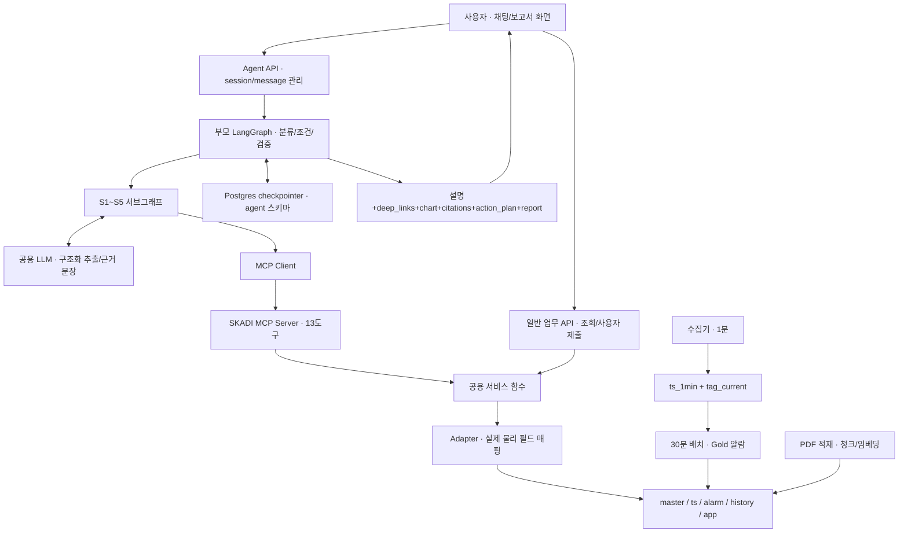
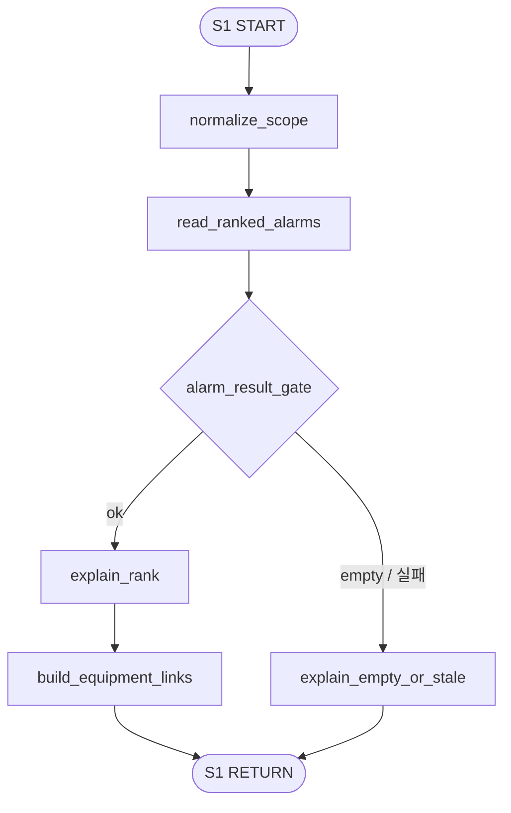
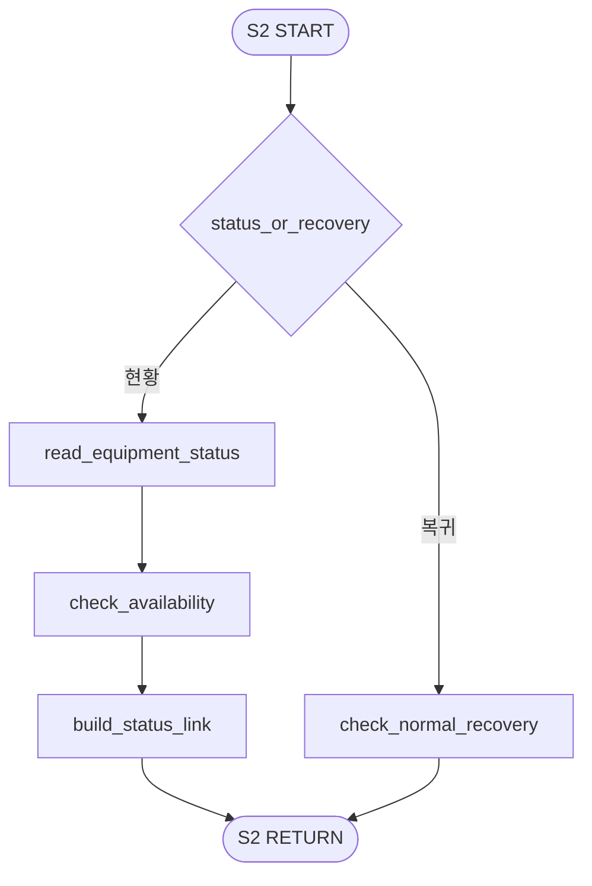
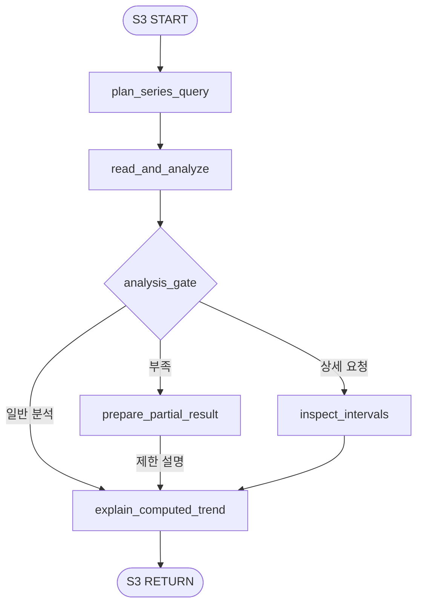
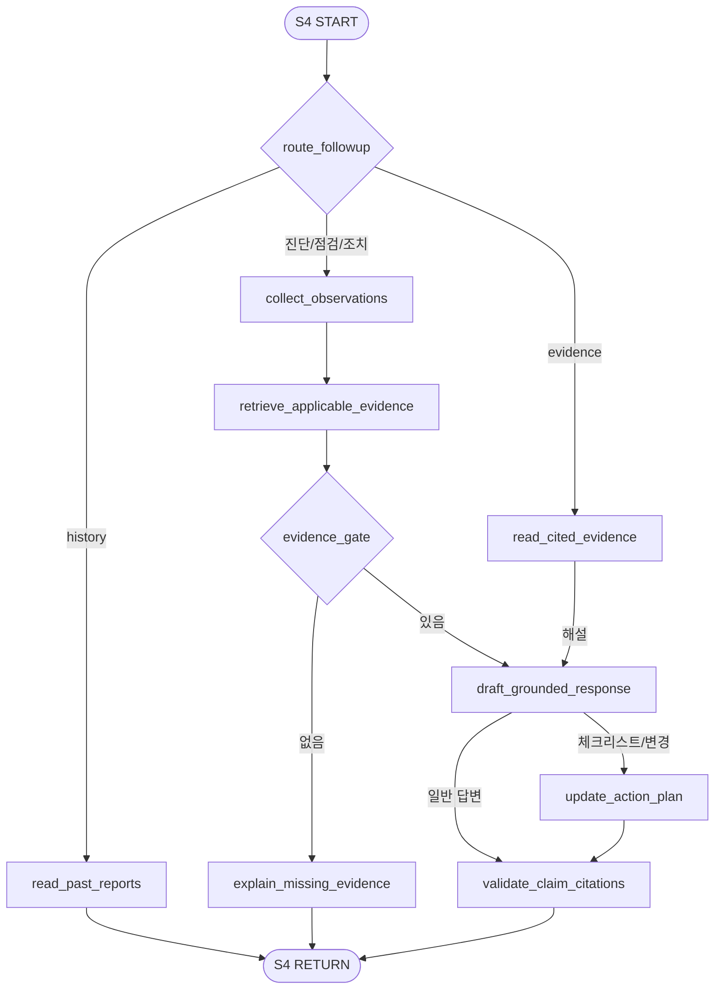
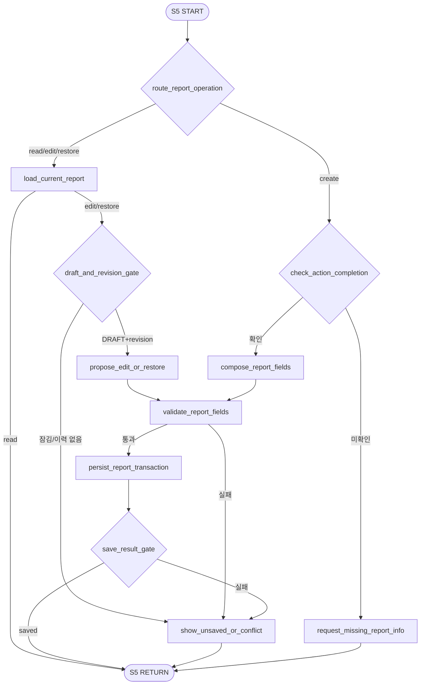

# SKADI AI Agent — LangGraph 흐름과 MCP 도구 설계 v2

기준: 요구사항정의서 **1111 탭**, DB 테이블 정의서 **v1.3**, 데모 데이터 **v1.3**. 작성: 2026-11-12.

이 문서는 이전 설계초안을 대체하는 **구현 설계안**이다. 요구사항/DB의 확정 내용, 이 문서의 구현 제안, 현재 파일로 검증한 결과를 구분한다. 원본 Excel은 수정하지 않았다. 참조 도구는 Excel에서 읽은 고정 데이터를 사용해 로컬에서 실행했다. 실제 LLM·MCP 서버·PostgreSQL 연결을 완성했다는 뜻은 아니다.

## 1. 설계의 출발점

### 사용자에게 제공할 경험

S1 알람 집계 → S2 설비 현황 → S3 추이 → S4 원인·점검·조치 → S5 보고서라는 업무 묶음을 유지한다. 한 질문에 업무 하나를 실행하며, S4에는 근거 설명·과거 보고서·체크리스트·현장 재진단을, S5에는 생성·조회·수정·복원을 추가한다. 이것은 매번 S1부터 S5까지 자동 실행하는 파이프라인이 아니다.

### 이번 자료로 확정되는 변경

- 물리 설비 키는 `equip_id`. `equip_name`, `equipment_alias`, `alarm_history`, `alarm_setpoint`, `priority_matrix`에 의존하지 않는다.
- 알람은 `alarm.alarm_detail`의 **설비 1대 × 30분 구간 1행**이다. 우선순위는 `equip_grade_score × 10 + severity_score`.
- 센서 판정은 `ts.ts_1min`, 현재 화면 값은 `ts.tag_current`, 차트는 기간별 집계 테이블을 사용한다.
- `tag_current.quality`, 보고서 `version`·`action_status`·`recommended_action` 등 삭제 필드를 있는 것처럼 사용하지 않는다.
- S5 신규 생성은 사용자의 조치 완료 확인 이후. 보고서는 `DRAFT / CONFIRMED`, 최종 제출은 사용자 화면 동작이다.
- 기존 보고서 18필드만으로 이전 버전 복원은 불가능하므로 **수정 이력 테이블을 추가 제안**한다.

### 문서 우선순위와 충돌 처리

업무 행동은 1111의 요구사항 설명(H열)을 기준으로 한다. 물리 필드는 v1.3 상세의 사용 표시를 기준으로 하고, 실제 샘플은 데모 파일을 기준으로 한다. G열 설명 일부는 이전 시나리오의 문구와 맞지 않는다. 요구사항·DB 충돌은 §12에 남기며, 제안 값을 확정 정책으로 둔갑시키지 않는다.

## 2. 전체 구조





| 구성요소 | 담당·실행 위치 | 역할 |
| --- | --- | --- |
| Agent API | 백엔드 | 로그인 사용자·session 소유권, 메시지 멱등 접수, 중지, 응답 저장 |
| LangGraph 노드 | AI팀 / Agent 서버 | 업무 분기, 상태, 필요한 도구 호출, 검증 |
| LLM | 모델 추론 서비스 | 의도/기간/현장 관측 추출, 근거를 사용한 문장. 숫자/우선순위 계산 안 함 |
| MCP Server | AI팀 / 별도 프로세스 또는 동일 호스트 | 13개 계약을 노출. 서비스를 호출하는 접점 |
| 서비스·Adapter | AI/백엔드 공용 코드 | 고정 SQL/계산/저장. 화면과 챗봇이 같은 결과 사용 |
| 수집기·30분 배치 | 백엔드 데이터 작업 | 센서 판정·Gold 생성. 사용자 대화 밖에서 실행 |
| 프론트 | 사용자 브라우저 | 차트·모달·문서·체크리스트 표시, 최종 제출 |
| checkpointer | Agent 서버 + PostgreSQL | 각 노드 상태 저장. 테이블은 saver가 관리, 수동 INSERT 금지 |


## 3. 큰 LangGraph

### 부모 그래프

```mermaid
flowchart TD
    start(["START"])
    load["load_context"]
    classify["classify_request"]
    scope{"scope_gate"}
    guide["role_or_change_guide"]
    resolve["resolve_context"]
    ready{"context_gate"}
    ask["clarify"]
    dispatch{"route_to_feature"}
    s1["S1 · 알람 집계"]
    s2["S2 · 설비 현황"]
    s3["S3 · 트렌드 분석"]
    s4["S4 · 원인·해결"]
    s5["S5 · 보고서"]
    validate["validate_result"]
    result_gate{"result_gate"}
    commit["commit_context"]
    respond["respond_and_persist"]
    end(["END"])
    start --> load
    load --> classify
    classify --> scope
    scope -->|"무관 / 변경"| guide
    scope -->|"복수 / 모호"| ask
    scope -->|"지원 하나"| resolve
    resolve --> ready
    ready -->|"부족 / 확인 필요"| ask
    ready -->|"확정"| dispatch
    dispatch -->|"S1"| s1
    dispatch -->|"S2"| s2
    dispatch -->|"S3"| s3
    dispatch -->|"S4"| s4
    dispatch -->|"S5"| s5
    s1 --> validate
    s2 --> validate
    s3 --> validate
    s4 --> validate
    s5 --> validate
    validate --> result_gate
    result_gate -->|"needs_input"| ask
    result_gate -->|"검증/제한 결과"| commit
    commit --> respond
    ask --> respond
    guide --> respond
    respond --> end
```

### 노드별 기능·입출력

| 노드 | 누가 / 어디서 | Input | Output | MCP 도구 | State 기록 |
| --- | --- | --- | --- | --- | --- |
| START | 그래프 실행 경계 / Agent 백엔드 · LangGraph 런타임 | 검증된 session_id, message_id, question | 실행 시작 | 없음 | 없음 |
| load_context | AI 개발자가 작성한 Python 함수 / Agent 백엔드 · LangGraph 런타임 | session_id=thread_id, 질문 ID | checkpoint state + 이번 turn 초기화 | 없음 | request, _turn |
| classify_request | 노드 함수가 호출하는 공용 LLM / Agent 백엔드 → LLM 추론 서비스 | 질문, pending_question, 현재 선택 | request_type, intent, operation, mentions, time_range | 없음 | request |
| scope_gate | 상태를 읽는 조건 함수 / Agent 백엔드 · 조건부 edge | 분류 결과 | 지원·모호·무관·운영 변경 경로 | 없음 | 없음 |
| role_or_change_guide | AI 개발자가 작성한 Python 함수 / Agent 백엔드 · LangGraph 런타임 | 무관/설비 변경 요청 | 가능 업무 안내 | 없음 | _turn.response |
| resolve_context | 노드 코드 + MCP Client + 서비스 함수 / Agent 백엔드 → MCP Server → DB/API Adapter | 대상 표현, 보류 질문, 기간 | 후보/검증된 설비·태그/기간/보고서 대상 | resolve_equipment, list_equipment_tags, get_report_draft | selected_equipment, selected_tag, time_range |
| context_gate | 상태를 읽는 조건 함수 / Agent 백엔드 · 조건부 edge | 필수 조건, 선택 확인 여부 | ready / needs_input | 없음 | 없음 |
| clarify | AI 개발자가 작성한 Python 함수 / Agent 백엔드 · LangGraph 런타임 | 후보 또는 빠진 조건 | 질문, 최대 3개 후보 | 없음 | pending_question |
| route_to_feature | 상태를 읽는 조건 함수 / Agent 백엔드 · 조건부 edge | intent=S1…S5 | 서브그래프 하나 호출 | 없음 | 없음 |
| S1 · 알람 집계 | 노드 코드 + MCP Client + 서비스 함수 / Agent 백엔드 → MCP Server → DB/API Adapter | scope, limit, sort | 순위·근거·링크 | summarize_unresolved_alarms | _turn.result |
| S2 · 설비 현황 | 노드 코드 + MCP Client + 서비스 함수 / Agent 백엔드 → MCP Server → DB/API Adapter | equip_id, tag_id?, operation | 현재값·화면 링크/복귀 상태 | get_equipment_status, check_recovery | _turn.result |
| S3 · 트렌드 분석 | 노드 코드 + MCP Client + 서비스 함수 / Agent 백엔드 → MCP Server → DB/API Adapter | equip_id, tag_id, start/end | 차트·기준선·구간·해석 | analyze_sensor_trend, get_abnormal_interval_detail | _turn.result |
| S4 · 원인·해결 | 노드 함수가 호출하는 공용 LLM / Agent 백엔드 → LLM 추론 서비스 | 관측, 현장 정보, operation | 근거 원인·점검·체크리스트 | search_knowledge, get_document_evidence, list_equipment_reports | _turn.result |
| S5 · 보고서 | 노드 함수가 호출하는 공용 LLM / Agent 백엔드 → LLM 추론 서비스 | operation=create/edit/restore/read | 저장 결과 / 조회 결과 / 추가 질문 | get_report_draft, save_report_draft, revise_report_draft | _turn.result |
| validate_result | AI 개발자가 작성한 Python 함수 / Agent 백엔드 · LangGraph 런타임 | 서브그래프 결과·출처·수치 | validated / partial / needs_input | get_document_evidence | _turn.validation |
| result_gate | 상태를 읽는 조건 함수 / Agent 백엔드 · 조건부 edge | 검증 상태·서브그래프 needs_input | 추가 질문 / 검증·제한 응답 | 없음 | 없음 |
| commit_context | AI 개발자가 작성한 Python 함수 / Agent 백엔드 · LangGraph 런타임 | 검증된 필드와 결과 상태 | 맥락 병합·기억 | 없음 | contexts, pending_question, action_plan |
| respond_and_persist | AI 개발자가 작성한 Python 함수 / Agent 백엔드 · LangGraph 런타임 | 답변·deep_links·citations·UI payload | chat_message 완료 갱신, UI 응답 | 없음 | _turn.response |
| END | 그래프 실행 경계 / Agent 백엔드 · LangGraph 런타임 | 응답 또는 질문 | 다음 사용자 입력 대기 | 없음 | 없음 |


### 분류 결과 계약

`request_type`은 `supported / multiple / ambiguous / unrelated / unsupported_change`. `intent`는 `S1..S5 | null`. `operation`은 아래 표의 값이다. `mentions`에 설비 표현·센서 표현·시설 범위·보고서 지시를, `time_range`에는 해석 전 표현과 정규화 결과를 분리한다. LLM 출력은 스키마 검사 후 사용하며 파싱 실패는 1회 재요청, 그래도 실패하면 되묻는다. 분류의 확신 수치를 진실의 확률로 해석하지 않는다.


| intent | operation | 필수 조건 |
| --- | --- | --- |
| S1 | summary | Unit/기본 담당 그룹 범위; 설비 선택 불필요 |
| S2 | status / recovery | 확정 equip_id; recovery는 tag_id·조치 후 시각·N |
| S3 | trend / interval_detail | equip_id+tag_id+start/end+resolution |
| S4 | diagnose / rediagnose / inspect / action / risk / evidence / history / checklist / update_checklist | equip_id; 선택 원인/구간/출처는 작업별 필요 |
| S5 | create / read / edit / restore | create: 설비·조치 완료 확인. 나머지: report_id. edit/restore: DRAFT·revision 이력 |


**되묻기:** `pending_question={intent,operation,candidates,missing_fields,question_message_id}`를 저장하고 END. 다음 입력은 새 invoke에서 이전 보류 질문의 답인지 먼저 해석한다. 명백한 새 요청이면 보류를 해제한다. “현황도 보고 원인도”는 우선할 기능을 묻는다. “원인과 조치”는 S4 내부 한 업무로 처리할 수 있다.

**대상 확인:** 정확한 ID 또는 사용자가 누른 후보 ID는 검증 후 확정한다. 자연어로 찾은 후보는 한 개여도 S2에서 확인 질문한다. “2호기 압축기”에서 `C-2100`을 추측하지 않는다. 실제 데이터에는 호기 번호가 없다.

**실패·중지:** 각 외부 호출은 timeout을 두고 읽기 일시 오류만 제한 재시도한다. 중지 요청은 `chat_message.answer_status=stopping`을 서버가 기록하고 노드 경계·외부 호출 취소로 `stopped`를 확정한다. 이미 커밋된 보고서 저장은 중지로 자동 롤백되었다고 말하지 않는다. 재시작 시 같은 질문 ID와 저장 이력을 조회해 중복 저장을 막는다.

## 4. 세션에 무엇을 기억할 것인가

아래는 **Graph State 제안**이다. 같은 이름의 DB 컬럼이 존재한다는 뜻이 아니다. `session_id=thread_id`, 요청 식별자는 질문의 `message_id`를 재사용한다.
| State 필드 | 형태 | 작성 주체 | 규칙 |
| --- | --- | --- | --- |
| session_id | chat_session.session_id = configurable.thread_id | API | 대화별 체크포인트 키 |
| request | message_id, question, request_type, intent, operation | load/classify | 이번 턴마다 초기화. 재전송 message_id는 동일 |
| selected_equipment | equip_id, equip_type, equip_model, hierarchy, confirmed_by | resolve_context | 명시 대상 우선. 후보 확인 전 변경 금지 |
| selected_tag | tag_id, sensor_type, unit | resolve_context | 새 설비 선택 시 무효화 |
| time_range | start,end,resolution,as_of,timezone | resolve/plan_series | 범위 바뀌면 이전 분석 결과 유효성 재검사 |
| pending_question | intent,operation,candidates,missing_fields,question_message_id | clarify | 다음 답변을 보류 요청과 연결. 새로운 업무 전환 시 해제 |
| alarm_context | scope, representative_alarm_ids, rank, watermark | commit_context | S1 결과이며 대상 자동 선택 아님 |
| status_context | equip_id, sensor snapshots, measured_at, freshness | commit_context | 현재값과 알람 배치 시각 분리 |
| trend_context | equip_id,tag_id,range,summary,chart payload/ref,status | commit_context | 부분 결과는 partial/unknown 보존. 다른 대상에 재사용 금지 |
| observations | field_observations[{text,message_id,reported_at,source}] | S4 | 사용자 관측과 센서·과거 문서를 구분 |
| evidence_context | chunk_ids,source_ids,pages,applicability | S4/commit | 본문 대량 배열 대신 확인 출처 중심 |
| diagnosis_context | candidate_id,cause,supports,counter_evidence,citations | S4/commit | 원인 후보 최대5. 관측 변경 시 재진단 |
| action_plan | items[{item_id,cause_id,text,status,source_message_id,citations}] | S4 | checkpoint 값. 설비 제어 상태·DB action_status 아님 |
| action_completion | confirmed,user_message_id,performed_action,action_result | S5 gate | 실제 조치 완료 확인. 효과 확인은 별도 |
| report_context | report_id,revision_no,status,saved,source_message_id | S5 persist | revision_no는 제안 확장 테이블의 값, 기존 DB 컬럼 아님 |
| _turn | query,tool_results,validation,warnings,response | 각 노드 | 임시 실행 값도 checkpoint에는 기록. 다음 load에서 초기화 |
| ui_context | chart payload/ref,action_plan,clarification,report | respond | chat_message에 없는 구조화 UI 복원용. 화면 새로고침 시 서버가 checkpoint에서 제공 |


### 상태 불변조건

1. 설비가 바뀌면 선택 태그·관측·추세·근거·진단·체크리스트·완료 확인을 현재 대상에서 분리한다. 저장된 보고서는 삭제하지 않는다.
2. `trend_context`에는 대상·기간·해상도·자료 시각·status가 필요하다. 같은 태그라는 이유만으로 다른 기간 결과를 사용하지 않는다.
3. `commit_context`는 검증한 업무 결과를 채택한다. 실제 checkpointer는 중간 노드에서도 State를 기록하므로 “검증 전 아무것도 저장 안 됨”은 아니다.
4. 부분 결과도 확인된 값은 `partial` 표지와 보존할 수 있다. `unknown`을 정상/안정으로 바꾸지 않는다.
5. 새 대화는 새 session_id. 기존 대화·보고서·revision은 유지한다. 부모·서브그래프는 동일 체크포인트 실행 구조를 사용하고 임의의 새 대화 키를 만들지 않는다.

## 5. MCP 도구 13개 — 실제 필드와 입출력

### 공통 계약

모든 도구는 `inputSchema`와 구조화 결과를 정의한다. 프로젝트 결과 봉투는 MCP 프로토콜 자체의 필수 필드와 구분한다. 반환 `status`: `ok / empty / ambiguous / needs_input / insufficient_data / policy_required / schema_gap / conflict / error`. 실행 오류는 MCP `isError=true`와 오류 코드로 전달하고, 빈 조회/자료 부족은 정상 도구 응답의 도메인 상태로 전달한다.

서버가 주입하는 값: 인증 사용자, 검증된 session_id, 질문 message_id, 요청 as_of. 사용자·LLM이 임의의 작성자·다른 세션을 정하지 않는다. 시간은 API에서 offset 포함 ISO 8601로 통일. `limit` 1~100(기본10), `top_k` 1~20(기본5), `chunk_ids` 1~20, resolution은 허용 enum만 수락하는 **구현 제안**이다. 동적 SQL 테이블 이름은 enum에서 코드가 매핑한다.

```json
{
  "status": "ok",
  "data": {},
  "warnings": [],
  "meta": {
    "data_mode": "xlsx_fixture | live",
    "schema_version": "v1.3",
    "policy_version": "V1.0",
    "as_of": "2026-11-10T11:05:00+09:00",
    "timezone": "Asia/Seoul"
  }
}
```


도구 함수의 숫자·조회 결과는 참조 코드로 실행했다. Graph의 LLM 호출과 실제 MCP transport는 후속 구현 범위다. 새 도구 수는 서버/에이전트 수를 뜻하지 않는다.


### 1. `resolve_equipment` — 설비 후보 해석

변경: resolve_asset → 물리 키 equip_id 사용. 실행: MCP Server → 공용 서비스 함수 → DB/API Adapter. 쓰기: 없음.


입력 JSON Schema 초안:
```json
{
  "type": "object",
  "properties": {
    "query": {
      "type": "string"
    },
    "unit_id": {
      "type": "string"
    }
  },
  "required": [
    "query"
  ],
  "additionalProperties": false
}
```


출력 `data` 필드: `match_status`, `candidates[{equip_id,equip_type,equip_model,process_name,hierarchy,match_reason,requires_confirmation}]`.


| 실제 테이블 | 사용 컬럼 |
| --- | --- |
| equipment | equip_id, equip_type, equip_model, process_name, is_used |
| facility_hierarchy | facility_id, name, level, parent_id |


처리 순서:

1. ID 정확 일치 우선. 계층 Unit/UnitGroup 범위 안의 활성 설비로 후보 제한.
2. 설비 유형 동의어는 코드 사전으로 정규화. 문자 유사도 임계값은 설정 합의 후 적용. 최대 3개만 반환.
3. 호기·별칭 자료가 없으면 미확정. 자연어로 찾은 단일 후보도 S2에서는 확인 질문.

예외: empty, ambiguous, invalid_hierarchy.

근거: 1111 H20:H21; DB 설비 기본정보 17:37; 시설 계층 17:20.


### 2. `list_equipment_tags` — 설비의 실제 태그

변경: list_asset_tags → list_equipment_tags. 실행: MCP Server → 공용 서비스 함수 → DB/API Adapter. 쓰기: 없음.


입력 JSON Schema 초안:
```json
{
  "type": "object",
  "properties": {
    "equip_id": {
      "type": "string"
    },
    "sensor_type": {
      "type": "string",
      "enum": [
        "VIBRATION",
        "TEMPERATURE",
        "PRESSURE",
        "SPEED"
      ]
    }
  },
  "required": [
    "equip_id"
  ],
  "additionalProperties": false
}
```


출력 `data` 필드: `tags[설비 태그의 사용 필드 12개]`.


| 실제 테이블 | 사용 컬럼 |
| --- | --- |
| equipment_tag | equip_id, tag_id, unit, delay_yn, is_used, alarm_hi, alarm_lo, trip_hi, trip_lo, sensor_type, soft_consec_cnt, trip_consec_cnt |


처리 순서:

1. equip_id·is_used로 조회. sensor_type은 VIBRATION/TEMPERATURE/PRESSURE/SPEED.
2. 0개면 없는 센서 안내, 여러 개면 tag_id 선택. drive_side/location은 삭제되어 조회하지 않음.

예외: empty, ambiguous.

근거: DB 설비 태그 17:41.


### 3. `get_equipment_status` — 현재값·최근 알람

변경: get_asset_status 변경; quality 제거. 실행: MCP Server → 공용 서비스 함수 → DB/API Adapter. 쓰기: 없음.


입력 JSON Schema 초안:
```json
{
  "type": "object",
  "properties": {
    "equip_id": {
      "type": "string"
    },
    "as_of": {
      "type": "string",
      "format": "date-time"
    }
  },
  "required": [
    "equip_id",
    "as_of"
  ],
  "additionalProperties": false
}
```


출력 `data` 필드: `equipment`, `hierarchy`, `sensors[{tag,current,classification,age_seconds,freshness,quality_status}]`, `missing_sensor_types`, `recent_alarms`.


| 실제 테이블 | 사용 컬럼 |
| --- | --- |
| equipment | equip_id, equip_type, equip_model, is_running, is_used, process_name |
| equipment_tag | equip_id, tag_id, sensor_type, unit, alarm_hi, alarm_lo, trip_hi, trip_lo |
| tag_current | tag_id, equip_id, tag_desc, eng_unit, current_value, measured_at |
| ts_1min | tag_id, measured_at, limit_kind, abnormal_level, severity_score |
| alarm_detail | equip_id, alarm_id, window_end, is_resolved, tag_id, measured_val |


처리 순서:

1. 현재값은 태그별 최신 UPSERT 행. 동일 tag_id+measured_at의 1분 판정을 연결. 일치 행이 없으면 판정 미확인.
2. age_seconds 계산. 300초 stale 기준은 제안 설정. 단위 불일치 시 계산하지 않음.
3. 최근 알람에는 해결된 과거 행도 포함. 현재 상태와 미해결 누적 알람을 섞지 않음.

예외: empty, insufficient_data, unit_mismatch.

근거: 1111 H7:H11,H20; DB 태그 현재값 17:23.


### 4. `summarize_unresolved_alarms` — 미처리 설비별 대응 순서

변경: summarize_setpoint_alarms 교체; 누적 Gold 조회. 실행: MCP Server → 공용 서비스 함수 → DB/API Adapter. 쓰기: 없음.


입력 JSON Schema 초안:
```json
{
  "type": "object",
  "properties": {
    "unit_id": {
      "type": "string"
    },
    "limit": {
      "type": "integer",
      "minimum": 1,
      "maximum": 100
    },
    "sort": {
      "type": "string",
      "enum": [
        "priority",
        "latest"
      ]
    },
    "as_of": {
      "type": "string",
      "format": "date-time"
    }
  },
  "required": [
    "as_of"
  ],
  "additionalProperties": false
}
```


출력 `data` 필드: `items[{equip_id,rank,representative_alarm,unit,unresolved_window_count,latest_abnormal_at,score_formula}]`, `total_equipment`, `unresolved_window_count`, `last_updated`, `last_run_id`.


| 실제 테이블 | 사용 컬럼 |
| --- | --- |
| alarm_detail | alarm_id, equip_id, window_start, window_end, severity_score, equip_grade_score, priority_score, tag_id, sensor_type, limit_kind, limit_val, measured_val, measured_at, first_abnormal_at, is_resolved |
| alarm_poll_run | run_id, window_end, status, finished_at |
| equipment_tag | tag_id, unit |
| facility_hierarchy | facility_id, level, parent_id |


처리 순서:

1. SUCCESS 및 finished_at≤as_of인 마지막 배치 watermark 확인. default 최근 12/24h 필터 없음.
2. is_resolved=false를 설비별로 모아 priority_score DESC, first_abnormal_at ASC, alarm_id 순 대표 선택.
3. 설비 목록은 대표 priority_score DESC → 대표 first_abnormal_at ASC → equip_id. 등급점수×10+심각도 점수 검증.
4. rank는 범위 내 전체 목록에서 먼저 계산. latest 정렬·limit=1·10건 페이지에도 rank 유지. window 수는 사건 횟수가 아님.

예외: empty, insufficient_data, priority_score mismatch.

근거: 1111 H2:H4,H19; DB 알람 상세정보 C5:C11,18:32.


### 5. `analyze_sensor_trend` — 시계열·기준선·추세

변경: 입출력 구체화; 규칙 미정은 명시. 실행: MCP Server → 공용 서비스 함수 → DB/API Adapter. 쓰기: 없음.


입력 JSON Schema 초안:
```json
{
  "type": "object",
  "properties": {
    "equip_id": {
      "type": "string"
    },
    "tag_id": {
      "type": "string"
    },
    "start": {
      "type": "string",
      "format": "date-time"
    },
    "end": {
      "type": "string",
      "format": "date-time"
    },
    "resolution": {
      "type": "string",
      "enum": [
        "1min",
        "10min",
        "1hour",
        "1day"
      ]
    },
    "as_of": {
      "type": "string",
      "format": "date-time"
    }
  },
  "required": [
    "equip_id",
    "tag_id",
    "start",
    "end",
    "resolution",
    "as_of"
  ],
  "additionalProperties": false
}
```


출력 `data` 필드: `source_table`, `equip_id`, `tag_id`, `start`, `end`, `resolution`, `points[]`, `limits`, `summary{min,max,unit,direction,slope_per_hour,valid_points,expected_points,coverage}`, `highlights[]`, `analysis_policy`, `statistical_outliers`.


| 실제 테이블 | 사용 컬럼 |
| --- | --- |
| ts_1min | tag_id, equip_id, measured_at, value, limit_kind, abnormal_level, severity_score |
| ts_10min | tag_id, equip_id, agg_at, avg_val, min_val, max_val, status, eng_unit |
| ts_1hour | tag_id, equip_id, agg_at, avg_val, min_val, max_val, std_val, status, eng_unit |
| ts_1day | tag_id, equip_id, agg_date, avg_val, min_val, max_val, eng_unit |
| equipment_tag | tag_id, unit, alarm_hi, alarm_lo, trip_hi, trip_lo |


처리 순서:

1. 기간 미지정은 최근 12시간. 7일은 1hour, 급등 상세는 10min, 정확 표본 구간은 1min, 장기는 1day. 허용 테이블을 코드로 선택.
2. [start,end), 집계는 bucket_end≤min(end,as_of), 시간순 정렬. NULL·품질·단위·누락 검사.
3. 한 점은 추세가 아님. 제안 trend-v1에만 OLS 방향 적용. max(max_val), min(min_val); std_val을 시간 간 변화의 표준편차로 오용하지 않음.
4. 집계 초과 박스는 “구간 내 초과 존재”. 실제 초과 지속시간은 1분 표본으로 별도 확인. statistical_outlier와 Setpoint를 구분.

예외: empty, insufficient_data, invalid_time_range, tag_equip_mismatch, quality_unknown.

근거: 1111 H10:H11,H22,G36:G38; DB 시계열 각 상세.


### 6. `get_abnormal_interval_detail` — 이상 구간과 앞뒤 15분

변경: 신규: 박스·지속시간·상세 모달 대응. 실행: MCP Server → 공용 서비스 함수 → DB/API Adapter. 쓰기: 없음.


입력 JSON Schema 초안:
```json
{
  "type": "object",
  "properties": {
    "equip_id": {
      "type": "string"
    },
    "tag_id": {
      "type": "string"
    },
    "start": {
      "type": "string",
      "format": "date-time"
    },
    "end": {
      "type": "string",
      "format": "date-time"
    }
  },
  "required": [
    "equip_id",
    "tag_id",
    "start",
    "end"
  ],
  "additionalProperties": false
}
```


출력 `data` 필드: `intervals[{sample_start,sample_end,abnormal_samples,sampled_duration_minutes,continuous_duration_minutes,left_censored,right_censored,display_start,display_end}]`, `observed_group_count`, `points[]`.


| 실제 테이블 | 사용 컬럼 |
| --- | --- |
| ts_1min | equip_id, tag_id, measured_at, value, limit_kind, abnormal_level, severity_score |


처리 순서:

1. 인접 1분 표본의 abnormal_level>0을 묶고 시간 간격이 1분을 넘으면 구간 분리.
2. 시작 전·끝 후 정상 표본이 없으면 censored. 결측 사이를 연결하지 않고 지속시간 NULL.
3. 앞뒤 15분 표시 범위와 이전/다음 구간 ID는 동일 조건의 결과에서 생성. SQL로 표시 범위를 별도 조회.

예외: insufficient_data, empty.

근거: 1111 H10:H11.


### 7. `search_knowledge` — 사례·매뉴얼·외부 자료 검색

변경: source_types 추가, 실제 FK 적용. 실행: MCP Server → 공용 서비스 함수 → DB/API Adapter. 쓰기: 없음.


입력 JSON Schema 초안:
```json
{
  "type": "object",
  "properties": {
    "equip_id": {
      "type": "string"
    },
    "query": {
      "type": "string"
    },
    "source_types": {
      "type": "array",
      "items": {
        "type": "string",
        "enum": [
          "manual",
          "case",
          "external"
        ]
      },
      "minItems": 1,
      "uniqueItems": true
    },
    "top_k": {
      "type": "integer",
      "minimum": 1,
      "maximum": 20
    }
  },
  "required": [
    "equip_id",
    "query"
  ],
  "additionalProperties": false
}
```


출력 `data` 필드: `hits[{chunk_id,source_type,source_id,title,content,page_start,page_end,pdf_url,revision,case_cause_status,retrieval_score,score_kind}]`, `retrieval_mode`, `query`.


| 실제 테이블 | 사용 컬럼 |
| --- | --- |
| rag_chunk | chunk_id, source_type, case_doc_id, manual_doc_id, reference_doc_id, content, page_start, page_end, embedding, is_eval |
| equipment_manual | doc_id, equip_id, equip_types, applicable_models, pdf_url, revision, title |
| equipment_case | doc_id, equip_id, cause_status, symptom, cause_description, performed_action, action_result, title, pdf_url |
| technical_reference | doc_id, equip_types, reference_type, title, pdf_url, source_url |


처리 순서:

1. is_eval=false·source_type 필터를 ranking/LIMIT 전에 적용. FK 3개 중 하나로 원문 연결.
2. manual은 equip_id 및 유형·모델 적용 조건 확인. case는 먼저 같은 설비, 다른 설비 확장은 명시적 설정 후 적용.
3. 현재 데모는 키워드 검색. 운영은 동일 모델·차원 pgvector + 텍스트 검색 후 순위화. 점수는 고장 확률 아님.
4. 최대 5개 원인은 근거가 있는 만큼만. 2개 청크를 5개 원인으로 부풀리지 않음.

예외: empty, insufficient_data, embedding_not_ready.

근거: 1111 H23:H26; DB RAG 청크 18:28.


### 8. `get_document_evidence` — 인용 본문·페이지 재확인

변경: 신규: 근거 후속 질문·인용 검증. 실행: MCP Server → 공용 서비스 함수 → DB/API Adapter. 쓰기: 없음.


입력 JSON Schema 초안:
```json
{
  "type": "object",
  "properties": {
    "chunk_ids": {
      "type": "array",
      "items": {
        "type": "string"
      },
      "minItems": 1,
      "maxItems": 20,
      "uniqueItems": true
    }
  },
  "required": [
    "chunk_ids"
  ],
  "additionalProperties": false
}
```


출력 `data` 필드: `evidence[{chunk_id,source_type,source_id,page_start,page_end,content,pdf_url,pdf_verified}]`.


| 실제 테이블 | 사용 컬럼 |
| --- | --- |
| rag_chunk | chunk_id, source_type, case_doc_id, manual_doc_id, reference_doc_id, content, page_start, page_end, is_eval |
| equipment_manual | doc_id, pdf_url |
| equipment_case | doc_id, pdf_url |
| technical_reference | doc_id, pdf_url |


처리 순서:

1. 후속 “근거 자세히” 요청이나 최종 검증에서 저장된 ID를 재조회.
2. source_id·유형·페이지와 청크 소속 일치 검사. eval 자료 차단.
3. pdf_url+#page=N은 서비스 공통 링크 함수에서 생성. 실파일 미제공은 별도 표시.

예외: invalid_or_eval_citation, empty.

근거: 1111 H23,H25:H26; DB RAG 청크 C9:C13.


### 9. `list_equipment_reports` — 설비 과거 보고서 조회

변경: 신규: 과거 보고서 딥링크. 실행: MCP Server → 공용 서비스 함수 → DB/API Adapter. 쓰기: 없음.


입력 JSON Schema 초안:
```json
{
  "type": "object",
  "properties": {
    "equip_id": {
      "type": "string"
    }
  },
  "required": [
    "equip_id"
  ],
  "additionalProperties": false
}
```


출력 `data` 필드: `reports[maintenance_report 18개 필드]`, `sort_policy`.


| 실제 테이블 | 사용 컬럼 |
| --- | --- |
| maintenance_report | report_id, session_id, equip_id, report_title, occurred_at, symptom, incident_type, incident_grade, cause_subcategory, cause_description, performed_action, action_result, chart_url, remaining_risk, citations, status, created_by, confirmed_at |


처리 순서:

1. 설비 ID로 한정하고 발생일 DESC NULLS LAST, report_id로 안정 정렬. API 확장 시 10건 페이지/Unit·발생일 필터.
2. DRAFT/CONFIRMED 표시. 목록 화면의 “내 보고서”는 created_by를 서버에서 추가.
3. 보고서를 RAG 근거로 자동 편입하지 않음. 현재 스키마에는 보고서 eval 구분 없음.

예외: empty.

근거: 1111 H9,H12,H23.


### 10. `get_report_draft` — 현재 보고서와 수정 이력

변경: 기존 도구 확장: revision은 추가 테이블. 실행: MCP Server → 공용 서비스 함수 → DB/API Adapter. 쓰기: 없음.


입력 JSON Schema 초안:
```json
{
  "type": "object",
  "properties": {
    "report_id": {
      "type": "string"
    }
  },
  "required": [
    "report_id"
  ],
  "additionalProperties": false
}
```


출력 `data` 필드: `report[maintenance_report 18개 필드]`, `revisions[]`, `revision_storage`.


| 실제 테이블 | 사용 컬럼 |
| --- | --- |
| maintenance_report | report_id, session_id, equip_id, report_title, occurred_at, symptom, incident_type, incident_grade, cause_subcategory, cause_description, performed_action, action_result, chart_url, remaining_risk, citations, status, created_by, confirmed_at |


처리 순서:

1. report_id로 현재 문서를 조회, status·session_id·equip_id를 확인.
2. revisions는 제안 확장 테이블의 snapshot 목록. 없으면 이력을 꾸며내지 않음.

예외: empty, schema_gap.

근거: 1111 H12:H14,H27; DB 정비 보고서 18:41.


### 11. `save_report_draft` — 조치 완료 확인 후 초안 저장

변경: 실제 18필드로 재구성; 확장 적용 전은 설계 계약. 실행: MCP Server → 공용 서비스 함수 → DB/API Adapter. 쓰기: 보고서와 제안 revision 저장소만.


입력 JSON Schema 초안:
```json
{
  "type": "object",
  "properties": {
    "report": {
      "type": "object",
      "properties": {
        "report_id": {
          "type": "string",
          "description": "보고서 ID"
        },
        "session_id": {
          "type": "string",
          "description": "세션 ID"
        },
        "equip_id": {
          "type": "string",
          "description": "설비 ID"
        },
        "report_title": {
          "type": "string",
          "description": "보고서 제목"
        },
        "occurred_at": {
          "type": [
            "string",
            "null"
          ],
          "description": "발생 시각",
          "format": "date-time"
        },
        "symptom": {
          "type": "string",
          "description": "이상 현상"
        },
        "incident_type": {
          "type": "string",
          "description": "이상·사건 유형명"
        },
        "incident_grade": {
          "type": "string",
          "description": "영향 등급명"
        },
        "cause_subcategory": {
          "type": "string",
          "description": "원인 소분류명"
        },
        "cause_description": {
          "type": [
            "string",
            "null"
          ],
          "description": "원인 설명"
        },
        "performed_action": {
          "type": [
            "string",
            "null"
          ],
          "description": "실제 조치 내역"
        },
        "action_result": {
          "type": [
            "string",
            "null"
          ],
          "description": "조치 결과"
        },
        "chart_url": {
          "type": [
            "string",
            "null"
          ],
          "description": "첨부 차트"
        },
        "remaining_risk": {
          "type": [
            "string",
            "null"
          ],
          "description": "남은 리스크"
        },
        "citations": {
          "type": [
            "array",
            "null"
          ],
          "description": "근거 출처",
          "items": {
            "type": "object"
          }
        },
        "status": {
          "type": "string",
          "description": "문서 상태",
          "enum": [
            "DRAFT"
          ]
        },
        "created_by": {
          "type": "string",
          "description": "작성자 ID"
        },
        "confirmed_at": {
          "type": "null"
        }
      },
      "required": [
        "report_id",
        "session_id",
        "equip_id",
        "report_title",
        "symptom",
        "incident_type",
        "incident_grade",
        "cause_subcategory",
        "status",
        "created_by"
      ],
      "additionalProperties": false
    },
    "source_message_id": {
      "type": "string"
    },
    "action_completed": {
      "type": "boolean"
    }
  },
  "required": [
    "report",
    "source_message_id",
    "action_completed"
  ],
  "additionalProperties": false
}
```


출력 `data` 필드: `report_id`, `revision_no`, `status`, `persistence`, `schema_extension_required`.


| 실제 테이블 | 사용 컬럼 |
| --- | --- |
| maintenance_report | report_id, session_id, equip_id, report_title, occurred_at, symptom, incident_type, incident_grade, cause_subcategory, cause_description, performed_action, action_result, chart_url, remaining_risk, citations, status, created_by, confirmed_at |
| classification_code | code, category, name, parent_code |


처리 순서:

1. 서버가 session_id·created_by·report_id를 부여. action_completed는 사용자의 명시적 확인 메시지에서 나온 Graph 상태로 코드가 확인.
2. 분류명은 category별 name과 검증. 권장 조치·과거 사례 조치를 현재 performed_action에 복사 금지.
3. DRAFT만 INSERT, confirmed_at=NULL. 데이터와 revision 1을 한 트랜잭션으로 저장. source_message_id로 멱등성.

예외: needs_input, conflict, invalid_classification_name, invalid_citation, schema_gap.

근거: 1111 H27; DB 정비 보고서 18:41.


### 12. `revise_report_draft` — 초안 수정·이전 버전 복원

변경: update_report_draft → 수정/복원 통합. 실행: MCP Server → 공용 서비스 함수 → DB/API Adapter. 쓰기: 보고서와 제안 revision 저장소만.


입력 JSON Schema 초안:
```json
{
  "type": "object",
  "properties": {
    "report_id": {
      "type": "string"
    },
    "expected_revision": {
      "type": "integer",
      "minimum": 1
    },
    "source_message_id": {
      "type": "string"
    },
    "patch": {
      "type": "object",
      "properties": {
        "report_title": {
          "type": "string",
          "description": "보고서 제목"
        },
        "occurred_at": {
          "type": [
            "string",
            "null"
          ],
          "description": "발생 시각",
          "format": "date-time"
        },
        "symptom": {
          "type": "string",
          "description": "이상 현상"
        },
        "incident_type": {
          "type": "string",
          "description": "이상·사건 유형명"
        },
        "incident_grade": {
          "type": "string",
          "description": "영향 등급명"
        },
        "cause_subcategory": {
          "type": "string",
          "description": "원인 소분류명"
        },
        "cause_description": {
          "type": [
            "string",
            "null"
          ],
          "description": "원인 설명"
        },
        "performed_action": {
          "type": [
            "string",
            "null"
          ],
          "description": "실제 조치 내역"
        },
        "action_result": {
          "type": [
            "string",
            "null"
          ],
          "description": "조치 결과"
        },
        "chart_url": {
          "type": [
            "string",
            "null"
          ],
          "description": "첨부 차트"
        },
        "remaining_risk": {
          "type": [
            "string",
            "null"
          ],
          "description": "남은 리스크"
        },
        "citations": {
          "type": [
            "array",
            "null"
          ],
          "description": "근거 출처",
          "items": {
            "type": "object"
          }
        }
      },
      "additionalProperties": false,
      "minProperties": 1
    },
    "restore_revision": {
      "type": "integer",
      "minimum": 1
    }
  },
  "required": [
    "report_id",
    "expected_revision",
    "source_message_id"
  ],
  "additionalProperties": false,
  "oneOf": [
    {
      "required": [
        "patch"
      ],
      "not": {
        "required": [
          "restore_revision"
        ]
      }
    },
    {
      "required": [
        "restore_revision"
      ],
      "not": {
        "required": [
          "patch"
        ]
      }
    }
  ]
}
```


출력 `data` 필드: `report_id`, `revision_no`, `status`, `persistence`, `schema_extension_required`.


| 실제 테이블 | 사용 컬럼 |
| --- | --- |
| maintenance_report | report_id, session_id, equip_id, report_title, occurred_at, symptom, incident_type, incident_grade, cause_subcategory, cause_description, performed_action, action_result, chart_url, remaining_risk, citations, status, created_by, confirmed_at |


처리 순서:

1. patch 또는 restore_revision 중 정확히 하나. 현재 행 FOR UPDATE, DRAFT 확인, 최신 revision 대조.
2. 제목·증상·분류·설명·실제 조치·결과·출처 등을 검증한 뒤 UPDATE. ID·작성자·확정 상태 변경 불가.
3. 복원도 과거 snapshot을 새 revision으로 append. CONFIRMED는 수정·복원 모두 거부.
4. maintenance_report_revision 확장 없으면 schema_gap. 체크포인트 되감기로 DB를 복원하지 않음.

예외: conflict, schema_gap, immutable_fields, invalid_citation.

근거: 1111 H14,L14,H27; DB 정비 보고서 J37.


### 13. `check_recovery` — 조치 후 정상 복귀 확인

변경: 신규: 3차 스프린트 관측 도구. 실행: MCP Server → 공용 서비스 함수 → DB/API Adapter. 쓰기: 없음.


입력 JSON Schema 초안:
```json
{
  "type": "object",
  "properties": {
    "equip_id": {
      "type": "string"
    },
    "tag_id": {
      "type": "string"
    },
    "after": {
      "type": "string",
      "format": "date-time"
    },
    "required_consecutive": {
      "type": "integer",
      "minimum": 1
    }
  },
  "required": [
    "equip_id",
    "tag_id",
    "after"
  ],
  "additionalProperties": false
}
```


출력 `data` 필드: `returned_to_normal`, `consecutive_normal_samples`, `required`, `is_resolved_changed`.


| 실제 테이블 | 사용 컬럼 |
| --- | --- |
| ts_1min | equip_id, tag_id, measured_at, limit_kind |


처리 순서:

1. 사용자가 말한 조치 시각 이후 1분 표본을 조회. N은 별도 정책 설정.
2. 정상 연속 표본 중 결측·비정상이 끼면 카운트 초기화. 도구는 일회 조회.
3. is_resolved 업데이트·지속 예약·알림 발송은 별도 백엔드 작업. 현재 데모에는 후속 표본 없음.

예외: policy_required, insufficient_data.

근거: 1111 H29,G29.


### 도구로 만들지 않는 것

의도 분류·후속 질문 해석·원인 문장 생성·보고서 문장 생성은 Graph 노드. URL 문자열 생성은 공통 함수. 체크리스트 체크 상태는 Graph State. 로그인·대화 중지·초기화·사용자의 보고서 최종 제출은 일반 API. 센서 수집·알람 생성·알람 정비 처리 표시는 백엔드 작업이다. SQL 자유 실행·Setpoint 변경·설비 제어 도구는 제공하지 않는다.

## 6. S1~S5별 정확한 내부 LangGraph

아래 각 START/RETURN은 부모의 feature 호출/반환 경계다. 실제 업무를 추가 실행하는 자동 연결은 없다. 노드의 문자열 이름은 구현 제안이며 도구명·물리 필드와 구분한다.


### S1 · 알람 집계

Gold의 미처리 행을 설비별로 묶는다. 순위와 계산은 코드가, 이유 문장은 LLM이 맡는다.



| 노드 | 누가 / 어디서 | Input | Output | MCP 도구 | State 기록 |
| --- | --- | --- | --- | --- | --- |
| S1 START | 그래프 실행 경계 / Agent 백엔드 · LangGraph 런타임 | Unit 범위, top_n, sort, as_of | 조회 조건 | 없음 | 없음 |
| normalize_scope | AI 개발자가 작성한 Python 함수 / Agent 백엔드 · LangGraph 런타임 | 사용자 담당 UnitGroup, 명시 Unit | scope + limit 1/10 + sort | 없음 | _turn.scope |
| read_ranked_alarms | 노드 코드 + MCP Client + 서비스 함수 / Agent 백엔드 → MCP Server → DB/API Adapter | scope, as_of | items, rank, watermark, total | summarize_unresolved_alarms | _turn.alarm_result |
| alarm_result_gate | 상태를 읽는 조건 함수 / Agent 백엔드 · 조건부 edge | status, last_updated | 있음 / empty / 실패 | 없음 | 없음 |
| explain_empty_or_stale | AI 개발자가 작성한 Python 함수 / Agent 백엔드 · LangGraph 런타임 | empty 또는 배치 실패 | 범위·마지막 갱신·한계 | 없음 | _turn.result |
| explain_rank | 노드 함수가 호출하는 공용 LLM / Agent 백엔드 → LLM 추론 서비스 | rank, priority_score, measured_val, limit_val, unit | 순서 보존한 설명 | 없음 | _turn.answer |
| build_equipment_links | AI 개발자가 작성한 Python 함수 / Agent 백엔드 · LangGraph 런타임 | 검증된 equip_id/tag_id/sensor_type | deep_links, items | 없음 | _turn.result |
| S1 RETURN | 그래프 실행 경계 / Agent 백엔드 · LangGraph 런타임 | 알람 결과 | 부모 validate_result | 없음 | 없음 |


- **S1 START:** 설비를 먼저 고를 필요가 없다. “가장 먼저”는 limit=1.
- **normalize_scope:** 담당 그룹은 기본 범위. Unit은 facility_hierarchy로 검증. 최근 12/24h는 명시 요청 때만.
- **read_ranked_alarms:** 미해결 모든 구간→대표 행→설비 순위→화면 정렬→페이지 순서.
- **alarm_result_gate:** 빈 알람 목록은 전체 설비 정상 선언이 아니다.
- **explain_empty_or_stale:** 성공 배치 0건과 적재 실패를 구분한다.
- **explain_rank:** 166=16×10+6. 점수 차이를 확률·퍼센트로 바꾸지 않는다.
- **build_equipment_links:** 공통 URL 함수. S1 1위가 나와도 selected_equipment로 자동 확정하지 않는다.
- **S1 RETURN:** alarm_context는 범위·배치 시각과 함께 보존.


### S2 · 설비 현황

대상을 확인한 뒤 현재값·누적 알람을 구분해서 보여 준다. 복귀 확인은 별도 operation이다.



| 노드 | 누가 / 어디서 | Input | Output | MCP 도구 | State 기록 |
| --- | --- | --- | --- | --- | --- |
| S2 START | 그래프 실행 경계 / Agent 백엔드 · LangGraph 런타임 | 확정 equip_id, tag_id?, operation | 실행 조건 | 없음 | 없음 |
| status_or_recovery | 상태를 읽는 조건 함수 / Agent 백엔드 · 조건부 edge | operation=status/recovery | 현황 / 복귀 조회 | 없음 | 없음 |
| read_equipment_status | 노드 코드 + MCP Client + 서비스 함수 / Agent 백엔드 → MCP Server → DB/API Adapter | equip_id, as_of | equipment, sensors, recent_alarms | get_equipment_status | _turn.status_result |
| check_normal_recovery | 노드 코드 + MCP Client + 서비스 함수 / Agent 백엔드 → MCP Server → DB/API Adapter | equip_id, tag_id, after, N | 복귀 여부/자료 부족 | check_recovery | _turn.recovery_result |
| check_availability | AI 개발자가 작성한 Python 함수 / Agent 백엔드 · LangGraph 런타임 | 현재값, 단위, age_seconds, 센서 목록 | 부족 센서·오래된 값 표지 | 없음 | _turn.warnings |
| build_status_link | AI 개발자가 작성한 Python 함수 / Agent 백엔드 · LangGraph 런타임 | equip_id, 실제 tag_id, sensor_type | 설비 현황 URL | 없음 | _turn.links |
| S2 RETURN | 그래프 실행 경계 / Agent 백엔드 · LangGraph 런타임 | 현황/복귀 결과 + 링크 | 부모 validate_result | 없음 | 없음 |


- **S2 START:** 부모 resolve_context에서 자연어 후보 확인을 마친다.
- **status_or_recovery:** “조치 후 정상으로 돌아왔어?”는 recovery. 백그라운드 예약을 자동 생성하지 않는다.
- **read_equipment_status:** tag_current 품질 필드는 없음. 시각 일치 1분 판정을 연결.
- **check_normal_recovery:** N 미정 또는 후속 표본 없음이면 제한 응답. is_resolved를 변경하지 않음.
- **check_availability:** 등록되지 않은 온도/압력/RPM을 Normal로 채우지 않는다. 데모 C-2100은 진동만 존재.
- **build_status_link:** /equipment/C-2100?sensor=vibration&tag_id=VI-C2100-01. 화면이 이동하고 차트를 렌더링한다.
- **S2 RETURN:** 사용자에게 현재값 측정 시각과 알람 마지막 갱신 시각을 구분해 보여 준다.


### S3 · 트렌드 분석

기간·해상도·데이터 품질을 확정하고, 계산한 결과만 문장으로 설명한다.



| 노드 | 누가 / 어디서 | Input | Output | MCP 도구 | State 기록 |
| --- | --- | --- | --- | --- | --- |
| S3 START | 그래프 실행 경계 / Agent 백엔드 · LangGraph 런타임 | equip_id, tag_id, 기간/요청 | 분석 조건 | 없음 | 없음 |
| plan_series_query | AI 개발자가 작성한 Python 함수 / Agent 백엔드 · LangGraph 런타임 | 기간, 상세 요청, as_of | start,end,resolution | 없음 | time_range, _turn.query |
| read_and_analyze | 노드 코드 + MCP Client + 서비스 함수 / Agent 백엔드 → MCP Server → DB/API Adapter | 검증된 조회 조건 | points, summary, limits, highlights | analyze_sensor_trend | _turn.trend_result |
| analysis_gate | 상태를 읽는 조건 함수 / Agent 백엔드 · 조건부 edge | status, valid_points, coverage | 분석 가능 / 부족 | 없음 | 없음 |
| prepare_partial_result | AI 개발자가 작성한 Python 함수 / Agent 백엔드 · LangGraph 런타임 | 데이터 부족·품질 미합의 | direction=unknown, 이유 | 없음 | _turn.result |
| inspect_intervals | 노드 코드 + MCP Client + 서비스 함수 / Agent 백엔드 → MCP Server → DB/API Adapter | 선택 구간 start/end | 1분 구간·상세 범위 | get_abnormal_interval_detail | _turn.intervals |
| explain_computed_trend | 노드 함수가 호출하는 공용 LLM / Agent 백엔드 → LLM 추론 서비스 | 계산 요약·기준선·관측 구간 | 사실과 한계를 포함한 설명 | 없음 | _turn.answer |
| S3 RETURN | 그래프 실행 경계 / Agent 백엔드 · LangGraph 런타임 | 구조화 차트+해석+링크 | 부모 validate_result | 없음 | 없음 |


- **S3 START:** 동일 대상 이전 기간 재사용보다 이번 명시 기간이 우선.
- **plan_series_query:** 기본 12h. 7일=1hour, 급등=10min, 표본 구간=1min. 집계 종료 시각 검사.
- **read_and_analyze:** SQL 필터→단위·품질→coverage→최대/최소→OLS. 1점으로 방향을 만들지 않는다.
- **analysis_gate:** 부족해도 실제 관측값과 차트 표본은 반환한다.
- **prepare_partial_result:** 한 점·빈 구간은 보간하지 않음. 최대값은 “조회된 구간 내 최대”로 제한.
- **inspect_intervals:** 박스 클릭/상세 요청 때만 호출. 양 끝 표본이 없으면 duration=NULL.
- **explain_computed_trend:** 통계적으로 유의하다는 답은 별도 검정 결과가 있어야 한다. 미정 예측은 생성하지 않음.
- **S3 RETURN:** chart payload를 사용해 프론트가 그림. 원시 배열은 LLM에 넣지 않는다.


### S4 · 원인·해결·후속 질문

진단·근거·과거 보고서·체크리스트·현장 재진단을 operation으로 구분한다.



| 노드 | 누가 / 어디서 | Input | Output | MCP 도구 | State 기록 |
| --- | --- | --- | --- | --- | --- |
| S4 START | 그래프 실행 경계 / Agent 백엔드 · LangGraph 런타임 | intent=S4, operation, 질문, 현재 맥락 | 작업 구분 | 없음 | 없음 |
| route_followup | 상태를 읽는 조건 함수 / Agent 백엔드 · 조건부 edge | operation, 선택 원인/문서 | 필요한 경로 | 없음 | 없음 |
| read_past_reports | 노드 코드 + MCP Client + 서비스 함수 / Agent 백엔드 → MCP Server → DB/API Adapter | equip_id | 과거 보고서 목록·링크 | list_equipment_reports | _turn.history |
| collect_observations | 노드 코드 + MCP Client + 서비스 함수 / Agent 백엔드 → MCP Server → DB/API Adapter | 선택 설비, 최신 관측, 현장 입력 | 수치·사용자 관측의 출처 구분 | get_equipment_status, analyze_sensor_trend | observations, _turn.observations |
| read_cited_evidence | 노드 코드 + MCP Client + 서비스 함수 / Agent 백엔드 → MCP Server → DB/API Adapter | 저장 chunk_ids | 본문·페이지·원문 경로 | get_document_evidence | _turn.evidence |
| retrieve_applicable_evidence | 노드 코드 + MCP Client + 서비스 함수 / Agent 백엔드 → MCP Server → DB/API Adapter | 관측+질문, 유형·모델, source_types | hits[] | search_knowledge | _turn.evidence |
| evidence_gate | 상태를 읽는 조건 함수 / Agent 백엔드 · 조건부 edge | 관련 본문·적용 조건 | 근거 있음 / 없음 | 없음 | 없음 |
| explain_missing_evidence | AI 개발자가 작성한 Python 함수 / Agent 백엔드 · LangGraph 런타임 | empty 또는 부적합 문서 | 근거 부족·추가 확인 질문 | 없음 | _turn.result |
| draft_grounded_response | 노드 함수가 호출하는 공용 LLM / Agent 백엔드 → LLM 추론 서비스 | 검증 관측 + 문서 본문 + operation | 원인 후보·지지/반대 관측·점검·조치·인용 | 없음 | _turn.diagnosis |
| update_action_plan | AI 개발자가 작성한 Python 함수 / Agent 백엔드 · LangGraph 런타임 | 근거 있는 체크리스트 + 사용자 완료/불가 보고 | item_id,cause_id,status,user_message_id | 없음 | action_plan |
| validate_claim_citations | AI 개발자가 작성한 Python 함수 / Agent 백엔드 · LangGraph 런타임 | 주장별 인용·태그·수치 | 검증된 결과 또는 제한 응답 | get_document_evidence | _turn.result |
| S4 RETURN | 그래프 실행 경계 / Agent 백엔드 · LangGraph 런타임 | 진단/근거/과거자료/계획 | 부모 validate_result | 없음 | 없음 |


- **S4 START:** operation=diagnose/rediagnose/inspect/action/risk/evidence/history/checklist/update_checklist.
- **route_followup:** “이 원인”이 다중 후보면 부모 clarify로 돌아갈 needs_input을 반환.
- **read_past_reports:** 관련 사례 검색과 보고서 조회는 서로 다른 자료. 현재 보고서는 자동 RAG 근거가 아님.
- **collect_observations:** 필요한 관측만 갱신. 새 현장 정보는 message_id와 user_reported로 보존. 과거 진단을 무조건 재사용하지 않음.
- **read_cited_evidence:** “근거 자세히”는 기존 인용을 먼저 재조회. 원문 미제공 표시.
- **retrieve_applicable_evidence:** is_eval=false 필터를 검색 순위 전에 적용. 진단에는 실제 content 필요.
- **evidence_gate:** 원인 후보 수 최대5. 비슷한 수치라는 이유만으로 동일 고장 확정하지 않음.
- **explain_missing_evidence:** 근거 없는 점검법을 만들어 내지 않는다.
- **draft_grounded_response:** 사례 cause_status=SUSPECTED 유지. 원인별 조치 명시. max5를 채우기 위한 추측 금지.
- **update_action_plan:** 체크 상태는 checkpoint에 저장. 실제 설비 조작·작업지시 발행 없음. 사용자 완료와 센서 정상화는 별개.
- **validate_claim_citations:** 코드: ID·페이지·수치 검사. 문장 근거 적합성은 LLM 검토+평가, 증명으로 과장하지 않음.
- **S4 RETURN:** 다음 턴 “조치 완료, 보고서”는 S5. 자동 S5 실행 없음.


### S5 · 보고서 생성·수정·복원

새 초안은 조치 완료 확인 후 작성한다. 제출은 사용자 화면 동작, 복원은 새 revision 저장이다.



| 노드 | 누가 / 어디서 | Input | Output | MCP 도구 | State 기록 |
| --- | --- | --- | --- | --- | --- |
| S5 START | 그래프 실행 경계 / Agent 백엔드 · LangGraph 런타임 | operation, session_id, report_id? | 처리 분기 | 없음 | 없음 |
| route_report_operation | 상태를 읽는 조건 함수 / Agent 백엔드 · 조건부 edge | operation | 생성 / 조회·수정·복원 | 없음 | 없음 |
| check_action_completion | 상태를 읽는 조건 함수 / Agent 백엔드 · 조건부 edge | 사용자의 완료 발화·조치 내역 | confirmed / needs_input | 없음 | action_completion |
| load_current_report | 노드 코드 + MCP Client + 서비스 함수 / Agent 백엔드 → MCP Server → DB/API Adapter | report_id | report, status, revisions | get_report_draft | _turn.report |
| request_missing_report_info | AI 개발자가 작성한 Python 함수 / Agent 백엔드 · LangGraph 런타임 | 미완료/작업 불명/대상 모호 | 질문 + pending_question | 없음 | pending_question |
| compose_report_fields | 노드 함수가 호출하는 공용 LLM / Agent 백엔드 → LLM 추론 서비스 | 확인 관측·근거·사용자 실제 조치 | 18필드 보고서 body 초안 | 없음 | _turn.report_proposal |
| draft_and_revision_gate | 상태를 읽는 조건 함수 / Agent 백엔드 · 조건부 edge | status, expected_revision, revision storage | 허용 / conflict / schema_gap | 없음 | 없음 |
| propose_edit_or_restore | AI 개발자가 작성한 Python 함수 / Agent 백엔드 · LangGraph 런타임 | 사용자 patch 또는 기존 snapshot | 검증 대상 새 body | 없음 | _turn.report_proposal |
| validate_report_fields | AI 개발자가 작성한 Python 함수 / Agent 백엔드 · LangGraph 런타임 | body, source refs, 분류표, 대상 | validated body / errors | get_document_evidence | _turn.validation |
| persist_report_transaction | 노드 코드 + MCP Client + 서비스 함수 / Agent 백엔드 → MCP Server → DB/API Adapter | 검증 body, message_id, expected_revision | report_id, revision_no, DRAFT | save_report_draft, revise_report_draft | report_context |
| save_result_gate | 상태를 읽는 조건 함수 / Agent 백엔드 · 조건부 edge | DB transaction 결과 | saved / failed | 없음 | 없음 |
| show_unsaved_or_conflict | AI 개발자가 작성한 Python 함수 / Agent 백엔드 · LangGraph 런타임 | 초안 및 저장 오류 | 미저장/충돌 안내 | 없음 | _turn.result |
| S5 RETURN | 그래프 실행 경계 / Agent 백엔드 · LangGraph 런타임 | 저장/조회 결과 또는 질문 | 부모 validate_result | 없음 | 없음 |


- **S5 START:** create/edit/restore/read. ID가 없거나 여러 보고서가 있으면 되묻기.
- **route_report_operation:** 보고서 문서 확정 상태를 실제 원인 확인·조치 완료로 해석하지 않는다.
- **check_action_completion:** 질문 “조치 완료했나요?”를 확인하고 source_message_id를 보존. 과거 사례의 조치를 가져오지 않음.
- **load_current_report:** DRAFT/CONFIRMED 구분. 조회는 모두 가능, 수정·복원은 DRAFT만.
- **request_missing_report_info:** 요청 상태를 보존해 부모 응답으로 돌아간다. DB에 임시 가짜 수행내역을 저장하지 않음.
- **compose_report_fields:** 모르는 action_result는 NULL. incident_grade는 알람 High와 별개. 생성 시각을 occurred_at에 넣지 않음.
- **draft_and_revision_gate:** CONFIRMED 수정 금지. revision 저장소 없으면 복원 불가. read는 쓰기 없이 반환.
- **propose_edit_or_restore:** 자연어 편집은 LLM 구조화 후 whitelist patch. 복원은 과거 snapshot 그대로 새 revision으로.
- **validate_report_fields:** classification_code category별 name 검증. 18개 실제 필드만 SQL에 전달. 상태·작성자·ID는 서버에서 고정.
- **persist_report_transaction:** report row lock + revision journal append를 원자 처리. 반복 요청은 같은 결과 반환.
- **save_result_gate:** 재시도 전 같은 source_message_id 저장 여부 확인. 단순 중지로 완료된 저장을 없었다고 말하지 않는다.
- **show_unsaved_or_conflict:** 성공한 report_context를 실패 결과로 덮지 않는다. 저장됨 링크를 만들지 않음.
- **S5 RETURN:** 최종 제출은 일반 업무 API에서 사용자만 수행. CONFIRMED+confirmed_at 변경 후 AI 편집 거부.


## 7. 도구와 화면이 주고받을 결과 형식

### Agent 요청 / 응답 제안

```json
{
  "session_id": "SES-DEMO-V2",
  "message_id": "client-generated-stable-id",
  "question": "최근 7일 진동 추이 보여줘",
  "selected_candidate_id": null
}
```

```json
{
  "answer_markdown": "확인된 결과와 한계",
  "deep_links": [],
  "chart": {
    "equip_id": "C-2100",
    "tag_id": "VI-C2100-01",
    "resolution": "1hour",
    "data_ref_or_payload": "검증된 조회 조건과 결과",
    "status": "partial"
  },
  "citations": [],
  "action_plan": [],
  "report": null,
  "clarification": null,
  "warnings": [],
  "answer_status": "completed"
}
```


### DB와 UI payload 구분

- `chat_session`: `session_id,user_id,created_at` 3필드. 모든 메시지·중지·복원 접근에 소유권을 검사한다.
- `chat_message`: `message_id,session_id,reply_to_message_id,seq,role,content,answer_status,deep_links,citations,created_at` 10필드. 질문+빈 답변은 같은 트랜잭션에 INSERT. 최종 답변은 UPDATE. 동일 질문 ID 재요청은 기존 응답을 반환한다.
- 별도 실행 테이블은 만들지 않는다. 세션당 running/stopping 답변 최대1, UNIQUE(session_id,seq), UNIQUE(reply_to_message_id).
- `chart`, `action_plan`, `report`, `clarification`은 현재 chat_message 컬럼이 아니다. API 응답과 checkpoint의 `ui_context`에 저장/복원하는 제안이다. 장기 UI snapshot 요구가 생기면 별도 스키마 합의가 필요하다.
- `answer_status=completed`는 정상 답변 전달을 뜻한다. 업무 결과가 `insufficient_data`이어도 설명 응답은 completed일 수 있다. 실행 오류와 중지는 각각 error/stopped.
- 화면 경로 `/equipment/{equip_id}?sensor=vibration&tag_id=...`, `/trend?tag=...&start=...&end=...`, `/reports/{report_id}`, `/docs/{doc_id}.pdf#page=18`은 **프론트와 합의할 URL 계약**이다. query는 URL 인코딩한다. 사이트에서는 서비스 화면 링크를 실제 동작하는 기능인 것처럼 열지 않는다.

### S5 저장·복원에 필요한 추가 테이블 제안

아래 DDL은 기존 파일에 없는 **새 migration 제안**이다. `maintenance_report`의 삭제된 version 컬럼을 몰래 복원하지 않는다. 배포 DB에 적용 전, 참조 실행의 저장은 메모리 시뮬레이션뿐이다.

```sql
CREATE TABLE app.maintenance_report_revision (
  report_id text NOT NULL REFERENCES app.maintenance_report(report_id),
  revision_no integer NOT NULL CHECK (revision_no > 0),
  snapshot jsonb NOT NULL,
  change_kind text NOT NULL CHECK (change_kind IN ('baseline','create','edit','restore','confirm')),
  source_message_id text NULL REFERENCES app.chat_message(message_id),
  restored_from_revision integer NULL,
  created_by text NOT NULL REFERENCES app.app_user(user_id),
  created_at timestamptz NOT NULL DEFAULT now(),
  PRIMARY KEY (report_id, revision_no),
  UNIQUE (report_id, source_message_id),
  FOREIGN KEY (report_id, restored_from_revision)
    REFERENCES app.maintenance_report_revision(report_id, revision_no)
);
-- snapshot = maintenance_report 18필드 전체. 다른 설비/작성자로 복원 금지.
-- 기존 DRAFT는 migration 시 revision 1 baseline 생성. 과거 이력은 복원할 수 없음.
-- create report_id는 서버가 session_id + 질문 message_id에 대해 안정적으로 발급.
-- 트랜잭션 안에서 현재 report row FOR UPDATE → DRAFT 확인 →
-- MAX(revision_no)=expected_revision → body 검증 → UPDATE + journal INSERT.
-- 복원도 revision_no+1을 추가. 과거 행은 삭제하지 않음.
-- 사용자 제출도 동일 lock/journal 경로로 CONFIRMED+confirmed_at 기록.

```


`source_message_id`가 같고 body가 다르면 충돌이다. 웹 편집은 같은 잠금 규칙을 쓰고 요청별 operation ID 또는 대응 메시지 생성 방식을 별도 확정한다. 마이그레이션·트랜잭션·세션 소유권 검사는 production Adapter에서 구현해야 하며 참조 코드의 메모리 저장은 그 계약 확인용이다.

## 8. 데모 데이터로 확인한 흐름

대화 재생은 주요 업무 노드 46단계를 발췌했다. 공통 진입·의도 분류·일부 조건 분기는 생략했으며, 전체 연결과 검증 순서는 §3·§6의 그래프가 기준이다. 실제 LangGraph 실행 로그는 아니다.

### 제공 파일의 실제 범위

기준 시각은 **2026-11-10 11:05 Asia/Seoul**로 고정한다. 10:00~11:00 시간 버킷이 완료된 시점으로 잡아 미래 버킷을 미리 읽지 않는다. 현재값은 10:21 측정이므로 44분 경과, 마지막 성공 알람 배치의 구간 끝은 10:30이다. 이것은 실시간 정상 데이터가 아니라 제공된 fixture 재생이다.
| 테이블 | 데모 행 수 | 읽는 의미 |
| --- | --- | --- |
| classification_code | 76 | 마스터/데모 fixture; 실제 원본 행 수 |
| severity_rule | 4 | 마스터/데모 fixture; 실제 원본 행 수 |
| sensor_weight | 4 | 마스터/데모 fixture; 실제 원본 행 수 |
| facility_hierarchy | 8 | 마스터/데모 fixture; 실제 원본 행 수 |
| equipment | 2 | 마스터/데모 fixture; 실제 원본 행 수 |
| equipment_risk_eval | 2 | 마스터/데모 fixture; 실제 원본 행 수 |
| equipment_tag | 2 | 마스터/데모 fixture; 실제 원본 행 수 |
| tag_current | 2 | 마스터/데모 fixture; 실제 원본 행 수 |
| ts_1min | 2 | 마스터/데모 fixture; 실제 원본 행 수 |
| ts_10min | 2 | 마스터/데모 fixture; 실제 원본 행 수 |
| ts_1hour | 2 | 마스터/데모 fixture; 실제 원본 행 수 |
| ts_1day | 2 | 마스터/데모 fixture; 실제 원본 행 수 |
| alarm_poll_run | 2 | 마스터/데모 fixture; 실제 원본 행 수 |
| alarm_detail | 2 | 마스터/데모 fixture; 실제 원본 행 수 |
| equipment_case | 2 | 마스터/데모 fixture; 실제 원본 행 수 |
| equipment_manual | 2 | 마스터/데모 fixture; 실제 원본 행 수 |
| technical_reference | 2 | 마스터/데모 fixture; 실제 원본 행 수 |
| rag_chunk | 2 | 마스터/데모 fixture; 실제 원본 행 수 |
| maintenance_report | 2 | 마스터/데모 fixture; 실제 원본 행 수 |


`equipment` 2대, `equipment_tag` 2개다. C-2100의 진동 태그는 `VI-C2100-01`; P-2201A 압력은 `PI-P2201A-DIS`. 한 설비에 4종 센서가 있는 것으로 처리하지 않는다. `equipment_manual`은 2건, `equipment_case`는 2건, `rag_chunk`는 2개다. `_목록`에 기록된 schema 예시 20대와 데모 실제 행을 혼동하지 않는다.

### 같은 세션의 8개 예시 턴

대화 질문·보고서 새 ID·조치 완료 발화는 **학습용 추가 시나리오**다. 수치·원문 청크·원본 ID는 제공 파일에서 가져왔다. 보고서 초안 문장은 LLM 실제 실행 결과가 아니고 작성 예시다. 쓰기는 복사된 메모리 자료에서만 수행했다.


#### S1 — 우선순위 166과 112

질문: “지금 알람 뭐부터 봐야 해?”

수치·행 ID는 제공된 데모에서 계산했다. 대화 문장과 세션 ID는 학습용 예시다.

재생하는 주요 단계: s1scope → s1query → s1gate → s1explain → s1link → commit → respond


대표 도구 Input:
```json
{
  "unit_id": "UG-01",
  "as_of": "2026-11-10T11:05:00+09:00",
  "limit": 10,
  "sort": "priority"
}
```
실제 참조 실행 Output:
```json
{
  "status": "ok",
  "data": {
    "items": [
      {
        "equip_id": "C-2100",
        "representative_alarm": {
          "alarm_id": "ALM-102332",
          "equip_id": "C-2100",
          "window_start": "2026-11-10 10:00:00",
          "window_end": "2026-11-10 10:30:00",
          "severity_score": 6,
          "equip_grade_score": 16,
          "priority_score": 166,
          "tag_id": "VI-C2100-01",
          "sensor_type": "VIBRATION",
          "limit_kind": "TRIP_HIGH",
          "limit_val": 7.1,
          "measured_val": 7.8,
          "measured_at": "2026-11-10 10:21:00",
          "first_abnormal_at": "2026-11-10 10:21:00",
          "is_resolved": false
        },
        "unit": "mm/s RMS",
        "unresolved_window_count": 1,
        "latest_abnormal_at": "2026-11-10T10:21:00+09:00",
        "score_formula": "16 × 10 + 6 = 166",
        "rank": 1
      },
      {
        "equip_id": "P-2201A",
        "representative_alarm": {
          "alarm_id": "ALM-102333",
          "equip_id": "P-2201A",
          "window_start": "2026-11-10 10:00:00",
          "window_end": "2026-11-10 10:30:00",
          "severity_score": 12,
          "equip_grade_score": 10,
          "priority_score": 112,
          "tag_id": "PI-P2201A-DIS",
          "sensor_type": "PRESSURE",
          "limit_kind": "TRIP_HIGH",
          "limit_val": 14.9,
          "measured_val": 14.9,
          "measured_at": "2026-11-10 10:21:00",
          "first_abnormal_at": "2026-11-10 10:21:00",
          "is_resolved": false
        },
        "unit": "bar",
        "unresolved_window_count": 1,
        "latest_abnormal_at": "2026-11-10T10:21:00+09:00",
        "score_formula": "10 × 10 + 12 = 112",
        "rank": 2
      }
    ],
    "total_equipment": 2,
    "unresolved_window_count": 2,
    "last_updated": "2026-11-10T10:30:00+09:00",
    "last_run_id": "POLL-20261110-1030"
  },
  "warnings": [],
  "meta": {
    "data_mode": "xlsx_fixture",
    "schema_version": "v1.3",
    "policy_version": "V1.0",
    "timezone": "Asia/Seoul",
    "as_of": "2026-11-10T11:05:00+09:00"
  }
}
```


#### S2 — 실제 진동 태그 확인

질문: “C-2100 진동 현황 보여줘.”

정확한 ID로 선택한다. 11:05 기준 10:21 측정값은 44분 전 값이다. 다른 3종 센서를 정상으로 채우지 않는다.

재생하는 주요 단계: resolve → resolve → s2status → s2quality → s2link → commit → respond


대표 도구 Input:
```json
{
  "equip_id": "C-2100",
  "as_of": "2026-11-10T11:05:00+09:00"
}
```
실제 참조 실행 Output:
```json
{
  "status": "ok",
  "data": {
    "sensors": [
      {
        "tag": {
          "equip_id": "C-2100",
          "tag_id": "VI-C2100-01",
          "unit": "mm/s RMS",
          "delay_yn": false,
          "is_used": true,
          "alarm_hi": 4.5,
          "alarm_lo": null,
          "trip_hi": 7.1,
          "trip_lo": null,
          "sensor_type": "VIBRATION",
          "soft_consec_cnt": 1,
          "trip_consec_cnt": 1
        },
        "current": {
          "tag_id": "VI-C2100-01",
          "equip_id": "C-2100",
          "tag_desc": "압축기 진동",
          "eng_unit": "mm/s RMS",
          "current_value": 7.8,
          "measured_at": "2026-11-10 10:21:00.000"
        },
        "classification": {
          "limit_kind": "TRIP_HIGH",
          "abnormal_level": 3,
          "severity_score": 6
        },
        "age_seconds": 2640.0,
        "freshness": "stale",
        "quality_status": "not_provided"
      }
    ],
    "missing_sensor_types": [
      "PRESSURE",
      "SPEED",
      "TEMPERATURE"
    ]
  }
}
```


#### S3 — 7일 요청에 한 점만 있을 때

질문: “최근 7일 진동 추이 보여줘.”

제공 파일의 시계열은 태그별 1행이다. 7일 상승 차트를 새로 만들어 내지 않고, 데이터 부족을 재생한다.

재생하는 주요 단계: s3plan → s3calc → s3gate → s3partial → s3explain → commit → respond


대표 도구 Input:
```json
{
  "equip_id": "C-2100",
  "tag_id": "VI-C2100-01",
  "start": "2026-11-03T11:00:00+09:00",
  "end": "2026-11-10T11:00:00+09:00",
  "resolution": "1hour",
  "as_of": "2026-11-10T11:05:00+09:00"
}
```
실제 참조 실행 Output:
```json
{
  "status": "insufficient_data",
  "data": {
    "summary": {
      "min": 4.2,
      "max": 7.8,
      "unit": "mm/s RMS",
      "direction": "unknown",
      "slope_per_hour": null,
      "valid_points": 1,
      "expected_points": 168,
      "coverage": 0.005952
    },
    "limits": {
      "alarm_hi": 4.5,
      "alarm_lo": null,
      "trip_hi": 7.1,
      "trip_lo": null
    },
    "highlights": [
      {
        "kind": "bucket_contains_exceedance",
        "start": "2026-11-10T10:00:00+09:00",
        "end": "2026-11-10T11:00:00+09:00",
        "exact_duration_minutes": null,
        "quality": "verified"
      }
    ]
  },
  "warnings": [
    "분석 가능한 데이터 부족: 상승·하강·안정 및 위험선 도달 시각을 단정하지 않음"
  ]
}
```


#### S4 — 두 청크로 근거 있는 후보 하나

질문: “진동 원인이 뭐로 보여? 뭘 점검해야 해?”

실제 청크 본문을 사용한다. 벡터 자리표시 대신 키워드 참조 검색이며 LLM 문장은 학습용이다. ACC-003은 과거 사례다.

재생하는 주요 단계: s4obs → s4search → s4gate → s4draft → s4verify → commit → respond


대표 도구 Input:
```json
{
  "equip_id": "C-2100"
}
```
실제 참조 실행 Output:
```json
{
  "status": "ok",
  "data": {
    "sensors": [
      {
        "tag": {
          "equip_id": "C-2100",
          "tag_id": "VI-C2100-01",
          "unit": "mm/s RMS",
          "delay_yn": false,
          "is_used": true,
          "alarm_hi": 4.5,
          "alarm_lo": null,
          "trip_hi": 7.1,
          "trip_lo": null,
          "sensor_type": "VIBRATION",
          "soft_consec_cnt": 1,
          "trip_consec_cnt": 1
        },
        "current": {
          "tag_id": "VI-C2100-01",
          "equip_id": "C-2100",
          "tag_desc": "압축기 진동",
          "eng_unit": "mm/s RMS",
          "current_value": 7.8,
          "measured_at": "2026-11-10 10:21:00.000"
        },
        "classification": {
          "limit_kind": "TRIP_HIGH",
          "abnormal_level": 3,
          "severity_score": 6
        },
        "age_seconds": 2640.0,
        "freshness": "stale",
        "quality_status": "not_provided"
      }
    ],
    "missing_sensor_types": [
      "PRESSURE",
      "SPEED",
      "TEMPERATURE"
    ]
  }
}
```


#### S4 — 체크리스트와 현장 상태

질문: “점검할 내용을 체크리스트로 만들어줘.”

체크 상태는 checkpoint에 저장하는 설계다. 실제 설비나 알람 상태를 변경하지 않는다.

재생하는 주요 단계: s4plan → commit → respond


#### S5 — 확인된 작업으로 초안 작성

질문: “조치 완료했어. 축 정렬을 측정하고 커플링을 재정렬했어. 재측정 결과는 아직 없어. 보고서 초안 써줘.”

이 발화는 추가한 학습용 시나리오이며 실제 정비 이력이 아니다. 보고서 쓰기는 메모리 시뮬레이션이고 revision 저장소는 추가 설계다.

재생하는 주요 단계: s5complete → s5compose → s5validate → s5save → commit → respond


대표 도구 Input:
```json
{
  "report": {
    "report_id": "RPT-DEMO-V2-001",
    "session_id": "SES-DEMO-V2",
    "equip_id": "C-2100",
    "report_title": "[C-2100] 진동 이상 조치 보고서 초안",
    "occurred_at": "2026-11-10 10:21:00+09:00",
    "symptom": "VI-C2100-01 진동 7.8 mm/s RMS, Trip High 7.1 초과",
    "incident_type": "이상 진동·소음",
    "incident_grade": "미평가",
    "cause_subcategory": "축 정렬 불량",
    "cause_description": "축 정렬 불량 추정. 현장 측정 필요.",
    "performed_action": "사용자 보고: 축 정렬 측정 및 커플링 재정렬",
    "action_result": null,
    "chart_url": "/trend?tag=VI-C2100-01&start=2026-11-03T11%3A00%3A00%2B09%3A00&end=2026-11-10T11%3A00%3A00%2B09%3A00",
    "remaining_risk": "조치 후 재측정 결과 미확인. 데이터 부족으로 추세 미판정.",
    "citations": [
      {
        "source_type": "case",
        "source_id": "ACC-003",
        "chunk_id": "CHK-ACC-003-001",
        "page_start": 2,
        "page_end": 2
      },
      {
        "source_type": "manual",
        "source_id": "MAN-002",
        "chunk_id": "CHK-MAN-002-001",
        "page_start": 18,
        "page_end": 19
      }
    ],
    "status": "DRAFT",
    "created_by": "USR-001",
    "confirmed_at": null
  },
  "source_message_id": "DEMO-Q-6",
  "action_completed": true
}
```
실제 참조 실행 Output:
```json
{
  "status": "ok",
  "data": {
    "report_id": "RPT-DEMO-V2-001",
    "revision_no": 1,
    "status": "DRAFT",
    "persistence": "memory_simulation",
    "schema_extension_required": true
  },
  "warnings": [],
  "meta": {
    "data_mode": "xlsx_fixture",
    "schema_version": "v1.3",
    "policy_version": "V1.0",
    "timezone": "Asia/Seoul",
    "as_of": "2026-11-10T11:05:00+09:00"
  }
}
```


#### S5 — 수정 후 revision 2

질문: “보고서 제목을 정렬 조치 보고서로 바꿔줘.”

같은 DRAFT를 수정한다. expected_revision은 제안 revision 테이블의 현재 번호다.

재생하는 주요 단계: s5read → s5edit → s5save → commit → respond


대표 도구 Input:
```json
{
  "report_id": "RPT-DEMO-V2-001",
  "expected_revision": 1,
  "source_message_id": "DEMO-Q-7",
  "patch": {
    "report_title": "[C-2100] 정렬 조치 보고서"
  }
}
```
실제 참조 실행 Output:
```json
{
  "status": "ok",
  "data": {
    "report_id": "RPT-DEMO-V2-001",
    "revision_no": 2,
    "status": "DRAFT",
    "persistence": "memory_simulation",
    "schema_extension_required": true
  },
  "warnings": [],
  "meta": {
    "data_mode": "xlsx_fixture",
    "schema_version": "v1.3",
    "policy_version": "V1.0",
    "timezone": "Asia/Seoul",
    "as_of": "2026-11-10T11:05:00+09:00"
  }
}
```


#### S5 — 복원은 새 revision 3

질문: “수정안 별로야. 이전 버전으로 복원해줘.”

revision 1을 읽어 새 revision 3으로 저장한다. 과거 revision 2를 지우지 않는다.

재생하는 주요 단계: s5read → s5save → commit → respond


대표 도구 Input:
```json
{
  "report_id": "RPT-DEMO-V2-001",
  "expected_revision": 2,
  "source_message_id": "DEMO-Q-8",
  "restore_revision": 1
}
```
실제 참조 실행 Output:
```json
{
  "status": "ok",
  "data": {
    "report_id": "RPT-DEMO-V2-001",
    "revision_no": 3,
    "status": "DRAFT",
    "persistence": "memory_simulation",
    "schema_extension_required": true
  },
  "warnings": [],
  "meta": {
    "data_mode": "xlsx_fixture",
    "schema_version": "v1.3",
    "policy_version": "V1.0",
    "timezone": "Asia/Seoul",
    "as_of": "2026-11-10T11:05:00+09:00"
  }
}
```


사이트에서는 46단계의 Input·Output과 실행 전/후 State, 변경 필드를 전부 확인할 수 있다. 별칭 부재·후보 확인·고립 표본·CONFIRMED 잠금·기존 보고서 이력 부재·복귀 N 미정·근거 없음의 7개 예외도 별도로 표시한다.

## 9. 계산 규칙과 데이터 조회

### 9.1 센서 판정 V1.0

사용하지 않는 한계는 NULL이다. 상한 방향: `value > alarm_hi`일 때만 Soft 이탈, `value >= trip_hi`면 Trip. 하한은 `value < alarm_lo`, `value <= trip_lo`. Soft와 같은 값은 NORMAL, Trip과 같은 값은 high다. 먼저 설정 순서를 검증한다(`trip_hi>alarm_hi`, `trip_lo<alarm_lo`). NULL을 0으로 바꾸지 않는다.

상한 진행률 `(value-alarm_hi)/(trip_hi-alarm_hi)`, 하한 진행률 `(alarm_lo-value)/(alarm_lo-trip_lo)`. NORMAL은 진행률 구간 적용 없이 0. 이탈 후 `0≤p<0.5 → low(1)`, `0.5≤p<1 → mid(2)`, `p≥1 → high(3)`. `severity_score=abnormal_level×weight`, 압력4·온도3·진동2·회전수1. 결측·비정상 설정이면 판정 불가를 반환한다.

예: C-2100 7.8 mm/s RMS → TRIP_HIGH, high3 × 진동2 = 6; P-2201A 14.9 bar → Trip와 같으므로 high3 × 압력4 = 12. 센서 레벨과 점수는 서로 다른 값이다. LLM이 이 점수를 다시 만들지 않는다.

### 9.2 Gold 생성은 대화 밖

수집기가 1분 값을 INSERT하고 tag_current를 UPSERT한다. 30분 배치가 `[window_start,window_end)`를 설비별로 묶고 severity_score 최대 표본을 대표로 고른다. 동률은 센서 가중치 DESC(정의서 제안), measured_at ASC, tag_id ASC의 결정적 순서로 제안한다. `first_abnormal_at`은 구간 내 score>0 최초 시각. 모든 표본 정상은 Gold 행 생성 없음. `UNIQUE(equip_id,window_start)`로 중복 방지. batch SUCCESS 기록과 해당 구간 Gold 확정은 원자적으로 수행해야 한다.

### 9.3 S1 대표 행과 정렬 SQL

아래는 SQL 계약 예시다. Unit 필터는 recursive facility_hierarchy로 얻은 equip_id 목록에 적용한다. 프론트도 같은 서비스를 사용한다. `is_resolved`는 현재 mutable 상태이므로 과거 시각의 미해결 여부를 재구성할 수 없다. as_of는 조회/자료 종료 기준이지 과거 상태 snapshot 보장값이 아니다.

```sql
WITH latest_run AS (
  SELECT run_id, window_end FROM alarm.alarm_poll_run
  WHERE status='SUCCESS' AND finished_at <= :as_of
  ORDER BY window_end DESC LIMIT 1
), scoped AS (
  SELECT a.* FROM alarm.alarm_detail a
  JOIN master.equipment e USING(equip_id)
  CROSS JOIN latest_run p
  WHERE a.is_resolved = false AND e.is_used = true
    AND a.window_end <= p.window_end
    AND a.equip_id = ANY(:scope_equip_ids)
), representatives AS (
  SELECT *, ROW_NUMBER() OVER (
    PARTITION BY equip_id
    ORDER BY priority_score DESC, first_abnormal_at ASC, alarm_id ASC
  ) AS representative_no,
  COUNT(*) OVER (PARTITION BY equip_id) AS unresolved_window_count,
  MAX(first_abnormal_at) OVER (PARTITION BY equip_id) AS latest_abnormal_at
  FROM scoped
), ranked AS (
  SELECT *, ROW_NUMBER() OVER (
    ORDER BY priority_score DESC, first_abnormal_at ASC, equip_id ASC
  ) AS rank
  FROM representatives WHERE representative_no=1
)
SELECT * FROM ranked ORDER BY rank LIMIT :limit OFFSET :offset;
-- latest 표시 정렬은 ranked에서 latest_abnormal_at DESC, rank로 변경.
-- rank와 total_equipment는 페이지 자르기 전에 계산한다.

```


`unresolved_window_count`는 누적 30분 행 수이고 고장 건수·반복 초과 횟수가 아니다. 대표 행의 `first_abnormal_at`과 설비의 가장 최근 관측 구간은 다른 값이다. “현재 이상 센서 전체”는 대표 태그 한 개만으로 알 수 없으므로 S2 현재값/1분 판정을 사용한다. 기존 정상 복귀 알람을 제외하는 정책 변경은 D01 합의 전 적용하지 않는다.

### 9.4 시계열과 이상 구간

`tag_current.measured_at`은 문자열, 집계 `agg_at`은 timestamp, `agg_date`는 date, 사례 `occurred_at`·설비 `run_changed_at`은 YYYYMMDDHHMM bigint, 보고서 `occurred_at`은 timestamptz다. Adapter가 명시적인 형식 파싱 후 Asia/Seoul로 정규화한다. 숫자형 날짜에 Unix epoch 변환을 쓰지 않는다. JSON 문자열 배열·jsonb는 파싱, boolean 0/1은 boolean, 빈 셀은 NULL로 변환한다.

집계 선은 avg_val, 최대/최소는 max_val/min_val이다. 버킷 내 표준편차 std_val은 시간 사이 추세 변화의 표준편차가 아니다. 10분 status=0 의미는 미합의라 정량 추세 분석에서 제외한다. 현재값 quality는 존재하지 않는다. 파생 `quality_status`는 DB quality 컬럼과 구분한다. 실제 Adapter는 중복·누락·잘못된 숫자·단위 불일치를 검사해야 한다.

**추세 규칙 제안 trend-v1:** 유효 12점 이상, 기대 버킷의 80% 이상인 경우 OLS(value 또는 avg_val, 시간)을 계산. 기울기×기간을 동일 태그의 Soft→Trip 폭으로 정규화해 ±5% 범위는 stable, 위는 rising, 아래는 falling. 단위별 임계값·방향 평가 기준은 팀 검토 대상이다. 표본이 부족하거나 폭을 정할 수 없으면 unknown. 이것은 통계적 유의성 검정이 아니다.

**이상 구간:** 집계 max/min 초과는 해당 버킷에 초과가 있었다는 의미다. 전체 60분 동안 초과했다는 뜻이 아니다. 1분 이상 표본을 연속성으로 묶고 결측에서 끊는다. 표본 사이 실제 지속시간은 모른다. 양 끝 정상 표본이 있어도 sampled_duration과 continuous_duration을 구분한다. 현재 데모 한 점은 지속시간 NULL. 상세 표시 범위는 관측 구간 앞뒤15분이며 해당 데이터가 없으면 빈 구간을 표시한다.

### 9.5 검색과 보고서 검증

`rag_chunk.source_type`은 FK에서 생성되는 컬럼이므로 INSERT하지 않는다. case/manual/reference FK 중 하나만 채워야 한다. `source_types`와 `is_eval=false`를 순위/LIMIT 전에 적용한다. 사례의 원인 추정 상태는 그대로 보존한다. source_id·chunk_id·페이지·적용 설비가 맞아야 인용한다. 실제 의미적 뒷받침은 별도 평가 대상이다.

보고서는 `incident_type`, `incident_grade`, `cause_subcategory`에 분류 **표시명**을 저장한다. `classification_code`의 category+name으로 검증하며 코드(C01-03 등)를 저장 필드에 직접 넣지 않는다. 원인 대분류는 parent_code로 조회한다. 분류표 시트 C7/C13에 남은 “보고서는 코드 저장” 설명은 최신 보고서 상세/데모와 충돌하므로 상세를 채택했다.

## 10. S6 평가는 그래프 밖에서

1. 알람 적중: Gold 30분 창은 거친 이벤트 존재 근거. 정확한 시작/끝을 평가하려면 1분 표본으로 얻은 구간과 정답 고장 구간을 비교한다. first_abnormal_at만으로 종료 시각을 만들지 않는다.
2. 딥링크: equip_id·tag_id·센서 조건을 실제 화면 query와 대조. 단순 URL 문자열 생성만으로 성공 판정하지 않는다.
3. 추세: 별도 상승/하강/안정 데이터셋과 합의된 규칙을 사용. 현재 1점 fixture의 unknown은 3종 정답 적중으로 세지 않는다.
4. 근거: 허용 검색 corpus와 숨겨진 정답 label을 분리한다. is_eval=true 문서를 검색에서 제외하면서 그 문서가 top3에 나오길 요구하는 모순을 해소해야 한다.
5. 보고서: 설비·근거·원인 추정·실제 조치·DRAFT 상태를 따로 검증한다. 복원·제출 후 잠금·동시 수정·저장 실패도 확인한다.

참조 코드 자동 검사는 스키마 193필드 대조, 관계키, 경계값, 점수, 그룹/정렬, 기간·품질·자료 부족, RAG 제외, 보고서 멱등성·복원·충돌을 포함한다. 이는 실제 DB 동시성·MCP 통신·LLM 정확도·브라우저 업무 API를 검증한 결과가 아니다.

## 11. 1111 요구사항과 설계 대응

기능 ID가 중복되므로 **행 번호를 함께 사용**한다. 빈 ID 행은 같은 요구사항의 세부조건으로 추적한다.
| 1111 행 | ID | 기능 / 우선순위 | 연결 | 구현 범위·남은 조건 |
| --- | --- | --- | --- | --- |
| 2 | IR-01-01 | 미해결 Setpoint 알람 목록 / Must | S1 + 공용 알람 조회 서비스 | 알람 집계·정렬은 구현 가능. 현재 2대. 여러 센서 표시는 추가 태그·현재값 필요. |
| 3 | IR-01-01 | 알람 목록 필터 / Should | S1 + 공용 알람 조회 서비스 | 알람 집계·정렬은 구현 가능. 현재 2대. 여러 센서 표시는 추가 태그·현재값 필요. |
| 4 | IR-01-01 | 이상 알람 미리보기 양식 / Must | S1 + 공용 알람 조회 서비스 | 알람 집계·정렬은 구현 가능. 현재 2대. 여러 센서 표시는 추가 태그·현재값 필요. |
| 5 | IR-01-02 | 설비별 상태 미리보기  / Must | S2/S3 + 프론트 | 계층/현황/차트/모달. 4종 센서·위치 배치·확정 자연어 요약은 자료/정책 보완. |
| 6 | IR-01-02 | 상위 항목 세부조건 / Should | S2/S3 + 프론트 | 계층/현황/차트/모달. 4종 센서·위치 배치·확정 자연어 요약은 자료/정책 보완. |
| 7 | IR-01-03 | 설비 메타 데이터  / Must | S2/S3 + 프론트 | 계층/현황/차트/모달. 4종 센서·위치 배치·확정 자연어 요약은 자료/정책 보완. |
| 8 | IR-01-03 | 설비 단위 현재 상태 요약 / Must | S2/S3 + 프론트 | 계층/현황/차트/모달. 4종 센서·위치 배치·확정 자연어 요약은 자료/정책 보완. |
| 9 | IR-01-03 | 점검 이력  / Could | S2/S3 + 프론트 | 계층/현황/차트/모달. 4종 센서·위치 배치·확정 자연어 요약은 자료/정책 보완. |
| 10 | IR-01-04 | 센서별 데이터 확인 / Must | S2/S3 + 프론트 | 계층/현황/차트/모달. 4종 센서·위치 배치·확정 자연어 요약은 자료/정책 보완. |
| 11 | IR-01-04 | 상위 항목 세부조건 / Must | S2/S3 + 프론트 | 계층/현황/차트/모달. 4종 센서·위치 배치·확정 자연어 요약은 자료/정책 보완. |
| 12 | MN-01-01 | 보고서 목록 확인 / Must | S5 + 일반 보고서 API | DRAFT/CONFIRMED, 10건 페이지. 복원은 revision 확장 필요. 최종 제출은 사용자 화면. |
| 13 | MN-01-02 | 보고서 작성  / Must | S5 + 일반 보고서 API | DRAFT/CONFIRMED, 10건 페이지. 복원은 revision 확장 필요. 최종 제출은 사용자 화면. |
| 14 | MN-01-03 | 보고서 수정 / Must | S5 + 일반 보고서 API | DRAFT/CONFIRMED, 10건 페이지. 복원은 revision 확장 필요. 최종 제출은 사용자 화면. |
| 15 | CH-01-01 | 대화 세션 관리 / Must | Agent API + load_context | 대화 목록·소유권·checkpoint·질문 기반 실행. |
| 16 | IR-02-02 | 챗봇 대응 진입 / Must | Agent API + load_context | 대화 목록·소유권·checkpoint·질문 기반 실행. |
| 17 | IR-03-01 | 업무 유형 안내  / Must | classify_request / clarify / resolve_context | S1~S5+예외 분기. 없는 별칭을 만들지 않음. |
| 18 | IR-03-02 | 역할 외 질문 안내 / Should | classify_request / clarify / resolve_context | S1~S5+예외 분기. 없는 별칭을 만들지 않음. |
| 19 | IR-02-03 | 1. 알람집계  / Must | S1 | 단건 limit=1 / 다건 / Unit 범위 / 검증 링크. |
| 20 | IR-02-04 | 2. 설비현황 딥링크 제공 / Must | S2 + 부모 resolve_context | 후보 확인 후 링크. 공식 설비명·호기 매핑은 없음. |
| 21 | IR-03-03 | 별칭 대응  / Should | classify_request / clarify / resolve_context | S1~S5+예외 분기. 없는 별칭을 만들지 않음. |
| 22 | IR-02-05 | 3. 트렌드 분석 / Should | S3 | 12h 기본·7일 1hour. 1점 데모는 unknown. 통계 유의성 정책 미정. |
| 23 | IR-02-06 | 4. 원인 분석 / Must | S4 | 원인 최대5·점검/조치/근거·현장 재진단·체크리스트. 후보와 실제 조치 구분. |
| 24 | IR-02-06 | 상위 항목 세부조건 / Should | S4 | 원인 최대5·점검/조치/근거·현장 재진단·체크리스트. 후보와 실제 조치 구분. |
| 25 | IR-02-07 | 5. 해결 도출 / Must | S4 | 원인 최대5·점검/조치/근거·현장 재진단·체크리스트. 후보와 실제 조치 구분. |
| 26 | IR-02-08 | 5. 해결 도출 고도화 (조치 과정 도움) / Must | S4 | 원인 최대5·점검/조치/근거·현장 재진단·체크리스트. 후보와 실제 조치 구분. |
| 27 | IR-02-09 | 6. 보고서 작성  / Must | S5 | 완료 확인→작성→검증→DRAFT 저장. 후순위 외부 작성 보고서는 별도 입력 검증. |
| 28 | IR-02-09 | 6. 보고서 작성 (예외 케이스) / Could | S5 | 완료 확인→작성→검증→DRAFT 저장. 후순위 외부 작성 보고서는 별도 입력 검증. |
| 29 | IR-02-10 | 조치 완료 후 정상 복귀 트래킹 / Should | S2 recovery + 별도 백엔드 관찰 작업 | 단발 조회 계약 포함. N·예약·알림 채널·is_resolved 관계는 미정. |
| 30 | MN-01-01 | 대시보드 조회 / Must | S1/S2/S3 + 일반 조회 API | 프론트와 공용 서비스 사용. G35 alarm_setpoint 참조 잔재는 Gold limit_val로 대체. |
| 31 | MN-01-02 | 정상 모니터링 상태 확인 / Must | S1/S2/S3 + 일반 조회 API | 프론트와 공용 서비스 사용. G35 alarm_setpoint 참조 잔재는 Gold limit_val로 대체. |
| 32 | MN-02-01 | 전체 설비 목록 확인 / Must | S1/S2/S3 + 일반 조회 API | 프론트와 공용 서비스 사용. G35 alarm_setpoint 참조 잔재는 Gold limit_val로 대체. |
| 33 | MN-02-02 | 설비 계층 탐색 / Could | S1/S2/S3 + 일반 조회 API | 프론트와 공용 서비스 사용. G35 alarm_setpoint 참조 잔재는 Gold limit_val로 대체. |
| 34 | MN-02-03 | 설비 상세정보 확인 / Must | S1/S2/S3 + 일반 조회 API | 프론트와 공용 서비스 사용. G35 alarm_setpoint 참조 잔재는 Gold limit_val로 대체. |
| 35 | MN-02-04 | 발생 당시 설정값 기반 알람 이력 / Should | S1/S2/S3 + 일반 조회 API | 프론트와 공용 서비스 사용. G35 alarm_setpoint 참조 잔재는 Gold limit_val로 대체. |
| 36 | MN-02-05 | 기간·해상도별 시계열 추이 / Must | S1/S2/S3 + 일반 조회 API | 프론트와 공용 서비스 사용. G35 alarm_setpoint 참조 잔재는 Gold limit_val로 대체. |
| 37 | MN-02-06 | 기준값 비교 / Must | S1/S2/S3 + 일반 조회 API | 프론트와 공용 서비스 사용. G35 alarm_setpoint 참조 잔재는 Gold limit_val로 대체. |
| 38 | MN-02-07 | 이상 구간 해석 / Should | S1/S2/S3 + 일반 조회 API | 프론트와 공용 서비스 사용. G35 alarm_setpoint 참조 잔재는 Gold limit_val로 대체. |
| 39 | DT-01-01 | 설비 계층·별칭·태그 저장 / Must | 적재/Adapter/RAG 준비 | 22개 데이터 테이블+라이브러리 checkpoint. 데모 수량·별칭·평가셋은 아직 미충족. |
| 40 | DT-01-02 | 시간 단위별 시계열 데이터 / Must | 적재/Adapter/RAG 준비 | 22개 데이터 테이블+라이브러리 checkpoint. 데모 수량·별칭·평가셋은 아직 미충족. |
| 41 | DT-01-03 | 내부 매뉴얼·고장 사례 색인 / Must | 적재/Adapter/RAG 준비 | 22개 데이터 테이블+라이브러리 checkpoint. 데모 수량·별칭·평가셋은 아직 미충족. |
| 42 | DT-01-04 | 압축기 연계 정답 사례 / Must | 적재/Adapter/RAG 준비 | 22개 데이터 테이블+라이브러리 checkpoint. 데모 수량·별칭·평가셋은 아직 미충족. |
| 43 | DT-01-05 | 평가용 정답 세트 격리 / Must | 적재/Adapter/RAG 준비 | 22개 데이터 테이블+라이브러리 checkpoint. 데모 수량·별칭·평가셋은 아직 미충족. |
| 44 | EV-01-01 | 알람 적중 평가 / Should | S6 별도 평가 실행기 | 온라인 Graph 밖. 정답 데이터/규칙/평가 corpus 별도 고정. |
| 45 | EV-01-02 | 딥링크 정확도 평가 / Should | S6 별도 평가 실행기 | 온라인 Graph 밖. 정답 데이터/규칙/평가 corpus 별도 고정. |
| 46 | EV-01-03 | 추이 해석 평가 / Should | S6 별도 평가 실행기 | 온라인 Graph 밖. 정답 데이터/규칙/평가 corpus 별도 고정. |
| 47 | EV-01-04 | 근거 적중 평가 / Should | S6 별도 평가 실행기 | 온라인 Graph 밖. 정답 데이터/규칙/평가 corpus 별도 고정. |
| 48 | EV-01-05 | 보고서 일치 평가 / Should | S6 별도 평가 실행기 | 온라인 Graph 밖. 정답 데이터/규칙/평가 corpus 별도 고정. |


## 12. 확정 사항·구현 제안·남은 합의

다음 항목은 작업을 멈추는 승인 목록이 아니라 팀이 구현 시 구분해야 할 근거와 결정이다. 설계·사이트에는 제한 동작과 예외 경로까지 포함했다.
| ID | 차이 / 근거 | 이번 설계의 처리 | 상태 |
| --- | --- | --- | --- |
| D01 | 알람 해제 기준 충돌 — 요구사항 1111!G29는 Soft 안 N회 복귀 시 S1 제외. DB 알람 상세정보!D32:L32는 is_resolved=사용자 정비 처리 여부. | 두 상태를 분리한다. S1은 is_resolved=false를 조회한다. check_recovery는 관측만 반환하며 자동 UPDATE하지 않는다. N·알림 방식은 후속 합의. | 설계 제안 / 정책 합의 필요 |
| D02 | 보고서 버전 복원 저장소 없음 — 요구사항 1111!L14,H27 vs DB 정비 보고서!J37=불필요. 현재 18개 필드에 version 없음. | 기존 18필드는 유지하고 app.maintenance_report_revision을 추가 제안. row lock + expected_revision + append-only snapshot. 배포 migration 전 수정·복원은 schema_gap. | 추가 테이블 필요 |
| D03 | 설비명·호기·별칭 필드 없음 — 요구사항 1111!H20,H21 / DB 설비 기본정보!K36 및 별칭 테이블 제외. | equip_id, equip_type, equip_model, process_name, 계층으로 후보 최대 3개. “2호기”를 C-2100으로 추측하지 않는다. 자연어 후보는 확인 후 확정. 공식명 표시 요구는 별도 매핑 합의 필요. | 제한된 동작 가능 |
| D04 | 데모 수량·기간 부족 — 데모 equipment!A2:J3, equipment_tag!A2:L3, ts_1hour!A2:J3, rag_chunk!A2:K3. | 설비 2대·태그 2개·태그당 각 해상도 1행. 7일 추세·4종 센서 연계·복귀 모니터링·8매뉴얼/20사례 평가를 충족하지 않는다. 부족 상태를 그대로 시연. | 추가 데이터 필요 |
| D05 | 품질 필드 삭제·코드 불일치 — DB 태그 현재값!K23=불필요, 10분 집계 시계열!L25, 1시간 집계 시계열!J26. | 현재값 quality를 읽지 않는다. age_seconds를 계산한다. 10분 status=0을 Good으로 단정하지 않고 unknown. 1일 품질 미제공. 1분은 품질 인증 없이 표본 누락 검사만 가능. | 품질 매핑 합의 필요 |
| D06 | 정상 경계·수집 주기 구문 잔재 — DB 센서 측정값 (1분)!C11 / 심각도 규칙!C11 / 설비 태그!L40. | V1.3 상세를 적용: 1분 표본, 1회 판정, Soft equality=NORMAL, Trip equality=high. 10분 연속 횟수·1초 수집 잔재는 현재 계산에 적용하지 않는다. | V1.3 기준 적용 |
| D07 | 샘플 보고서와 새 생성 조건 차이 — 요구사항 1111!H27 / 데모 maintenance_report!K2:L2는 NULL. | 기존 DRAFT는 조회 가능. 새 S5 생성은 사용자 조치 완료 확인이 선행한다. 완료 여부, 수행한 작업, 효과 확인을 구분하고 권장 조치를 수행 내역으로 복사하지 않는다. | 요구사항 조건 적용 |
| D08 | 벡터·PDF는 자리표시 — 데모 rag_chunk!J2:J3, equipment_manual!E2:E3 및 technical_reference!F2. | 현재는 키워드 참조 실행. pgvector 차원·모델을 정한 뒤 전 청크 재임베딩. PDF 파일과 페이지를 검증하기 전 원문 열림을 보장하지 않는다. | 실서비스 연결 전 준비 |
| D09 | 평가 누출 조건 — 요구사항 1111!G43,G47 / 데모 rag_chunk!K2:K3=false. | 평가 정답 label은 실행기 전용. 검색 적중 평가의 허용 corpus와 label 분리 필요. is_eval=true를 top_k 이전 제외. 두 데모 청크는 개발 예시이며 독립 평가 세트가 아니다. | 평가셋 별도 구성 |
| D10 | 문서 내부 집계·ID 오류 — DB 목록!G26은 매뉴얼 사용 8, 상세!C15 및 데모는 9. 요구사항 MN-01-01/02는 보고서와 대시보드에서 중복. | 컬럼 상세 9개를 채택한다. 요구사항 추적 키는 기능 ID와 1111 행 번호를 함께 쓴다. | 대조 완료 |
| D11 | 접근 범위 설명 충돌 — DB 사용자!C5=권한 검사 안 함 vs 대화 세션!C13=소유권 검사. | 복잡한 역할별 권한 체계는 보류하되 로그인 사용자와 세션 소유권은 검증한다. app_user.unit_group_ids는 기본 조회 범위이며 보안 권한으로 단정하지 않는다. 공유 보고서 열람 범위 별도 확정. | 구현 경계 제안 |
| D12 | 확정되지 않은 분석 규칙 — 요구사항 1111!L8,L10,L22 및 H23에 원인 설명 일부 미완. | 추세 최소 12점·coverage 80%·정규화 기울기 ±5%는 제안 버전으로 분리. 통계 유의성·센서 선후행·Trip 도달 예측은 구현 완료처럼 말하지 않는다. 근거 있는 원인만 최대 5개. | 분석 정책 제안 |
| D13 | 시각·집계 확정 시점 — 데모 _목록!B32:B35 및 ts_1hour!E2, ts_1day!E2. | 로컬 timestamp는 Asia/Seoul을 명시적으로 적용. bigint YYYYMMDDHHMM은 Unix time 아님. 집계 시작 시각 기준으로 끝난 버킷만 분석. 11:05 데모에서 당일 일 집계는 미래 누출이므로 제외. | Adapter 계약 |
| D14 | 실제 고장 사건과 과거 사례 날짜가 다름 — 데모 equipment_case!I2=202603221341, alarm_detail!M2=2026-11-10 10:21. | ACC-003은 유사한 과거 사례로 사용한다. 현재 알람의 정답 고장 사례라고 표시하지 않는다. DT-01-04 연계 정답 사례는 별도 준비. | 데모 해석 제한 |


추가 구현 순서: (1) 백엔드와 S1 공용 조회·URL 계약 연결 (2) 현재 필드 기반 S2/S3 읽기 도구 (3) 실제 PDF·임베딩과 S4 (4) 보고서 revision migration + S5 (5) N·정상 복귀/알림 정책 및 독립 평가 데이터. Graph 뼈대와 Mock 연결은 병렬 구현 가능하다.

## 13. 설계 결과와 참고자료

### 기준 파일


- `판교_1반_1조_요구사항정의서_261111.xlsx` — (진행중) 요구사항정의서_1111
- `판교_1반_1조_DB테이블정의서_v1.3_20261111.xlsx` — 각 테이블 시트
- `판교_1반_1조_데모데이터_v1.3_20261111.xlsx` — 각 테이블 시트


### 기술 참고

- 노드·State·조건부 연결 모델: [LangGraph Graph API](https://docs.langchain.com/oss/python/langgraph/graph-api).
- thread_id와 체크포인트: [LangGraph Persistence](https://docs.langchain.com/oss/python/langgraph/persistence).
- inputSchema·outputSchema·structuredContent·isError: [MCP Tools 규격](https://modelcontextprotocol.io/specification/2025-11-25/server/tools).

### 산출물

- 본 Markdown: 큰 그래프 + S1~S5 내부 그래프 + 노드별 실행 주체/입출력/State + 13도구 + 요구사항 대응 + 미결 사항.
- 학습 사이트: 같은 설계 모델로 만든 노드 탐색, 8개 대화 턴·46단계 State 재생, 7개 예외, 실제 필드 사전·테이블별 데모값.
- `v2/reference_tools.py`: XLSX snapshot의 필드로 실행하는 참조 서비스. 실제 MCP transport/운영 DB 미연결.
- `v2/verify.py`: 실제 계산과 실패·복원 계약 검사.

### 실제 사용 필드 사전 (정의서 대조 193개)

아래는 데모 `_컬럼`과 DB 상세 행의 사용 여부를 대조한 결과다. 원본 DB 정의서의 미사용/제외 필드는 포함하지 않는다. 체크포인트 4테이블의 내부 컬럼은 라이브러리가 관리하므로 직접 도구 매핑에 쓰지 않는다. 사용자 인증 데이터의 샘플 값은 공개 사이트에 싣지 않는다.


#### `classification_code`

| 필드 | 의미 | 타입 | NULL | 키 | 사용 단계 | 정의서 위치 |
| --- | --- | --- | --- | --- | --- | --- |
| code | 분류 코드 | text | N | PK | 필수 | DB 공통 분류 코드!C18 |
| category | 분류 구분 | text | N | CHECK | 필수 | DB 공통 분류 코드!C19 |
| name | 분류명 | text | N | — | 필수 | DB 공통 분류 코드!C20 |
| parent_code | 상위 코드 | text | Y | FK→본 테이블 | 필수 | DB 공통 분류 코드!C21 |
| description | 설명·판정 기준 | text | Y | — | 필수 | DB 공통 분류 코드!C22 |


#### `severity_rule`

| 필드 | 의미 | 타입 | NULL | 키 | 사용 단계 | 정의서 위치 |
| --- | --- | --- | --- | --- | --- | --- |
| rule_version | 규칙 버전 | string | N | PK | 필요 | DB 심각도 규칙!D17 |
| level_name | 이상정도 이름 | string | N | — | 필요 | DB 심각도 규칙!D18 |
| abnormal_level | 이상정도 | int | N | PK | 필요 | DB 심각도 규칙!D19 |
| progress_min | 진행률 하한 | double | Y | — | 필요 | DB 심각도 규칙!D21 |
| progress_max | 진행률 상한 | double | Y | — | 필요 | DB 심각도 규칙!D22 |
| description | 설명 | string | Y | — | 필요 | DB 심각도 규칙!D23 |
| is_active | 사용 여부 | boolean | N | — | 필요 | DB 심각도 규칙!D24 |


#### `sensor_weight`

| 필드 | 의미 | 타입 | NULL | 키 | 사용 단계 | 정의서 위치 |
| --- | --- | --- | --- | --- | --- | --- |
| rule_version | 규칙 버전 | string | N | PK | 필요 | DB 심각도 규칙!D35 |
| sensor_type | 센서 유형 | string | N | PK | 필요 | DB 심각도 규칙!D36 |
| weight | 가중치 | int | N | — | 필요 | DB 심각도 규칙!D37 |


#### `facility_hierarchy`

| 필드 | 의미 | 타입 | NULL | 키 | 사용 단계 | 정의서 위치 |
| --- | --- | --- | --- | --- | --- | --- |
| facility_id | 시설 ID | string | N | PK | 필요 | DB 시설 계층!D17 |
| name | 이름 | string | N | — | 필요 | DB 시설 계층!D18 |
| level | 계층 단계 | string | N | — | 필요 | DB 시설 계층!D19 |
| parent_id | 상위 시설 ID | string | Y | FK→facility_hierarchy | 필요 | DB 시설 계층!D20 |


#### `equipment`

| 필드 | 의미 | 타입 | NULL | 키 | 사용 단계 | 정의서 위치 |
| --- | --- | --- | --- | --- | --- | --- |
| equip_id | 설비 ID | string | N | PK | 필요 | DB 설비 기본정보!D17 |
| equip_type | 대표 설비 유형 | string | N | — | 필요 | DB 설비 기본정보!D20 |
| equip_model | 설비 기종 | string | N | — | 필요 | DB 설비 기본정보!D21 |
| is_running | 운전 여부 | boolean | N | — | 필요 | DB 설비 기본정보!D22 |
| is_used | 사용 여부 | boolean | N | — | 필요 | DB 설비 기본정보!D23 |
| run_changed_at | 운전 변경 시각 | bigint | Y | — | 2차 스프린트 | DB 설비 기본정보!D27 |
| criticality | 설비 등급 (중요도) | string | N | — | 필요 | DB 설비 기본정보!D33 |
| equip_grade_score | 설비등급점수 | int | N | — | 필요 | DB 설비 기본정보!D34 |
| criticality_reason | 등급 사유 | string | Y | — | 필요 | DB 설비 기본정보!D35 |
| process_name | 소속 공정명 | string | N | — | 필요 | DB 설비 기본정보!D37 |


#### `equipment_risk_eval`

| 필드 | 의미 | 타입 | NULL | 키 | 사용 단계 | 정의서 위치 |
| --- | --- | --- | --- | --- | --- | --- |
| equip_id | 설비 ID | string | N | PK, FK→equipment | 필요 | DB 설비 중요도 평가!D17 |
| safety_score | 안전 S | int | N | — | 필요 | DB 설비 중요도 평가!D18 |
| downtime_score | 가동중지 D | int | N | — | 필요 | DB 설비 중요도 평가!D19 |
| protect_score | 보호/구동 P | int | N | — | 필요 | DB 설비 중요도 평가!D20 |
| no_spare_score | 예비기 없음 N | int | N | — | 필요 | DB 설비 중요도 평가!D21 |
| note | 평가 메모 | string | Y | — | 필요 | DB 설비 중요도 평가!D22 |


#### `equipment_tag`

| 필드 | 의미 | 타입 | NULL | 키 | 사용 단계 | 정의서 위치 |
| --- | --- | --- | --- | --- | --- | --- |
| equip_id | 설비 ID | string | N | FK→equipment | 필요 | DB 설비 태그!D17 |
| tag_id | 태그 ID | string | N | PK | 필요 | DB 설비 태그!D18 |
| unit | 단위 | string | Y | — | 필요 | DB 설비 태그!D20 |
| delay_yn | 지연 판정 여부 | boolean | N | — | 2차 스프린트 | DB 설비 태그!D28 |
| is_used | 사용 여부 | boolean | N | — | 필요 | DB 설비 태그!D29 |
| alarm_hi | 알람 상한 | double | Y | — | 필요 | DB 설비 태그!D31 |
| alarm_lo | 알람 하한 | double | Y | — | 필요 | DB 설비 태그!D32 |
| trip_hi | 정지 상한 | double | Y | — | 필요 | DB 설비 태그!D35 |
| trip_lo | 정지 하한 | double | Y | — | 필요 | DB 설비 태그!D36 |
| sensor_type | 센서 유형 | string | N | — | 필요 | DB 설비 태그!D39 |
| soft_consec_cnt | Soft 연속 횟수 | int | N | — | 필요 | DB 설비 태그!D40 |
| trip_consec_cnt | Trip 연속 횟수 | int | N | — | 필요 | DB 설비 태그!D41 |


#### `app_user`

| 필드 | 의미 | 타입 | NULL | 키 | 사용 단계 | 정의서 위치 |
| --- | --- | --- | --- | --- | --- | --- |
| user_id | 사용자 ID | string | N | PK | 필요 | DB 사용자!D17 |
| user_name | 이름 | string | N | — | 필요 | DB 사용자!D18 |
| email | 이메일 | string | Y | — | 필요 | DB 사용자!D19 |
| role | 권한 | string | N | — | 필요 | DB 사용자!D20 |
| unit_group_ids | 담당 유닛그룹 목록 | array<string> | Y | — | 필요 | DB 사용자!D22 |
| is_used | 사용 여부 | boolean | N | — | 필요 | DB 사용자!D23 |
| password_hash | 비밀번호 해시 | string | N | — | 필요 | DB 사용자!D25 |


#### `tag_current`

| 필드 | 의미 | 타입 | NULL | 키 | 사용 단계 | 정의서 위치 |
| --- | --- | --- | --- | --- | --- | --- |
| tag_id | 태그 ID | string | N | PK | 필요 | DB 태그 현재값!D17 |
| equip_id | 설비 ID | string | N | FK→equipment | 필요 | DB 태그 현재값!D18 |
| tag_desc | 태그 설명 | string | Y | — | 필요 | DB 태그 현재값!D19 |
| eng_unit | 공학 단위 | string | Y | — | 필요 | DB 태그 현재값!D20 |
| current_value | 현재값 | double | Y | — | 필요 | DB 태그 현재값!D21 |
| measured_at | 측정 시각 | string | N | — | 필요 | DB 태그 현재값!D22 |


#### `ts_1min`

| 필드 | 의미 | 타입 | NULL | 키 | 사용 단계 | 정의서 위치 |
| --- | --- | --- | --- | --- | --- | --- |
| tag_id | 태그 ID | string | N | PK, FK→equipment_tag | 필요 | DB 센서 측정값 (1분)!D17 |
| measured_at | 측정 시각 | timestamp | N | PK | 필요 | DB 센서 측정값 (1분)!D18 |
| equip_id | 설비 ID | string | N | FK→equipment | 필요 | DB 센서 측정값 (1분)!D19 |
| value | 측정값 | double | N | — | 필요 | DB 센서 측정값 (1분)!D20 |
| limit_kind | 판정 결과 | string | N | — | 필요 | DB 센서 측정값 (1분)!D21 |
| abnormal_level | 이상정도 | int | N | — | 필요 | DB 센서 측정값 (1분)!D22 |
| severity_score | 심각도 점수 | int | N | — | 필요 | DB 센서 측정값 (1분)!D23 |


#### `ts_10min`

| 필드 | 의미 | 타입 | NULL | 키 | 사용 단계 | 정의서 위치 |
| --- | --- | --- | --- | --- | --- | --- |
| equip_id | 설비 ID | string | N | FK→equipment | 필요 | DB 10분 집계 시계열!D17 |
| tag_id | 태그명 | string | N | FK→equipment_tag | 필요 | DB 10분 집계 시계열!D18 |
| tag_desc | 태그 설명 | string | Y | — | 필요 | DB 10분 집계 시계열!D19 |
| eng_unit | 공학 단위 | string | Y | — | 필요 | DB 10분 집계 시계열!D20 |
| agg_at | 집계 시각 | timestamp | N | PK | 필요 | DB 10분 집계 시계열!D21 |
| avg_val | 평균 | double | Y | — | 필요 | DB 10분 집계 시계열!D22 |
| min_val | 최소 | double | Y | — | 필요 | DB 10분 집계 시계열!D23 |
| max_val | 최대 | double | Y | — | 필요 | DB 10분 집계 시계열!D24 |
| status | 상태 | string | Y | — | 필요 | DB 10분 집계 시계열!D25 |


#### `ts_1hour`

| 필드 | 의미 | 타입 | NULL | 키 | 사용 단계 | 정의서 위치 |
| --- | --- | --- | --- | --- | --- | --- |
| equip_id | 설비 ID | string | N | FK→equipment | 필요 | DB 1시간 집계 시계열!D17 |
| tag_id | 태그명 | string | N | FK→equipment_tag | 필요 | DB 1시간 집계 시계열!D18 |
| tag_desc | 태그 설명 | string | Y | — | 필요 | DB 1시간 집계 시계열!D19 |
| eng_unit | 공학 단위 | string | Y | — | 필요 | DB 1시간 집계 시계열!D20 |
| agg_at | 집계 시각 | timestamp | N | PK | 필요 | DB 1시간 집계 시계열!D21 |
| avg_val | 평균 | double | Y | — | 필요 | DB 1시간 집계 시계열!D22 |
| min_val | 최소 | double | Y | — | 필요 | DB 1시간 집계 시계열!D23 |
| max_val | 최대 | double | Y | — | 필요 | DB 1시간 집계 시계열!D24 |
| std_val | 표준편차 | double | Y | — | 필요 | DB 1시간 집계 시계열!D25 |
| status | 상태 | string | Y | — | 필요 | DB 1시간 집계 시계열!D26 |


#### `ts_1day`

| 필드 | 의미 | 타입 | NULL | 키 | 사용 단계 | 정의서 위치 |
| --- | --- | --- | --- | --- | --- | --- |
| equip_id | 설비 ID | string | N | FK→equipment | 필요 | DB 1일 집계 시계열!D17 |
| tag_id | 태그명 | string | N | FK→equipment_tag | 필요 | DB 1일 집계 시계열!D18 |
| tag_desc | 태그 설명 | string | Y | — | 필요 | DB 1일 집계 시계열!D19 |
| eng_unit | 공학 단위 | string | Y | — | 필요 | DB 1일 집계 시계열!D20 |
| agg_date | 집계 일자 | date | N | PK | 필요 | DB 1일 집계 시계열!D21 |
| avg_val | 평균 | double | Y | — | 필요 | DB 1일 집계 시계열!D22 |
| min_val | 최소 | double | Y | — | 필요 | DB 1일 집계 시계열!D23 |
| max_val | 최대 | double | Y | — | 필요 | DB 1일 집계 시계열!D24 |


#### `alarm_poll_run`

| 필드 | 의미 | 타입 | NULL | 키 | 사용 단계 | 정의서 위치 |
| --- | --- | --- | --- | --- | --- | --- |
| run_id | 실행 ID | string | N | PK | 필요 | DB 알람 적재 실행 이력!D17 |
| window_start | 구간 시작 | timestamp | N | UNIQUE | 필요 | DB 알람 적재 실행 이력!D18 |
| window_end | 구간 끝 | timestamp | N | — | 필요 | DB 알람 적재 실행 이력!D19 |
| status | 상태 | string | N | — | 필요 | DB 알람 적재 실행 이력!D20 |
| tags_checked | 점검 태그 수 | int | Y | — | 필요 | DB 알람 적재 실행 이력!D21 |
| alarms_created | 새 알람 수 | int | Y | — | 필요 | DB 알람 적재 실행 이력!D22 |
| started_at | 시작 시각 | timestamp | N | — | 필요 | DB 알람 적재 실행 이력!D24 |
| finished_at | 종료 시각 | timestamp | Y | — | 필요 | DB 알람 적재 실행 이력!D25 |
| error_message | 오류 내용 | string | Y | — | 필요 | DB 알람 적재 실행 이력!D26 |


#### `alarm_detail`

| 필드 | 의미 | 타입 | NULL | 키 | 사용 단계 | 정의서 위치 |
| --- | --- | --- | --- | --- | --- | --- |
| alarm_id | 알람 ID | string | N | PK | 유지 | DB 알람 상세정보 (Gold)!D18 |
| equip_id | 설비 ID | string | N | FK→equipment | 유지 | DB 알람 상세정보 (Gold)!D19 |
| window_start | 구간 시작 | timestamp | N | UNIQUE(equip_id, window_start) | v1.3 추가 | DB 알람 상세정보 (Gold)!D20 |
| window_end | 구간 끝 | timestamp | N | — | v1.3 추가 | DB 알람 상세정보 (Gold)!D21 |
| severity_score | 심각도 점수 | int | N | — | v1.3 추가 | DB 알람 상세정보 (Gold)!D22 |
| equip_grade_score | 설비등급점수 | int | N | — | v1.3 변경 | DB 알람 상세정보 (Gold)!D23 |
| priority_score | 우선순위 점수 | int | N | — | v1.3 변경 | DB 알람 상세정보 (Gold)!D24 |
| tag_id | 대표 태그 ID | string | N | FK→equipment_tag | 유지 | DB 알람 상세정보 (Gold)!D25 |
| sensor_type | 센서 유형 | string | N | — | 유지 | DB 알람 상세정보 (Gold)!D26 |
| limit_kind | 판정 결과 | string | N | — | 유지 | DB 알람 상세정보 (Gold)!D27 |
| limit_val | 기준값 | double | N | — | 유지 | DB 알람 상세정보 (Gold)!D28 |
| measured_val | 실측값 | double | N | — | 유지 | DB 알람 상세정보 (Gold)!D29 |
| measured_at | 대표 값 측정 시각 | timestamp | N | — | v1.3 추가 | DB 알람 상세정보 (Gold)!D30 |
| first_abnormal_at | 이상 시작 시각 | timestamp | N | — | v1.3 추가 | DB 알람 상세정보 (Gold)!D31 |
| is_resolved | 정비 처리 여부 | boolean | N | — | v1.3 추가 | DB 알람 상세정보 (Gold)!D32 |


#### `equipment_case`

| 필드 | 의미 | 타입 | NULL | 키 | 사용 단계 | 정의서 위치 |
| --- | --- | --- | --- | --- | --- | --- |
| doc_id | 문서 ID | text | N | PK | 필요 | DB 설비 이상·조치 사례!D17 |
| cause_category | 원인 대분류명 | text | Y | 적재 검증 | 필요 | DB 설비 이상·조치 사례!D18 |
| cause_subcategory | 원인 소분류명 | text | Y | 적재 검증 | 필요 | DB 설비 이상·조치 사례!D19 |
| incident_result | 발생 영향·결과 | text | Y | — | 필요 | DB 설비 이상·조치 사례!D22 |
| cause_description | 원인 설명 | text | Y | — | 필요 | DB 설비 이상·조치 사례!D25 |
| equip_id | 설비 ID | text | N | FK→equipment | 필요 | DB 설비 이상·조치 사례!D27 |
| pdf_url | 원문 PDF 주소 | text | N | — | 필요 | DB 설비 이상·조치 사례!D28 |
| incident_grade | 영향 등급명 | text | Y | 적재 검증 | 필요 | DB 설비 이상·조치 사례!D29 |
| occurred_at | 발생 시각 | bigint | N | — | 필요 | DB 설비 이상·조치 사례!D33 |
| title | 사례 제목 | text | N | — | 필요 | DB 설비 이상·조치 사례!D40 |
| total_loss | 총 손실 금액 | double precision | Y | — | 필요 | DB 설비 이상·조치 사례!D41 |
| incident_type | 이상·사건 유형명 | text | Y | 적재 검증 | 필요 | DB 설비 이상·조치 사례!D42 |
| symptom | 이상 현상 | text | Y | — | 필요 | DB 설비 이상·조치 사례!D48 |
| cause_status | 원인 판단 상태 | text | N | CHECK | 필요 | DB 설비 이상·조치 사례!D49 |
| performed_action | 실제 조치 내역 | text | Y | — | 필요 | DB 설비 이상·조치 사례!D50 |
| action_result | 조치 결과 | text | Y | — | 필요 | DB 설비 이상·조치 사례!D51 |


#### `equipment_manual`

| 필드 | 의미 | 타입 | NULL | 키 | 사용 단계 | 정의서 위치 |
| --- | --- | --- | --- | --- | --- | --- |
| doc_id | 문서 ID | text | N | PK | 필수 | DB 설비 매뉴얼!C18 |
| title | 매뉴얼 제목 | text | N | — | 필수 | DB 설비 매뉴얼!C21 |
| equip_id | 관련 설비 ID | string | Y | FK→equipment | 필수 | DB 설비 매뉴얼!C22 |
| equip_types | 관련 설비 유형 | text[] | Y | — | 필수 | DB 설비 매뉴얼!C23 |
| pdf_url | 원문 PDF 주소 | text | N | — | 필수 | DB 설비 매뉴얼!C24 |
| published_at | 발행일 | date | Y | — | 필수 | DB 설비 매뉴얼!C28 |
| publisher | 발행 기관·제조사 | text | Y | — | 필수 | DB 설비 매뉴얼!C30 |
| applicable_models | 적용 모델 (설비 기종) | text[] | Y | — | 필수 | DB 설비 매뉴얼!C31 |
| revision | 원문 개정판 | text | Y | — | 필수 | DB 설비 매뉴얼!C32 |


#### `technical_reference`

| 필드 | 의미 | 타입 | NULL | 키 | 사용 단계 | 정의서 위치 |
| --- | --- | --- | --- | --- | --- | --- |
| doc_id | 문서 ID | text | N | PK | 필수 | DB 외부 기술 자료!C18 |
| title | 자료 제목 | text | N | — | 필수 | DB 외부 기술 자료!C19 |
| reference_type | 자료 종류 | text | N | CHECK | 필수 | DB 외부 기술 자료!C20 |
| publisher | 발행 기관·저자 | text | Y | — | 필수 | DB 외부 기술 자료!C21 |
| published_at | 발행일 | date | Y | — | 필수 | DB 외부 기술 자료!C22 |
| source_url | 원본 출처 URL | text | Y | — | 필수 | DB 외부 기술 자료!C23 |
| equip_types | 관련 설비 유형 | text[] | Y | — | 필수 | DB 외부 기술 자료!C24 |
| pdf_url | 원문 PDF 주소 | text | N | — | 필수 | DB 외부 기술 자료!C25 |


#### `rag_chunk`

| 필드 | 의미 | 타입 | NULL | 키 | 사용 단계 | 정의서 위치 |
| --- | --- | --- | --- | --- | --- | --- |
| chunk_id | 청크 ID | text | N | PK | 필수 | DB RAG 청크!C18 |
| source_type | 자료 구분 | text (생성 컬럼) | N | GENERATED | 필수 | DB RAG 청크!C19 |
| case_doc_id | 사례 문서 ID | text | Y | FK→equipment_case | 필수 | DB RAG 청크!C20 |
| manual_doc_id | 매뉴얼 문서 ID | text | Y | FK→equipment_manual | 필수 | DB RAG 청크!C21 |
| reference_doc_id | 외부 자료 문서 ID | text | Y | FK→technical_reference | 필수 | DB RAG 청크!C22 |
| chunk_seq | 문서 안 순서 | integer | N | UNIQUE + CHECK | 필수 | DB RAG 청크!C23 |
| content | 본문 | text | N | — | 필수 | DB RAG 청크!C24 |
| page_start | 시작 페이지 | integer | N | CHECK > 0 | 필수 | DB RAG 청크!C25 |
| page_end | 끝 페이지 | integer | N | CHECK ≥ 시작 | 필수 | DB RAG 청크!C26 |
| embedding | 임베딩 | vector(N) | N | — | 필수 | DB RAG 청크!C27 |
| is_eval | 평가용 여부 | boolean | N | DEFAULT false | 필수 | DB RAG 청크!C28 |


#### `chat_session`

| 필드 | 의미 | 타입 | NULL | 키 | 사용 단계 | 정의서 위치 |
| --- | --- | --- | --- | --- | --- | --- |
| session_id | 세션 ID | text | N | PK | 필수 | DB 대화 세션!C18 |
| user_id | 소유 사용자 ID | text | N | 사용자 참조 | 필수 | DB 대화 세션!C19 |
| created_at | 생성 시각 | timestamptz | N | — | 필수 | DB 대화 세션!C20 |


#### `chat_message`

| 필드 | 의미 | 타입 | NULL | 키 | 사용 단계 | 정의서 위치 |
| --- | --- | --- | --- | --- | --- | --- |
| message_id | 메시지 ID | text | N | PK | 필수 | DB 대화 이력!C18 |
| session_id | 세션 ID | text | N | FK→chat_session | 필수 | DB 대화 이력!C19 |
| reply_to_message_id | 응답 대상 질문 ID | text | Y | FK + UNIQUE | 필수 | DB 대화 이력!C20 |
| seq | 순서 | integer | N | 복합 UNIQUE | 필수 | DB 대화 이력!C21 |
| role | 역할 | text | N | CHECK | 필수 | DB 대화 이력!C22 |
| content | 내용 | text | N | — | 필수 | DB 대화 이력!C23 |
| answer_status | 응답 상태 | text | Y | CHECK | 필수 | DB 대화 이력!C24 |
| deep_links | 화면 링크 | text[] | Y | — | 필수 | DB 대화 이력!C25 |
| citations | 근거 출처 | jsonb | Y | 논리 참조 | 필수 | DB 대화 이력!C26 |
| created_at | 생성 시각 | timestamptz | N | — | 필수 | DB 대화 이력!C27 |


#### `maintenance_report`

| 필드 | 의미 | 타입 | NULL | 키 | 사용 단계 | 정의서 위치 |
| --- | --- | --- | --- | --- | --- | --- |
| report_id | 보고서 ID | text | N | PK | 필수 | DB 정비 보고서!C18 |
| session_id | 세션 ID | text | N | FK→chat_session | 필수 | DB 정비 보고서!C19 |
| equip_id | 설비 ID | text | N | FK→equipment | 필수 | DB 정비 보고서!C20 |
| report_title | 보고서 제목 | text | N | — | 필수 | DB 정비 보고서!C21 |
| occurred_at | 발생 시각 | timestamptz | Y | — | 필수 | DB 정비 보고서!C22 |
| symptom | 이상 현상 | text | N | — | 필수 | DB 정비 보고서!C23 |
| incident_type | 이상·사건 유형명 | text | N | 적재 검증 | 필수 | DB 정비 보고서!C24 |
| incident_grade | 영향 등급명 | text | N | 적재 검증 | 필수 | DB 정비 보고서!C25 |
| cause_subcategory | 원인 소분류명 | text | N | 적재 검증 | 필수 | DB 정비 보고서!C26 |
| cause_description | 원인 설명 | text | Y | — | 필수 | DB 정비 보고서!C27 |
| performed_action | 실제 조치 내역 | text | Y | — | 필수 | DB 정비 보고서!C30 |
| action_result | 조치 결과 | text | Y | — | 필수 | DB 정비 보고서!C32 |
| chart_url | 첨부 차트 | text | Y | — | 필수 | DB 정비 보고서!C33 |
| remaining_risk | 남은 리스크 | text | Y | — | 4차 | DB 정비 보고서!C34 |
| citations | 근거 출처 | jsonb | Y | 논리 참조 | 필수 | DB 정비 보고서!C35 |
| status | 문서 상태 | text | N | CHECK | 필수 | DB 정비 보고서!C36 |
| created_by | 작성자 ID | text | N | 사용자 참조 | 필수 | DB 정비 보고서!C38 |
| confirmed_at | 확정 시각 | timestamptz | Y | — | 필수 | DB 정비 보고서!C41 |

